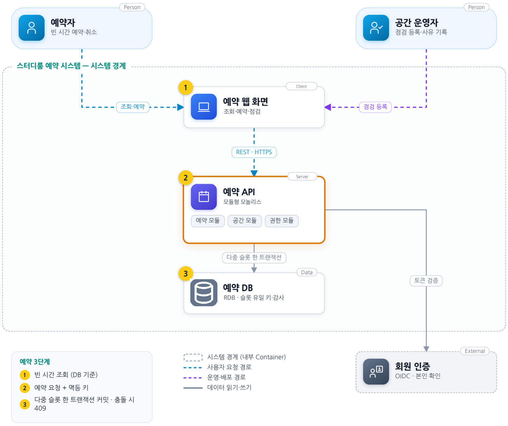
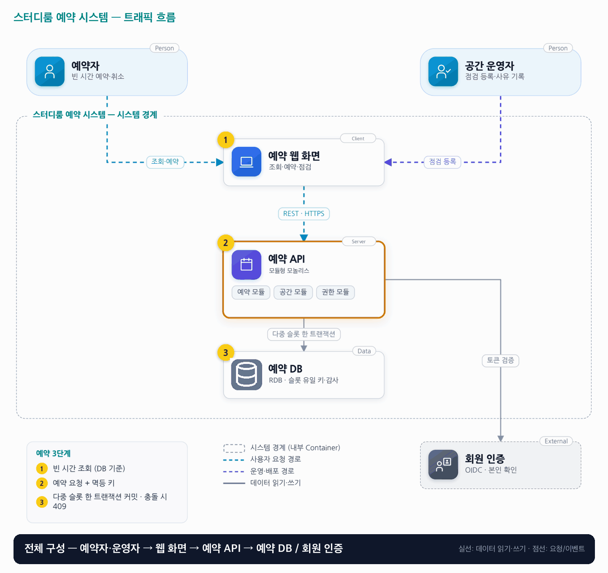

# 01. 스터디룸 예약 시스템

- **난이도**: 초급
- **규모**: 공간 30개 · 피크 50건/초
- **핵심 요약**: 스터디룸 예약 시스템 · 모듈형 모놀리스 · 슬롯 유일 키 · 멱등 예약

## 1. 문제

### 요구사항

1. 운영 09:00~23:00, 30분 단위·최대 4시간, 지점 시간대 입력·UTC 저장
2. 같은 방·시간은 예약 또는 점검 하나만 점유, 점검도 기존 예약을 덮어쓰지 못함
3. 시작 30분 전까지 본인 취소 가능, 이후 변경은 운영자 사유·감사 이력 기록
4. 가능 화면은 참고 정보로 확정 시 충돌 가능, 확정 실패 시 다른 시간 제안
5. 같은 생성 요청 재전송은 새 예약 생성 안 함, 결제·반복 예약·대기자 배정 제외

### 문제 정의

대학가 스터디룸 운영사의 전화 예약 웹 전환. 인기 시간에 예약과 운영자 점검 등록이 겹쳐 이중 배정이 발생한다. 개발자 2명이 4주 안에 출시하며, 운영자가 DB 직접 수정 없이 충돌 사유를 설명해야 한다.

## 2. 설계

### 01 아키텍처 드라이버

동일 시간대의 예약과 점검이 경합하며 운영 인력은 제한적이다.

### 02 품질 속성

| 속성 | 목표 |
|---|---|
| 정합성 (우선) | room_id·slot_start당 점유 행 최대 1개, 중복 점유 0건 |
| 성능 | 정상 예약 API p95 300ms |
| 가용성 | 월 99.9%, DB 장애 중 신규 예약 중단, RTO 30분 ·RPO 5분 |

### 03 아키텍처 택틱

- 유일성 제약으로 중복 차단 · INSERT 자체가 "비어 있는지 확인 + 확정"
- 여러 슬롯을 한 트랜잭션으로 확정 · slot_start 오름차순 고정 순서 삽입(교착 방지)
- 멱등 요청 키로 재전송 흡수 · 키는 웹 화면이 생성(UUID)하고 예약 행의 (user_id, idempotency_key) 유일 키로 DB에 저장, 별도 캐시 없음

### 04 아키텍처 스타일

**모듈형 모놀리스** — 예약·공간·권한을 논리 모듈로 나누고 한 DB에 기록, DB 제약이 최종 판정점

### 05 아키텍처 패턴

**고정 슬롯 모델과 멱등 요청 키** — 예약과 점검이 같은 점유 키 사용, 30분 고정 슬롯이라 방·슬롯 유일 키로 충분

### 06 트레이드오프

| 대안 | 평가 |
|---|---|
| 애플리케이션 락만 사용 | 인스턴스 간 공유 불가, 캐시 락도 만료·DB 커밋 경계가 남아 최종 보장은 DB가 맡는다 |
| 임의 시간 구간 모델 | 고정 슬롯보다 유연하나 범위 겹침 제약·시간 경계가 복잡, 15분 미만 요구 시 재검토 |
| 조회 후 INSERT (SELECT → INSERT) | 두 요청이 모두 "비어 있음"을 보고 둘 다 INSERT할 수 있어 트랜잭션만으로는 순서가 정해지지 않는다. 최종 판정은 유일 키가 맡는다 |
| 사전 생성 슬롯 + 조건부 UPDATE | 슬롯 행을 미리 만들고 `WHERE status='FREE'`로 갱신, 영향 행 수로 판정. 예외 경로가 없고 상태 전이가 명시적이라 유효한 대안. 규모가 작아 유일 키 INSERT로 충분해 채택하지 않음 |

### 07 아키텍처 결정

- 30분 슬롯과 공통 점유 테이블 채택, 슬롯 유일 키와 다중 슬롯 커밋을 한 트랜잭션에서 검사
- 확정은 조회 결과를 믿지 않고 바로 INSERT한다 · 유일 키 위반(23505)은 409, 교착(40P01)은 1회 재시도 후 409로 매핑
- 멱등 키는 예약 행과 같은 트랜잭션에 커밋한다 · 같은 키 재전송은 저장된 예약을 그대로 반환, 409로 끝난 시도는 저장하지 않음(재시도해도 결과 동일)
- 앱·모듈은 한 배포 단위이며 독립 Gateway·MQ·CQRS는 추가하지 않는다

#### 동시성 처리 흐름

1. 조회 화면은 참고 정보다. 비어 보여도 확정 시점에는 이미 잡혔을 수 있다.
2. 확정 요청은 (room_id, slot_start) 행을 바로 INSERT한다. 같은 키는 DB에 하나만 들어가므로 INSERT 성공이 곧 내 예약, 실패가 곧 "이미 점유"다.
3. A가 INSERT 후 아직 커밋 전이면 B의 같은 키 INSERT는 즉시 실패하지 않고 A가 끝날 때까지 대기한다. A 커밋 → B는 23505로 409, A 롤백 → B 성공. 순서는 애플리케이션이 아니라 DB가 정한다.
4. 여러 슬롯은 한 트랜잭션에서 slot_start 오름차순으로 INSERT한다. 하나라도 실패하면 전부 롤백되고, 고정 순서라 두 트랜잭션이 서로를 기다리는 교착이 생기지 않는다.
5. 점검 등록도 같은 점유 테이블에 같은 키로 INSERT하므로 예약과 점검의 충돌도 같은 장치로 막힌다.
6. 멱등 키는 웹 화면이 버튼을 누르는 순간 만들고 재전송·더블 클릭에 같은 키를 재사용한다. 서버는 (user_id, idempotency_key)로 기존 예약을 찾아 있으면 그대로 반환하고, 같은 키 두 건이 동시에 와도 유일 키가 한 건만 INSERT되게 막는다. 새로고침 후 다시 누르면 새 키이며, 이때 같은 슬롯 충돌은 멱등 키가 아니라 슬롯 유일 키가 409로 막는다.

### 08 결정 기록 (ADR-001 · 제안 · 구현 전 검증 필요)

- **맥락**: 동일 시간대의 예약과 점검이 경합하며 운영 인력은 제한적이다.
- **선택**: 30분 슬롯과 공통 점유 테이블을 채택한다.
- **결과와 비용**: 공유 캐시가 없어 조회 DB 부하 증가 가능, 인덱스·실행 계획 확인 후 TTL 조회 캐시 추가
- **재검토 조건**: 임의 시간 단위 예약이 필요해지면 구간 겹침 제약을 비교한다.

### 검증

- 검증 1 같은 슬롯에 병렬 100요청 → 서로 다른 키로 실행, 성공 1건·점유 행 1건, 나머지 409
- 검증 2 성공 응답 강제 차단 후 같은 키 재전송 → 예약 ID 동일, 총 예약 수 증가 없음
- 검증 3 A가 INSERT 후 커밋을 지연시킨 상태에서 B가 조회·예약 → B 조회에는 빈 슬롯으로 보임, B INSERT는 대기, A 커밋 시 B 409·점유 행 1건, A 롤백 시 B 성공·점유 행 1건
- 검증 4 10:00·10:30 두 슬롯을 A는 정순, B는 역순으로 병렬 요청 → 교착 0건, 성공 1건·실패 1건(409), 부분 점유 0건

## 3. 전체 아키텍처 (System Context + Container)

스터디룸 예약 시스템 · 모듈형 모놀리스 · 슬롯 유일 키 · 멱등 예약

### 트래픽 흐름

### 구성 요소

| 구분 | 이름 | 기술·역할 | 내부 요소 |
|---|---|---|---|
| Person | 예약자 | 빈 시간 예약·취소 |  |
| Person | 공간 운영자 | 점검 등록·사유 기록 |  |
| Client | 예약 웹 화면 | 조회·예약·점검 |  |
| Server | 예약 API | 모듈형 모놀리스 | 예약 모듈 · 공간 모듈 · 권한 모듈 |
| Data | 예약 DB | RDB · 슬롯 유일 키·감사 |  |
| External | 회원 인증 | OIDC · 본인 확인 |  |

### 예약 3단계

1. 빈 시간 조회 (DB 기준)
2. 예약 요청 + 멱등 키
3. 다중 슬롯 한 트랜잭션 커밋 · 충돌 시 409 (동시 요청은 유일 키에서 대기 후 하나만 입력)
