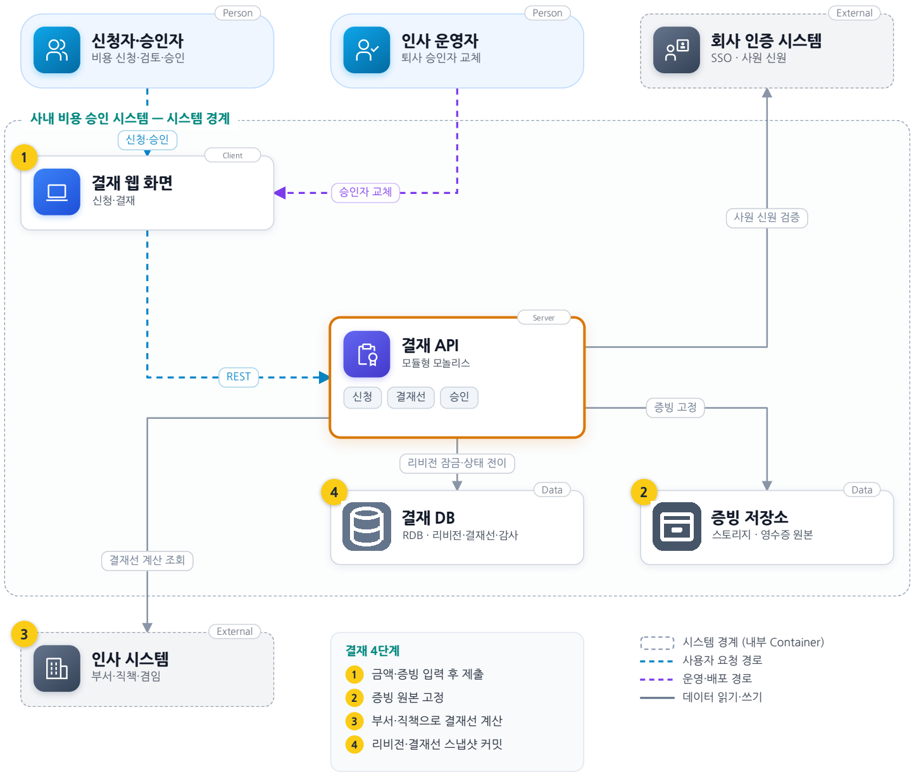
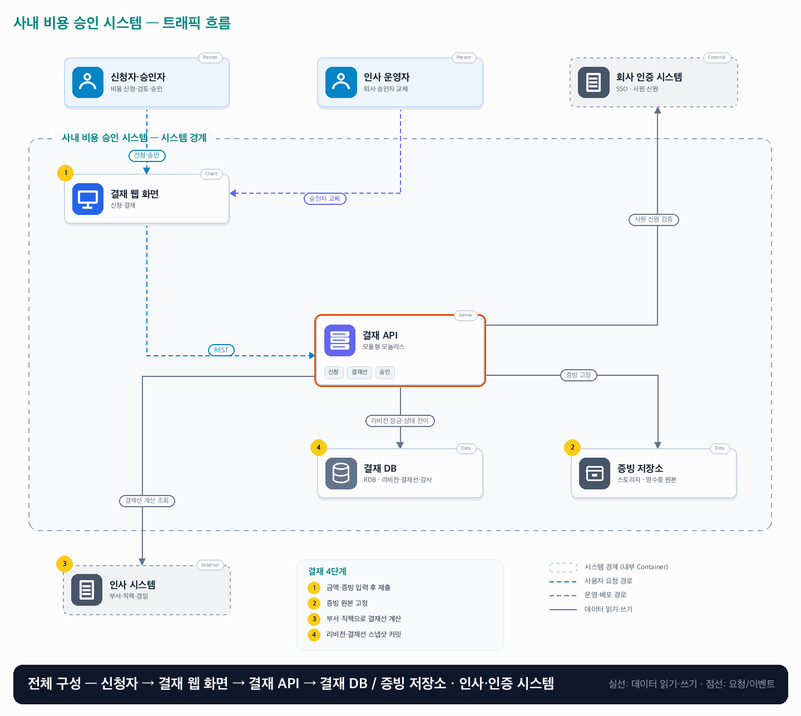

# 02. 사내 비용 승인 시스템

- **난이도**: 초급
- **규모**: 직원 1,000명 · 일 신청 300건
- **핵심 요약**: 사내 비용 승인 시스템 · 모듈형 모놀리스 · 리비전 고정 · 결재선 스냅샷

## 1. 문제

### 요구사항

1. 원화만 지원, 10만 원 미만은 팀장 1단계, 이상은 팀장·부서장 2단계
2. 본인 비용은 본인 승인 불가, 직책 겸임 시 정책 지정 대체 승인자 사용
3. 제출 시 금액·증빙·부서·결재선 고정, 변경은 철회·반려 후 새 리비전 제출
4. 마지막 승인 전 철회 가능, 반려는 사유 필수이며 이전 결정은 삭제하지 않음
5. 퇴사 승인자 교체는 인사 운영자 권한·전후 담당자·사유 기록, 송금·세무 제외

### 문제 정의

메신저 결재로 정책 변경 후 결재선이 바뀌고 승인자가 중복 처리하는 문제 발생. 직원 1,000명·월말 집중, 개발자 2명 운영. 금액 지급이 아니라 승인 사실을 신뢰할 수 있게 만드는 것이 목적이다.

## 2. 설계

### 01 아키텍처 드라이버

진행 중 결재선은 안정적이어야 하며 권한과 승인 이력을 설명할 수 있어야 한다.

### 02 품질 속성

| 속성 | 목표 |
|---|---|
| 정합성 | 중복 최종 승인·승인 순서 위반 0건, 종결 리비전은 재승인되지 않음 |
| 추적성 | 감사 이력을 상태 변경과 함께 저장, 보존기간은 조직 정책 설정값 |
| 성능·가용성 | 결재 API p95 300ms, 월 가용성 99.9% |

### 03 아키텍처 택틱

- 결재선 스냅샷으로 변경 격리
- 행 잠금으로 승인·철회 직렬화 · 리비전 행을 잠근 뒤 상태·권한을 검사하고 전이, 멱등 키 없이 상태 머신이 중복 처리를 막음
- 상태 변경·감사 기록 함께 커밋

### 04 아키텍처 스타일

**모듈형 모놀리스** — 신청·정책·결재·감사 책임을 나누되 원자적 감사가 필요한 쓰기는 같은 DB로 모음

### 05 아키텍처 패턴

**정책 스냅샷과 명시적 상태 머신** — 제출 당시 결재선 유지, 두 단계 승인 규모에선 외부 엔진보다 명시적 상태 전이가 단순

### 06 트레이드오프

| 대안 | 평가 |
|---|---|
| 최신 정책을 매번 적용 | 수정은 쉽지만 진행 중 결재선이 바뀜, 제출 스냅샷으로 예측·설명 가능성 확보 |
| 범용 워크플로 엔진 | 병렬 결재·수십 단계·장기 타이머엔 유리, 현재는 명시적 상태 모델이 운영에 단순 |

### 07 아키텍처 결정

- 제출 시 정책 버전·결재선 스냅샷 고정, 승인·철회는 같은 리비전 상태를 잠가 순서 확정
- 승인·철회·반려·승인자 교체는 모두 같은 리비전 행을 SELECT FOR UPDATE로 잠근 뒤 상태·권한 검사 → 전이 → 감사 행 INSERT를 한 트랜잭션으로 처리한다 · 검사 실패는 409(이미 처리됨)
- 두 업무 모듈은 별도 네트워크 서비스가 아니며 외부 지급이나 알림은 범위 밖이다

#### 리비전 상태 전이

| 현재 상태 | 허용 동작 (주체) | 다음 상태 |
|---|---|---|
| 1단계 대기 | 승인 (1단계 승인자) | 2단계 대기 또는 승인 완료 (10만 원 미만) |
| 1단계 대기 · 2단계 대기 | 반려 (해당 단계 승인자, 사유 필수) | 반려 |
| 1단계 대기 · 2단계 대기 | 철회 (신청자) | 철회 |
| 2단계 대기 | 승인 (2단계 승인자) | 승인 완료 |
| 1단계 대기 · 2단계 대기 | 승인자 교체 (인사 운영자, 전후 담당자·사유 기록) | 상태 유지, 결재선 스냅샷의 해당 단계 승인자만 교체 |
| 승인 완료 · 반려 · 철회 | 없음 (종결) | 변경은 새 리비전 제출 |

#### 동시성 처리 흐름

1. 모든 결재 동작은 리비전 행을 먼저 잠근다. 같은 리비전에 대한 두 요청은 DB가 순서를 정하고, 뒤에 온 요청은 앞 요청이 커밋한 상태를 보고 검사한다.
2. **승인 더블 클릭·재전송**: 첫 요청이 상태를 전이시키면 두 번째 요청은 "현재 단계가 나를 기다리지 않음"으로 409. 멱등 키가 필요 없다. 승인은 "해당 단계 대기 상태에서 해당 승인자가" 보낼 때만 성립하므로 상태 머신 자체가 멱등성을 준다.
3. **승인 vs 철회**: 신청자 철회와 승인자 승인이 동시에 오면 먼저 잠근 쪽이 전이하고, 나머지는 종결 또는 바뀐 단계를 보고 409를 받는다. 두 동작 모두 감사 이력에 남고, 종결 상태는 하나다.
4. **승인자 교체 vs 승인**: 인사 운영자가 2단계 승인자를 교체하는 동안 기존 승인자가 승인을 보내면, 교체가 먼저 커밋된 경우 기존 승인자의 승인은 권한 검사에서 거절되고, 승인이 먼저 커밋된 경우 교체는 이미 지난 단계라 적용 대상이 없어 거절된다. 어느 쪽이든 이력에 누가 언제 무엇을 했는지 남는다.
5. 정책 변경은 진행 중 리비전에 영향이 없다. 결재선은 제출 시 스냅샷으로 고정돼 있고, 새 정책은 다음 제출부터 적용된다.

### 08 결정 기록 (ADR-001 · 제안 · 구현 전 검증 필요)

- **맥락**: 진행 중 결재선은 안정적이어야 하며 권한과 승인 이력을 설명할 수 있어야 한다.
- **선택**: 제출 시 결재선 고정과 리비전별 상태 전이를 채택한다.
- **결과와 비용**: 스냅샷 중복 저장, 진행 중 변경은 별도 절차 필요. 엔진 도입은 규칙 변경 빈도·이관 비용으로 판단
- **재검토 조건**: 병렬 승인·위임·장기 타이머가 늘면 워크플로 엔진을 비교한다.

### 검증

- 검증 1 승인·철회 병렬 실행 → 종결 상태 한 개, 감사 이력과 단계 상태 일치
- 검증 2 권한·순서 위반 요청 → 다음 단계 선승인·자기 승인·타인 철회 모두 거절
- 검증 3 같은 승인자가 승인을 병렬 2회 전송 → 전이 1회, 두 번째는 409, 감사 행 1건
- 검증 4 2단계 승인자 교체와 기존 승인자의 승인을 동시 실행 → 둘 중 하나만 성공, 종결·결재선 상태가 감사 이력과 일치

## 3. 전체 아키텍처 (System Context + Container)

사내 비용 승인 시스템 · 모듈형 모놀리스 · 리비전 고정 · 결재선 스냅샷

### 트래픽 흐름

### 구성 요소

| 구분 | 이름 | 기술·역할 | 내부 요소 |
|---|---|---|---|
| Person | 신청자·승인자 | 비용 신청·검토·승인 |  |
| Person | 인사 운영자 | 퇴사 승인자 교체 |  |
| External | 회사 인증 시스템 | SSO · 사원 신원 |  |
| Client | 결재 웹 화면 | 신청·결재 |  |
| Server | 결재 API | 모듈형 모놀리스 | 신청 · 결재선 · 승인 |
| Data | 결재 DB | RDB · 리비전·결재선·감사 |  |
| Data | 증빙 저장소 | 스토리지 · 영수증 원본 |  |
| External | 인사 시스템 | 부서·직책·겸임 |  |

### 결재 4단계

1. 금액·증빙 입력 후 제출
2. 증빙 원본 고정
3. 부서·직책으로 결재선 계산
4. 리비전·결재선 스냅샷 커밋
