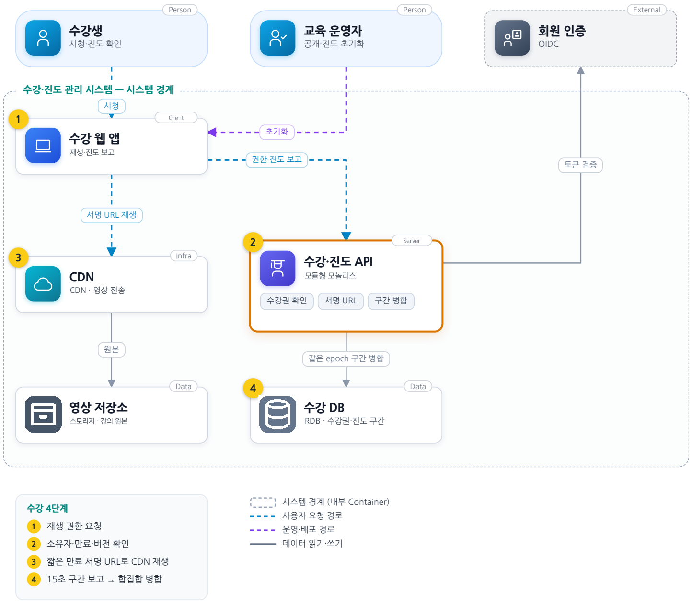
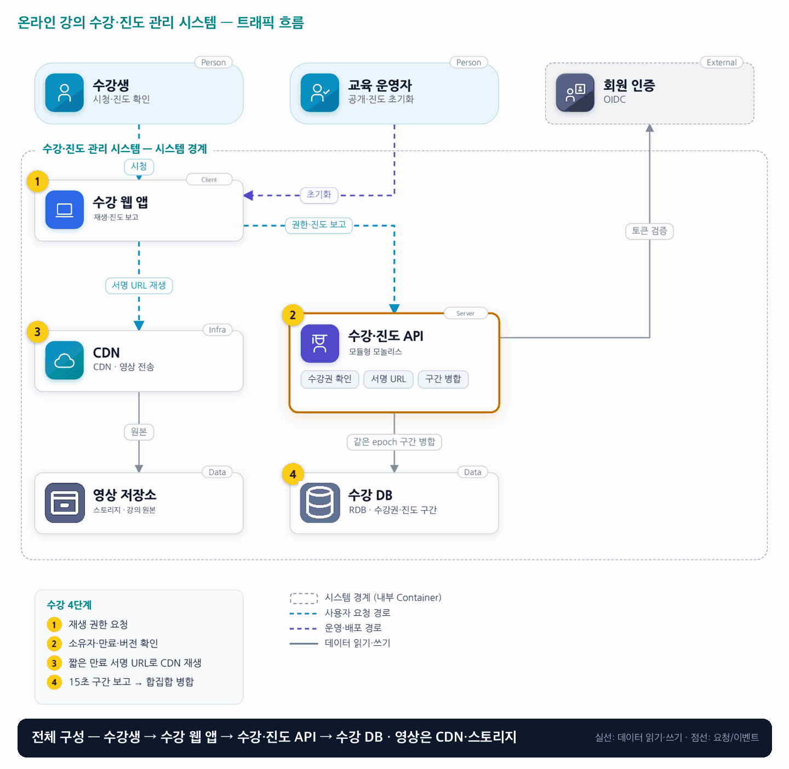

# 03. 온라인 강의 수강·진도 관리 시스템

- **난이도**: 초급
- **규모**: 수강생 1만 명 · 동시 학습 500명
- **핵심 요약**: 온라인 강의 수강·진도 관리 시스템 · 모듈형 모놀리스 · 서명 URL + CDN · 구간 합집합 진도

## 1. 문제

### 요구사항

1. 수강 신청 시 커리큘럼 버전 고정, 이후 영상 추가가 기존 수료를 취소하지 않음
2. 필수 강의별 보고된 시청 구간 합집합이 길이의 90% 이상이면 완료
3. 여러 기기 중복 구간은 한 번만 계산, 탐색 이동 구간은 시청으로 보고하지 않음
4. 15초 간격·배치·재시도 허용, 만료·회수 뒤 신규 보고 거절, 서버 기준 시각 검증
5. 진도는 감소하지 않고 초기화는 progress_epoch 증가, 결제·시험·인코딩 제외

### 문제 정의

재생 위치를 진도로 써서 끝으로 건너뛰면 수료되고, 휴대전화·PC 보고 역전으로 진도가 줄어든다. 개발자 2명이 강좌 200개·수강생 1만 명 운영, 수료는 학습 UX 기준이며 부정 방지 인증이 아니다.

## 2. 설계

### 01 아키텍처 드라이버

여러 기기의 진도 보고는 겹치거나 역전되며 영상 전송 부하는 API와 다르다.

### 02 품질 속성

| 속성 | 목표 |
|---|---|
| 정합성 | watched_ms는 구간 합집합 길이, 같은 epoch 내 완료는 취소 안 됨 |
| 성능 | 진도 저장 API p95 300ms, 정상 보고 후 화면 반영 20 초 이내 |

### 03 아키텍처 택틱

- 구간 합집합으로 중복 제거 · 같은 구간을 다시 보고해도 결과가 같아 재시도·배치에 멱등 키가 필요 없음
- 진도 행 잠금으로 병합 직렬화 · (수강권, 강의) 진도 행을 잠근 뒤 읽기 → 병합 → 쓰기, 여러 기기 동시 보고의 갱신 유실 방지
- 세대 번호로 초기화 전 보고 차단
- 클라이언트 로컬 큐로 보고 보존 · 끊김 중 시청 구간을 로컬 저장소에 쌓았다가 재접속 시 배치 전송, 서버는 시각 검증 후 병합
- 영상은 CDN 경로로 분리

### 04 아키텍처 스타일

**모듈형 모놀리스와 별도 미디어 경로** — 영상은 객체 저장소·CDN으로 보내 진도 API가 약 1Gbps 영상 대역폭을 감당하지 않음

### 05 아키텍처 패턴

**구간 병합과 버전 고정** — 시청 위치와 수료 근거를 분리, 진도 수신 영수증을 상태 갱신과 함께 기록

### 06 트레이드오프

| 대안 | 평가 |
|---|---|
| 마지막 위치 또는 최댓값 저장 | 저장은 쉽지만 건너뛰기가 시청으로 계산됨, 재생 재개 위치와 수료 진도를 분리 |
| 모든 재생 이벤트 영구 보존 | 분석엔 유리하나 비용이 큼, 구간 병합 결과와 감사 필요 원본의 보존기간을 나눔 |
| 배속 재생을 시청으로 인정하지 않음 | 부정 방지엔 엄격하나 학습 UX 목적과 어긋남, 허용 최대 배속(2배)까지 인정하고 그 이상만 거절 |

### 07 아키텍처 결정

- 수강 버전 고정, 동일 세대 구간을 병합한 합집합으로 완료 계산, 진도·권한 응답은 공유 캐시 안 함
- 영상 CDN과 진도 API를 별도 부하로 보며, 토큰 만료 전 이미 제공한 영상은 회수할 수 없다
- 진도 보고는 (수강권, 강의) 진도 행을 SELECT FOR UPDATE로 잠근 뒤 권한·epoch 검사 → 구간 병합 → watched_ms·완료 여부 갱신 → 수신 영수증 기록을 한 트랜잭션으로 처리한다 · 검사 실패는 409
- 오프라인 보고는 서버 수신 시각 기준 24시간 이내 구간만 수락한다 · 새로 주장하는 시청 시간은 (마지막 수락 보고 이후 흐른 실제 시간 × 허용 최대 배속 2배)를 넘지 못하며, 초과분은 거절하고 재생 재개 위치만 갱신. 배속 시청은 허용한다(수료는 학습 UX 기준, 부정 방지 아님)
- 영상 길이는 커리큘럼 버전에 고정한다 · 90% 완료 기준의 분모가 바뀌지 않도록 길이가 달라지는 영상 교체는 새 버전으로만 허용
- 한도 계산은 클라이언트 시각이 아니라 서버 수신 시각과 마지막 수락 시각으로 한다 · 구간 자체는 영상 내 위치(초)라 기기 시계와 무관

#### 동시성 처리 흐름

1. 진도는 (수강권, 강의, epoch)당 한 행에 병합된 구간 목록과 watched_ms로 저장한다. 보고 한 건은 이 행 하나만 바꾼다.
2. **두 기기 동시 보고**: 휴대전화와 PC가 같은 강의 구간을 동시에 보내면 뒤에 온 요청은 앞 요청이 커밋한 구간 목록 위에 병합한다. 행 잠금이 없으면 "읽기 → 병합 → 쓰기"가 교차해 한쪽 구간이 사라질 수 있으므로 잠금이 필수다. 결과는 두 보고의 합집합과 같고 진도는 줄지 않는다.
3. **재시도·배치 중복**: 같은 구간을 다시 보고해도 합집합은 변하지 않는다. 네트워크 재시도나 15초 배치가 겹쳐 와도 watched_ms는 같으므로 멱등 키 없이 안전하다.
4. **초기화 vs 보고**: 운영자 초기화는 같은 행을 잠그고 progress_epoch를 올린다. 이전 epoch를 들고 온 보고는 잠금 뒤 검사에서 409로 거절되어 초기화 이전 구간이 되살아나지 않는다.
5. **권한 회수 vs 보고**: 수강권 만료·회수도 같은 잠금 아래 검사한다. 회수 커밋 이후 도착한 보고는 거절되고, 커밋 이전에 잠금을 잡은 보고는 정상 반영된다. 이미 발급된 서명 URL로 재생 중인 영상은 만료까지 볼 수 있지만 진도는 더 쌓이지 않는다.
6. **완료 판정**: watched_ms가 길이의 90% 이상이 되는 순간 같은 트랜잭션에서 미완료 → 완료로 전이한다. 잠금 안에서 한 번만 일어나므로 완료 알림 같은 후속 동작도 한 번만 발생한다.

#### 오프라인·재접속 처리

자주 일어나는 상황이다. 지하철·이동 중 연결이 끊겼다가 수 분 뒤 돌아온다.

| 구분 | 앱이 가진 것 | 서버가 가진 것 |
|---|---|---|
| 영상 | 재생 중인 구간의 짧은 버퍼(수십 초) | 원본은 스토리지, 전송은 CDN |
| 진도 | 아직 보내지 못한 시청 구간 큐 · 마지막 재생 위치 | 병합된 구간 목록 · watched_ms · 완료 여부 · 마지막 수락 보고 시각 |

1. **평소**: 플레이어가 실제로 재생한 15초 구간을 로컬 큐에 넣고 바로 전송한다. 성공 응답을 받으면 큐에서 지운다. 정상 상태에서 큐는 비어 있다.
2. **끊김 중**: 전송이 실패하므로 큐에 구간이 쌓인다. 영상은 버퍼만큼 더 재생되다가 멈추고, 멈춘 시간은 구간이 아니므로 큐에 들어가지 않는다. 서버 진도는 마지막 성공 보고에 멈춰 있고 줄어들지 않는다.
3. **재접속**: 서명 URL이 만료됐으면 새 URL을 요청한다. 이때 수강권·버전·만료를 다시 확인하므로 끊긴 동안 권한이 회수됐다면 여기서 막힌다. 재생은 마지막 위치부터 이어진다.
4. **배치 전송**: 큐의 구간을 한 번에 보낸다. 서버는 진도 행을 잠그고 epoch 일치, 수강권 유효, 서버 수신 기준 24시간 이내, 새 시청 시간 ≤ (마지막 수락 이후 흐른 시간 × 최대 배속 2배)를 검사한 뒤 합집합으로 병합한다. 10분 끊겼으면 새 구간 합계는 20분을 넘을 수 없다. 2배속으로 본 10분은 20분 분량이라 정상 수락된다.
5. **중복·실패**: 배치가 두 번 가도 합집합이라 결과가 같다. 끊긴 동안 초기화·권한 회수가 있었으면 배치는 409이며 초기화 전 구간은 되살아나지 않는다.
6. **큐 저장소**: 브라우저 HTTP 캐시가 아니라 앱이 직접 읽고 쓰는 로컬 저장소(웹은 IndexedDB, 앱은 로컬 DB)를 쓴다. HTTP 캐시는 브라우저가 임의로 비우고 앱이 읽어낼 수 없다. 큐는 참고 자료이며 진도의 원본은 끝까지 서버다.
7. **큐 유실은 허용된 손실**: 시크릿 모드, 저장소 정리, 앱 삭제로 큐가 사라지면 미전송 구간은 복구하지 않는다. 큐 크기는 24시간 분량으로 제한하고, 화면에 "미전송 구간 N개" 표시를 두어 사용자가 손실 가능성을 알 수 있게 한다. 이 정책을 문서화해 두어야 "진도가 빠졌다"는 문의에 근거를 댈 수 있다.

### 08 결정 기록 (ADR-001 · 제안 · 구현 전 검증 필요)

- **맥락**: 여러 기기의 진도 보고는 겹치거나 역전되며 영상 전송 부하는 API와 다르다.
- **선택**: 수강 버전을 고정하고 보고된 시청 구간의 합집합으로 완료를 계산한다.
- **결과와 비용**: CDN 적중률·원본 비용은 개선 가능하나 서명 만료·접근 회수 시간차 발생, 버전·권한 만료 검증
- **재검토 조건**: 구간 파편화가 저장 한도를 압박하거나 인증 수준이 높아지면 재검토한다.

### 검증

- 검증 1 10분 영상 [0,300]·[200,500] → 합집합 500초, 83.3%로 미완료. 중복 합산 600초로 완료시키면 실패
- 검증 2 초기화·권한 회수와 보고 경합 → 이전 epoch 재반영 0건, 회수 커밋 이후 신규 수락 0건
- 검증 3 같은 강의에 기기 2대가 서로 다른 구간을 병렬 보고 → 저장된 구간 목록이 두 보고의 합집합과 일치, 유실 구간 0건, watched_ms 감소 0회
- 검증 4 같은 구간 보고를 3회 재전송 → watched_ms 변화 없음, 영수증 3건
- 검증 5 재생 중 네트워크를 10분 차단 후 복구 → 큐의 구간이 배치로 수락되어 실제 재생 구간만 반영, 멈춘 시간 미반영, 새 시청 시간 합계 ≤ 20분(최대 배속 2배 기준)
- 검증 6 서버 수신 기준 25시간 지난 구간 보고 전송 → 구간 거절, 재생 재개 위치만 갱신, watched_ms 변화 없음
- 검증 7 2배속으로 10분 재생 후 보고 → 20분 분량 구간 정상 수락, 3배속 분량(30분)을 주장하는 보고 → 초과분 거절
- 검증 8 같은 커리큘럼 버전에서 영상 길이 변경 시도 → 거절, 새 버전으로만 교체 가능하며 기존 수료 유지

## 3. 전체 아키텍처 (System Context + Container)

온라인 강의 수강·진도 관리 시스템 · 모듈형 모놀리스 · 서명 URL + CDN · 구간 합집합 진도

### 트래픽 흐름

### 구성 요소

| 구분 | 이름 | 기술·역할 | 내부 요소 |
|---|---|---|---|
| Person | 수강생 | 시청·진도 확인 |  |
| Person | 교육 운영자 | 공개·진도 초기화 |  |
| External | 회원 인증 | OIDC |  |
| Client | 수강 웹 앱 | 재생·진도 보고 |  |
| Server | CDN | CDN · 영상 전송 | Infra · 수강·진도 API · Server · 모듈형 모놀리스 · 수강권 확인 · 서명 URL · 구간 병합 |
| Data | 영상 저장소 | 스토리지 · 강의 원본 |  |
| Data | 수강 DB | RDB · 수강권·진도 구간 |  |

### 수강 4단계

1. 재생 권한 요청
2. 소유자·만료·버전 확인
3. 짧은 만료 서명 URL로 CDN 재생
4. 15초 구간 보고 → 합집합 병합
