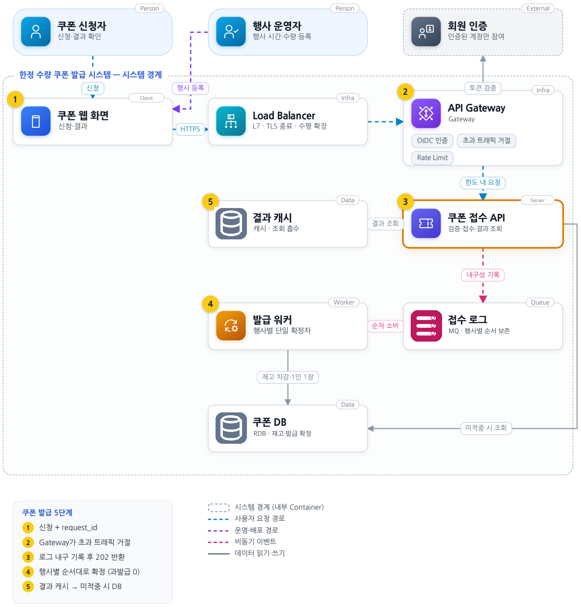
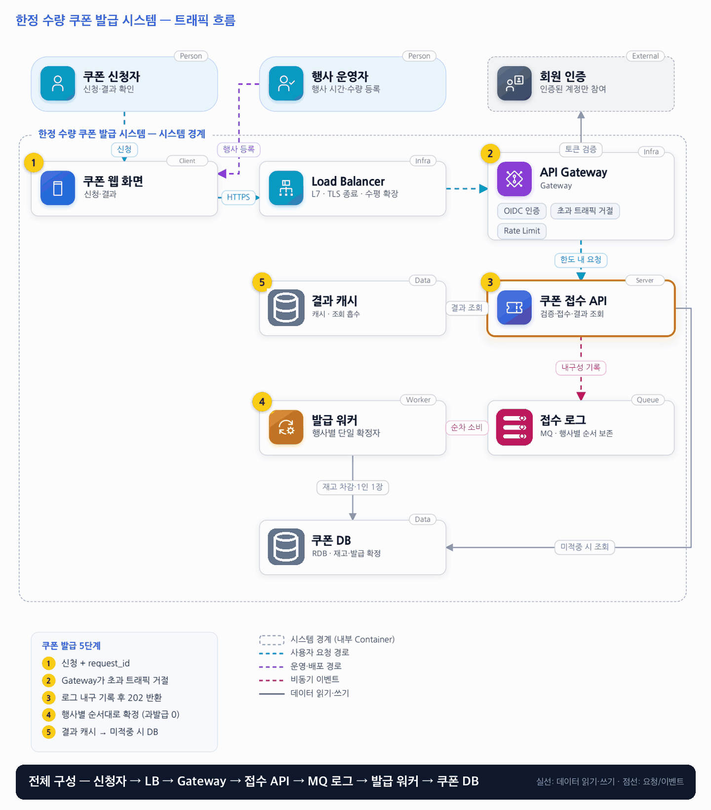

# 04. 한정 수량 쿠폰 발급 시스템

- **난이도**: 중급
- **규모**: 쿠폰 1만 개 · 피크 2만 요청/초
- **핵심 요약**: 한정 수량 쿠폰 발급 시스템 · 선착순 = 로그 순서 · 행사별 단일 확정자 · 과발급 0

## 1. 문제

### 요구사항

1. 1인 1장, 총 1만 장, 발급된 쿠폰은 행사 중 재고로 되돌리지 않음
2. 선착순은 검증된 요청이 내구성 있는 단일 행사 로그에 기록된 순서
3. 인증된 계정만 참여, 행사 시작·종료는 서버 시각으로 판단
4. 202·request_id, PENDING·ISSUED·SOLD_OUT·REJECTED
5. 대기 목표 초과 시 접수 제한, 큐 내구성 확인 전 성공 미반환, 사용·결제 제외

### 문제 정의

쇼핑몰이 정각에 1만 장을 선착순 배포, 시작 직후 10초간 초당 2만 요청과 반복 클릭이 몰린다. 성공 표시 후 쿠폰 없음·수량 초과는 불허. 개발팀 4명, 단일 리전으로 시작한다.

## 2. 설계

### 01 아키텍처 드라이버

짧은 시간에 재고보다 많은 요청이 들어오며 접수 순서를 지켜야 한다.

### 02 품질 속성

| 속성 | 목표 |
|---|---|
| 정합성 | 과발급·계정 중복 0건, remaining+발급 건수 =initial_count |
| 성능 | 피크 접수 p95 200ms, 정상 접수 후 결과 p95 30초 |
| 공정성 | 유효 요청의 승자는 접수 순서, 순서화 지점 장애 중 신규 접수 중단 |

### 03 아키텍처 택틱

- 유한 큐·유입 제한으로 과부하 제어 · Gateway 접수 카운터가 남은 수량 × 3배를 넘으면 즉시 거절, 뒤쪽은 참여자 수와 무관하게 3만 건만 봄
- 행사별 순차 확정
- DB 제약으로 과발급 차단 · (행사, 사용자)·(행사, request_id) 유일 키에 ON CONFLICT DO NOTHING으로 INSERT, 실제 삽입된 행 수만큼만 remaining 차감
- 종결 상태만 캐시 · ISSUED·SOLD_OUT·REJECTED는 불변이라 무효화 불필요, PENDING은 캐시하지 않음
- 접수 멱등은 최선 노력, 확정 멱등은 강제 · 클라이언트가 만든 request_id를 캐시 SETNX로 1차 중복 제거하고, 최종 보장은 DB 유일 키가 맡음

### 04 아키텍처 스타일

**웹-큐-워커** — 접수 웹 계층과 행사별 순차 확정 워커를 비동기 로그로 연결, API는 접수까지만 동기화

### 05 아키텍처 패턴

**Queue-Based Load Leveling** — 멱등 소비자와 함께 적용, 확정 결과와 체크포인트를 함께 저장

### 06 트레이드오프

| 대안 | 평가 |
|---|---|
| 여러 워커가 자유롭게 병렬 확정 | 처리량은 높지만 접수 순서와 승자 순서가 달라짐, 엄격한 선착순이라 순차 확정 선택 |
| 캐시에서만 차감 후 나중에 저장 | 빠르지만 장애 후 이중 발급·유실·복구 문제, 채택 시 내구성·원장 대사 설계 필요 |

### 07 아키텍처 결정

- Gateway가 초과 트래픽 거절, 로그에 내구성 있게 접수 후 202, 행사별 단일 확정자가 순서 유지
- 과부하는 Gateway에서 끝낸다 · 접수 카운터 상한(남은 수량 × 3배) 초과, 행사 시작 전, 매진 이후 요청은 접수 API에 닿지 않고 종결 응답으로 거절하며 클라이언트는 재시도하지 않는다
- 워커는 로그 100건 단위 배치로 커밋하고 SOLD_OUT·REJECTED는 저장하지 않는다 · 결과는 매진 플래그와 사용자 발급 행 유무로 계산, 매진 시 체크포인트를 로그 끝으로 이동
- 결과 API는 요청 오프셋이 워커 체크포인트보다 뒤면 DB 없이 PENDING을 응답한다 · 202에 오프셋과 retry-after(2초부터 증가)를 포함
- 재전달 시 DB 체크포인트로 재개, 앞 요청을 건너뛰지 않도록 장애 시 해당 행사만 일시 중단
- 확정 트랜잭션은 발급 행 INSERT · remaining 차감 · 체크포인트(처리한 로그 오프셋) 갱신을 한 번에 커밋한다 · 오프셋이 체크포인트 이하인 메시지는 건너뛴다
- 결과 조회는 request_id가 아니라 (행사, 사용자) 기준으로 사용자의 최종 상태를 돌려준다 · 중복 클릭으로 REJECTED된 요청이 있어도 사용자에겐 ISSUED가 보인다
- remaining이 0이 되면 매진 플래그를 캐시에 올리고 Gateway가 즉시 SOLD_OUT을 응답한다 · 이미 이길 수 없는 요청이라 선착순 공정성에 영향 없음
- 행사 시작·종료 판정은 API 노드 시각이 아니라 로그 기록 시각(브로커 시각)으로 워커가 확정한다 · API는 1차 거절만

#### 동시성 처리 흐름

1. **접수**: Gateway가 인증·유입 제한을 통과시킨 요청을 접수 API가 행사별 로그에 기록하고, 브로커가 내구성을 확인한 뒤에만 202·request_id를 돌려준다. 이 시점에 승패는 정해지지 않았고 순서만 정해졌다.
2. **순차 확정**: 행사당 한 워커가 로그 순서대로 처리한다. 발급 행을 `ON CONFLICT DO NOTHING`으로 INSERT해 (행사, 사용자) 충돌이면 삽입 0행(중복), remaining이 0이면 삽입하지 않음(SOLD_OUT), 아니면 삽입 1행(ISSUED). 삽입된 행 수만큼 remaining을 차감하고 체크포인트와 함께 한 트랜잭션으로 커밋한다.
3. **반복 클릭**: 같은 사용자의 요청이 로그에 여러 건 있어도 첫 건만 ISSUED이고 나머지는 2번에서 REJECTED된다. 결과 조회는 사용자 기준이므로 어느 request_id로 물어도 ISSUED를 본다.
4. **워커 장애·재전달**: DB 커밋 뒤 오프셋 커밋 전에 죽으면 같은 메시지가 다시 온다. 체크포인트 이하 오프셋은 건너뛰고, 혹시 통과해도 (행사, request_id) 유일 키의 ON CONFLICT가 두 번째 INSERT를 0행으로 만든다. 결과는 재시작 전과 같다.
5. **리밸런스 중 중복 소비자**: 컨슈머 재배치 순간 옛 워커가 몇 건 더 처리할 수 있다. 두 워커 모두 같은 로그 순서를 같은 규칙으로 처리하고 커밋이 멱등이라 결과는 하나로 수렴한다. 단일 확정자는 "동시에 하나"가 아니라 "결과가 하나"로 보장한다.
6. **매진 이후**: 워커가 remaining 0을 커밋하면 매진 플래그를 캐시에 올린다. 이후 Gateway는 로그에 쓰지 않고 바로 SOLD_OUT을 응답하고, 이미 로그에 있던 요청은 저장 없이 SOLD_OUT으로 계산된다(체크포인트를 로그 끝으로 이동).
7. **결과 조회**: 종결 상태만 캐시에 쓰고 PENDING은 쓰지 않는다. 캐시 미적중이면 DB를 본다. 종결 상태는 바뀌지 않으므로 TTL이 지나 다시 읽어도 같은 값이다.

#### 멱등성 경계

| 경계 | 중복이 생기는 상황 | 보장 장치 | 강도 |
|---|---|---|---|
| 클라이언트 → 접수 API | 202 유실 후 재클릭, 앱 자동 재시도 | 클라이언트가 버튼을 누를 때 request_id(UUID) 생성·재시도에 재사용, 접수 API가 캐시에 (행사, request_id)를 SETNX로 기록해 중복이면 로그에 쓰지 않고 기존 request_id로 202 | 최선 노력 · 캐시 장애 시 중복 로그가 생길 뿐 과발급 없음 |
| 접수 API → 로그 | 브로커 확인 타임아웃 뒤 재전송 | 프로듀서 멱등 전송(가능하면) + 워커의 (행사, request_id) 유일 키 | 강제 · 두 번 기록돼도 두 번째는 REJECTED(중복) |
| 로그 → 워커 → DB | 재전달, 리밸런스 중 중복 소비자 | 체크포인트 이하 오프셋 건너뜀 + (행사, request_id)·(행사, 사용자) 유일 키, 한 트랜잭션 커밋 | 강제 |
| 워커 → 결과 캐시 | 커밋 후 캐시 쓰기 재시도 | 종결 상태는 결정적·불변이라 같은 값을 다시 써도 무해 | 자연 멱등 |

접수 단계가 최선 노력이어도 되는 이유는 1인 1장 규칙 때문이다. 같은 사용자의 어떤 중복도 결과를 바꾸지 못하고, 결과 조회가 사용자 기준이라 202를 못 받은 사용자도 자기 상태를 볼 수 있다. 중복 제거는 정합성이 아니라 로그 용량과 대기 시간을 위한 것이다.

#### 과부하 처리 흐름

정각에 몰리는 것이 전제다. 좋은 쿠폰이면 1만 장에 100만 명이 올 수 있으므로, 참여자 수에 비례하는 부담을 Gateway 한 곳으로 모으고 뒤쪽은 참여자 수와 무관하게 만든다.

| 단계 | 2만 명 | 100만 명 | 비고 |
|---|---|---|---|
| Gateway 도달 | 2만 | 100만 | 여기만 참여자 수에 비례 · 10초면 10만 RPS |
| 로그 기록 | ≤ 3만 | ≤ 3만 | 접수 카운터 상한 = 남은 수량 × 3배 |
| 워커 DB 쓰기 | 1만 행 | 1만 행 | 승자만 저장 |
| 결과 폴링 | ≤ 3만 명 | ≤ 3만 명 | 거절된 사용자는 즉시 종결 응답이라 폴링하지 않음 |

1. **Gateway 접수 상한**: 행사별 접수 카운터를 두고 남은 수량 × 3배(1만 장이면 3만 건)를 넘으면 접수 API에 보내지 않고 "대기 초과"로 종결 응답한다. 3만 번째 뒤에 선 요청은 어차피 이길 수 없으므로 선착순 공정성은 깨지지 않는다. 상한은 어림값이라 정확할 필요가 없어, 노드별로 할당량을 나눈 로컬 카운터로 처리해 캐시 한 대에 10만 INCR/초가 몰리지 않게 한다.
2. **시작 전·매진 후 차단**: 행사 시작 전 요청과 매진 플래그 이후 요청도 Gateway가 상태 조회 없이 거절한다. 행사 페이지는 CDN 정적 자원이고 버튼 활성화는 서버 시각 기준 카운트다운이라 정각 전 요청 자체가 적다.
3. **재시도 금지**: 거절 응답은 종결 상태(대기 초과·시작 전·매진)이며 클라이언트는 자동 재시도하지 않는다. 97만 명이 재시도하면 두 번째 파도가 오기 때문이다.
4. **예열**: 시작 시각을 아는 폭주이므로 10분 전에 Gateway·접수 API 인스턴스를 목표 RPS에 맞춰 미리 띄운다. 오토스케일은 10초 폭주를 따라가지 못한다.
5. **워커 배치 커밋**: 로그 100건을 한 트랜잭션으로 처리한다(발급 행 INSERT 최대 100개 + remaining 1회 + 체크포인트 1회). 발급 행 INSERT는 `ON CONFLICT DO NOTHING`이라 같은 사용자의 중복 클릭이나 재전달된 request_id가 섞여 있어도 예외가 나지 않고 0행으로 넘어간다. 유일 키 위반이 배치 전체를 롤백시키면 같은 배치가 무한 재처리되므로, 롤백은 DB 장애·교착 같은 시스템 오류에만 허용한다. 배치 안에서도 로그 순서를 지키며 처리량은 1만 건/초 이상이 된다.
6. **SOLD_OUT·REJECTED 미저장**: 결과는 "매진 플래그 + 이 사용자의 발급 행 유무"로 계산되므로 승자 1만 행만 쓴다. 매진 순간 체크포인트를 로그 끝으로 옮겨 남은 로그를 건너뛴다. 수십 초짜리 처리 꼬리가 사라진다.
7. **폴링 흡수**: 202 응답에 로그 오프셋과 retry-after를 넣는다. 결과 API는 요청 오프셋이 워커 체크포인트(캐시)보다 뒤면 DB를 보지 않고 PENDING을 돌려주고, 종결 상태만 캐시에서 읽는다. 읽기 폭주가 DB에 닿지 않는다.

**결과**: 100만 요청이 몰려도 로그 3만 건, DB 쓰기 1만 행, DB 읽기는 종결 직후 사용자당 1회 수준으로 떨어진다. 참여자 수가 늘면 Gateway 인스턴스만 늘리면 된다.

### 08 결정 기록 (ADR-001 · 제안 · 구현 전 검증 필요)

- **맥락**: 짧은 시간에 재고보다 많은 요청이 들어오며 접수 순서를 지켜야 한다.
- **선택**: 행사별 내구성 로그와 순차 확정을 채택한다.
- **결과와 비용**: 한 인기 행사는 단일 확정자 처리량에 묶이므로 배치 커밋으로 완화, 폴링은 오프셋 비교로 DB 밖에서 흡수. 대신 Gateway 상한 때문에 유효한 사용자도 거절될 수 있고, 거절 비율을 측정해 둬야 한다
- **재검토 조건**: 순서화 병목이 목표를 못 맞추면 업무상 허용 가능한 공정성 기준부터 재검토한다. Gateway 상한에서 거절되는 비율이 업무상 받아들이기 어려우면 선착순 대신 추첨으로 바꾸는 업무 결정을 검토한다.

### 검증

- 검증 1 2만 RPS 10초 + 계정 중복 → 발급 <= 10,000, 계정당 <= 1, 접수 지연·거절률 기록
- 검증 2 DB 커밋 직후 워커 종료 → 재시작 후 결과 동일, remaining + issue_count = 10,000
- 검증 3 한 사용자가 50회 클릭 → 발급 행 1건, 나머지 49건은 저장 없이 중복 처리, 사용자 기준 결과 조회는 모두 ISSUED
- 검증 4 리밸런스를 강제해 옛·새 워커가 같은 구간을 겹쳐 처리 → 발급 행·remaining·체크포인트 모두 단일 처리와 동일
- 검증 5 매진 직후 1만 건 추가 접수 → Gateway가 즉시 SOLD_OUT, 로그 신규 기록 0건, 기존 로그의 대기 건은 저장 없이 SOLD_OUT으로 조회됨
- 검증 6 202 응답을 강제 차단한 뒤 같은 request_id로 재시도 → 캐시 정상 시 로그 1건·202 동일 request_id, 캐시 차단 시 로그 2건이어도 발급 행 1건·사용자 결과 ISSUED
- 검증 7 100만 요청을 10초에 주입 → 로그 기록 ≤ 3만 건, Gateway 거절 응답에 재시도 지시 없음, 접수 API·DB 부하는 2만 요청 시와 동일
- 검증 8 워커 배치 100건 커밋 → 로그 순서와 발급 순서 일치, 처리량 ≥ 1만 건/초, 매진 후 체크포인트가 로그 끝으로 이동하고 남은 건 처리 0
- 검증 9 결과 폴링 중 DB 조회 수 측정 → PENDING 응답은 DB 조회 0, 사용자당 DB 조회는 종결 직후 1회 이하
- 검증 10 100건 배치에 같은 사용자 중복 30건·재전달 request_id 5건 혼입 → 예외 0, 발급 행 65건, remaining 65 차감, 배치 재처리 0회

## 3. 전체 아키텍처 (System Context + Container)

한정 수량 쿠폰 발급 시스템 · 선착순 = 로그 순서 · 행사별 단일 확정자 · 과발급 0

### 트래픽 흐름

### 구성 요소

| 구분 | 이름 | 기술·역할 | 내부 요소 |
|---|---|---|---|
| Person | 쿠폰 신청자 | 신청·결과 확인 |  |
| Person | 행사 운영자 | 행사 시간·수량 등록 |  |
| External | 회원 인증 | 인증된 계정만 참여 |  |
| Client | 쿠폰 웹 화면 | 신청·결과 |  |
| Infra | Load Balancer | L7 · TLS 종료 · 수평 확장 |  |
| Infra | API Gateway | Gateway | OIDC 인증 · 초과 트래픽 거절 · Rate Limit |
| Data | 결과 캐시 | 캐시 · 조회 흡수 |  |
| Server | 쿠폰 접수 API | 검증·접수·결과 조회 |  |
| Worker | 발급 워커 | 행사별 단일 확정자 |  |
| Queue | 접수 로그 | MQ · 행사별 순서 보존 |  |
| Data | 쿠폰 DB | RDB · 재고·발급 확정 |  |

### 쿠폰 발급 5단계

1. 신청 + request_id
2. Gateway가 초과 트래픽 거절
3. 로그 내구 기록 후 202 반환
4. 행사별 순서대로 확정 (과발급 0)
5. 결과 캐시 → 미적중 시 DB
