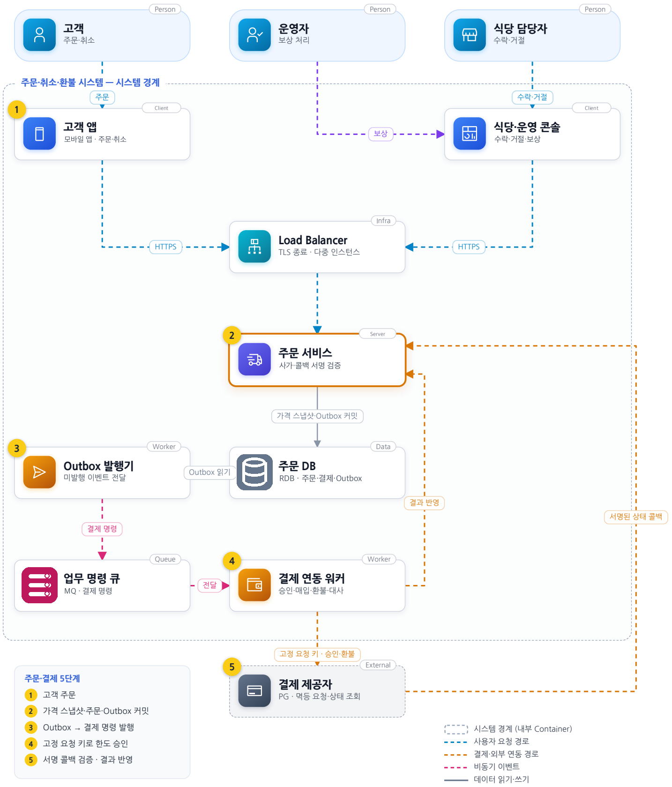
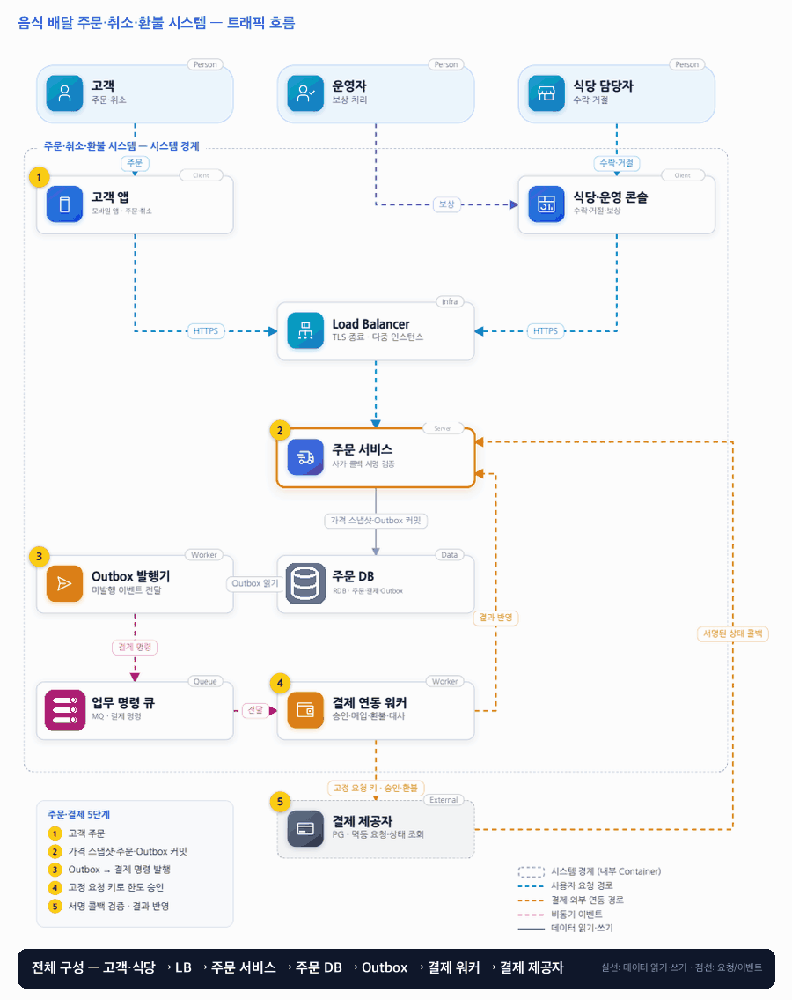

# 05. 음식 배달 주문·취소·환불 시스템

- **난이도**: 중급
- **규모**: 일 주문 10만 건 · 피크 300건/초
- **핵심 요약**: 음식 배달 주문·취소·환불 시스템 · 가격 스냅샷 · Transactional Outbox · 결제 사가 · 멱등 요청 키

## 1. 문제

### 요구사항

1. 가격·메뉴·옵션·배달비는 서버 검증 후 스냅샷 고정, 클라이언트 금액 불신
2. 카드 한도 승인 후 식당 요청, 수락 뒤 매입, 매입 성공 후 조리 확정 통지
3. 수락 전 고객 취소는 전액 승인 취소, 수락 뒤 자동 취소는 거절·운영자 보상
4. 식당은 60초 이내 응답, 무응답은 만료하되 늦은 결과의 보상을 추적
5. 주문·결제 상태 분리, 결과 불명은 PENDING·조회·대사, 취소·환불 완료 구분

### 문제 정의

배달 중개에서 식당 수락과 고객 취소가 겹치고 결제 콜백 지연으로 이중 환불 발생. 개발팀 4명, 결제 제공자는 승인·매입·승인 취소·환불·상태 조회와 멱등 요청 지원 가정. 실시간 지도·배차 최적화 제외.

## 2. 설계

### 01 아키텍처 드라이버

식당과 결제는 독립 시스템이며 수락·취소·콜백이 경합한다.

### 02 품질 속성

| 속성 | 목표 |
|---|---|
| 결제 정합성 | 중복 청구·환불 0건, 환불 총액은 원 매입을 넘지 않음 |
| 상태 정합성 | 취소 확정 주문은 수락으로 되살아나지 않고 조리 확정은 매입 성공 뒤에만 |
| 성능 | 주문 접수 API p95 500ms, 결제·식당 확정은 비동기 |

### 03 아키텍처 택틱

- 주문 상태 직렬화 · 수락·취소·만료·콜백은 모두 주문 행을 잠근 뒤 현재 상태에서 허용된 전이만 적용
- 멱등 키·조회로 외부 결과 확인 · 주문 생성 키는 클라이언트 생성, 승인·매입·취소·환불 키는 주문 ID에서 파생해 재시도마다 동일
- 실패는 보상으로 처리

### 04 아키텍처 스타일

**이벤트 기반 서비스 구조** — 주문이 상태를 소유하고 외부 연동은 워커가 담당, MQ는 최소 한번 전달 가정

### 05 아키텍처 패턴

**사가와 Transactional Outbox** — 오케스트레이션 사가로 승인 해제·환불을 보상 단계로 두고 주문갱신·Outbox 같은 커밋

### 06 트레이드오프

| 대안 | 평가 |
|---|---|
| 주문 트랜잭션 안에서 외부 호출 | DB 잠금을 오래 잡고 외부 성공 후 DB 롤백을 해결 못함, Outbox와 보상 상태 선택 |
| 주문·결제를 한 상태로 표현 | 조회는 쉽지만 취소 주문의 환불 대기 같은 조합을 숨김, 상태와 허용 조합을 명시 |

### 07 아키텍처 결정

- 식당 수락 후 매입, 결과 불명은 조회·대사로 해소. 주문 커밋과 Outbox 기록을 함께 한다
- 콜백은 서명 검증 후 주문 상태에 반영, 중복·역전·타임아웃은 조회와 보상으로 해결
- 환불은 결제 상태 전이(CAPTURED → REFUND_PENDING → REFUNDED) 한 경로로만 나간다 · 자동 보상과 운영자 수동 환불 모두 같은 경로를 쓰고 환불 키는 주문 ID 파생 고정값, 누적 환불액 ≤ 매입액을 잠금 아래 검사
- 늦은 식당 수락(만료 후 도착)은 거절하되 운영자 보상 큐에 기록한다 · 식당이 이미 조리를 시작했을 수 있으므로

#### 주문·결제 상태

| 주문 상태 | 뜻 | 허용 동작 → 다음 상태 |
|---|---|---|
| CREATED | 가격 스냅샷 고정, 승인 요청 전 | 승인 성공 → WAITING_STORE · 승인 실패 → FAILED |
| WAITING_STORE | 식당 응답 대기(60초) | 수락 → ACCEPTED · 거절 → CANCELLED(승인 취소) · 고객 취소 → CANCELLED(승인 취소) · 60초 만료 → EXPIRED(승인 취소) |
| ACCEPTED | 매입 요청 중 | 매입 성공 → CONFIRMED · 매입 실패 → CANCELLED(식당 통지) · 고객 취소 → 거절(운영자 보상만) |
| CONFIRMED | 조리 확정 통지 | 운영자 보상 → REFUND 진행(주문은 유지) |
| CANCELLED · EXPIRED · FAILED | 종결 | 없음 |

| 결제 상태 | 전이 |
|---|---|
| NONE → AUTH_PENDING → AUTHORIZED / AUTH_FAILED | 승인 |
| AUTHORIZED → VOIDED | 승인 취소(수락 전 취소·거절·만료) |
| AUTHORIZED → CAPTURE_PENDING → CAPTURED / CAPTURE_FAILED | 매입 |
| CAPTURED → REFUND_PENDING → REFUNDED(부분·전액) | 환불(운영자 보상 포함) |
| *_PENDING → UNKNOWN → (조회 후) 성공·실패 상태 | 타임아웃·결과 불명 |

주문 상태와 결제 상태는 따로 저장하고, 허용 조합(예: CANCELLED + REFUND_PENDING = 취소 주문의 환불 대기)을 명시한다. 조리 확정은 CAPTURED 뒤에만 통지한다.

#### 동시성 처리 흐름

1. **모든 전이는 주문 행 잠금 아래**: 수락·거절·고객 취소·만료·콜백 반영·조회 결과 반영은 주문 행을 SELECT FOR UPDATE로 잠그고 현재 상태에서 허용된 전이인지 검사한 뒤, 상태 갱신과 Outbox 기록을 한 트랜잭션으로 커밋한다. 허용되지 않으면 409이며 사유는 현재 상태다.
2. **고객 취소 vs 식당 수락**: 동시에 오면 먼저 잠근 쪽이 전이한다. 취소가 먼저면 식당 콘솔은 "이미 취소된 주문"을 보고, 수락이 먼저면 고객은 "수락되어 취소 불가"를 보고 운영자 보상으로 안내된다. 두 결과가 모두 성립하는 일은 없다.
3. **60초 만료 vs 늦은 수락**: 만료 워커가 WAITING_STORE인 주문을 잠그고 EXPIRED로 바꾸며 승인 취소 명령을 Outbox에 넣는다. 그 뒤 도착한 수락은 1번 검사에서 거절되고 운영자 보상 큐에 "늦은 수락"으로 기록된다. 수락이 먼저 커밋됐다면 만료 워커는 상태가 바뀐 것을 보고 아무것도 하지 않는다.
4. **콜백 중복·역전·조회 경합**: 콜백은 서명 검증 후 결제 상태 머신에 대입한다. 이미 CAPTURED인데 같은 콜백이 또 오면 무시, CAPTURE 결과가 AUTH 결과보다 먼저 오면 결제 ID로 대조해 유효한 전이만 적용한다. 워커가 타임아웃으로 UNKNOWN을 기록한 뒤 조회 결과와 콜백이 동시에 와도 같은 행 잠금 아래 같은 종착 상태로 수렴하며, 두 번째는 변화 없음으로 끝난다.
5. **Outbox 중복 발행**: 발행기는 최소 1회 전달이므로 결제 워커는 Outbox ID로 처리 여부를 기록하고, PG 호출은 고정 키라 두 번 보내도 PG가 한 번만 처리한다.
6. **이중 환불 차단**: 환불은 결제 상태 전이로만 나간다. 운영자 화면의 환불 버튼도 자동 보상과 같은 경로를 호출하므로, 한 주문에 환불 요청이 두 경로로 들어와도 잠금 아래 REFUND_PENDING은 한 번만 성립하고 PG에는 같은 환불 키가 간다. 부분 환불은 누적액을 잠금 아래 검사해 매입액을 넘지 못한다.

#### 멱등성 경계

| 경계 | 키 | 생성 주체 | 보장 |
|---|---|---|---|
| 고객 앱 → 주문 서비스 (주문 생성) | 주문 멱등 키(UUID) | 클라이언트, 재시도에 재사용 | (사용자, 키) 유일 키 · 같은 키는 기존 주문 반환 |
| 주문 서비스 → PG (승인·매입·승인 취소·환불) | 주문 ID + 동작 종류에서 파생한 고정 키 | 서버 | PG 멱등 계약 · 재시도·중복 발행에도 1회 처리 |
| PG → 주문 서비스 (콜백) | 결제 ID + 상태 | PG | 서명 검증 + 상태 머신 유효 전이만 적용, 나머지 무시 |
| Outbox → 결제 워커 | Outbox ID | 서버 | 처리 기록으로 중복 소비 무시 |
| 식당 콘솔 → 주문 서비스 (수락·거절) | 없음 | — | 상태 머신이 멱등성 제공 · 두 번째 수락은 "이미 수락됨" |

### 08 결정 기록 (ADR-001 · 제안 · 구현 전 검증 필요)

- **맥락**: 식당과 결제는 독립 시스템이며 수락·취소·콜백이 경합한다.
- **선택**: 식당 수락 후 매입하고, 결과 불명은 조회·대사로 해소한다.
- **결과와 비용**: 사가 보상은 DB 롤백이 아님, 매입된 결제는 환불 필요, 불명 상태는 문의·대사 운영 비용
- **재검토 조건**: 결제 제공자의 멱등·조회 계약 또는 취소 정책이 바뀌면 다시 검토한다.

### 검증

- 검증 1 고객 취소·식당 수락 병렬 → 확정 순서 하나, 취소 후 수락 없음. 상태·Outbox 일치.
- 검증 2 매입 성공 후 응답 차단 → 같은 키 재조회로 단일 매입, 고객 재시도에도 이중 청구 없음.
- 검증 3 60초 만료와 식당 수락을 동시 실행 → 종결 상태 하나, 만료가 이기면 승인 취소 1건 + 늦은 수락이 운영자 보상 큐에 기록, 수락이 이기면 만료 워커 무동작
- 검증 4 같은 매입 콜백 2회 + 승인·매입 콜백 순서 역전 → 결제 상태 CAPTURED 1회 전이, 무시된 콜백은 로그만 남음
- 검증 5 자동 보상과 운영자 환불을 같은 주문에 동시 요청 → REFUND_PENDING 1회, PG 환불 호출 키 동일, 환불 총액 ≤ 매입액
- 검증 6 주문 생성 응답 차단 후 같은 멱등 키 재전송 → 주문 1건, 승인 요청 1건

## 3. 전체 아키텍처 (System Context + Container)

음식 배달 주문·취소·환불 시스템 · 가격 스냅샷 · Transactional Outbox · 결제 사가 · 멱등 요청 키

### 트래픽 흐름

### 구성 요소

| 구분 | 이름 | 기술·역할 | 내부 요소 |
|---|---|---|---|
| Person | 고객 | 주문·취소 |  |
| Person | 운영자 | 보상 처리 |  |
| Person | 식당 담당자 | 수락·거절 |  |
| Client | 고객 앱 | 모바일 앱 · 주문·취소 |  |
| Client | 식당·운영 콘솔 | 수락·거절·보상 |  |
| Infra | Load Balancer | TLS 종료 · 다중 인스턴스 |  |
| Server | 주문 서비스 | 사가·콜백 서명 검증 |  |
| Worker | Outbox 발행기 | 미발행 이벤트 전달 |  |
| Data | 주문 DB | RDB · 주문·결제·Outbox |  |
| Queue | 업무 명령 큐 | MQ · 결제 명령 |  |
| Worker | 결제 연동 워커 | 승인·매입·환불·대사 |  |
| External | 결제 제공자 | PG · 멱등 요청·상태 조회 |  |

### 주문·결제 5단계

1. 고객 주문
2. 가격 스냅샷·주문·Outbox 커밋
3. Outbox → 결제 명령 발행
4. 고정 요청 키로 한도 승인
5. 서명 콜백 검증 · 결과 반영
