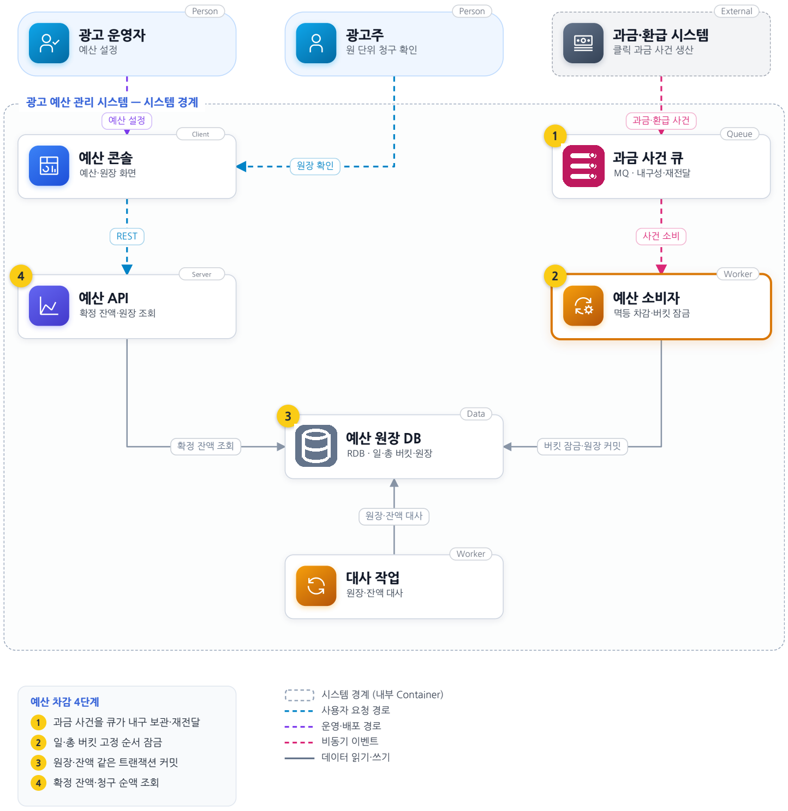
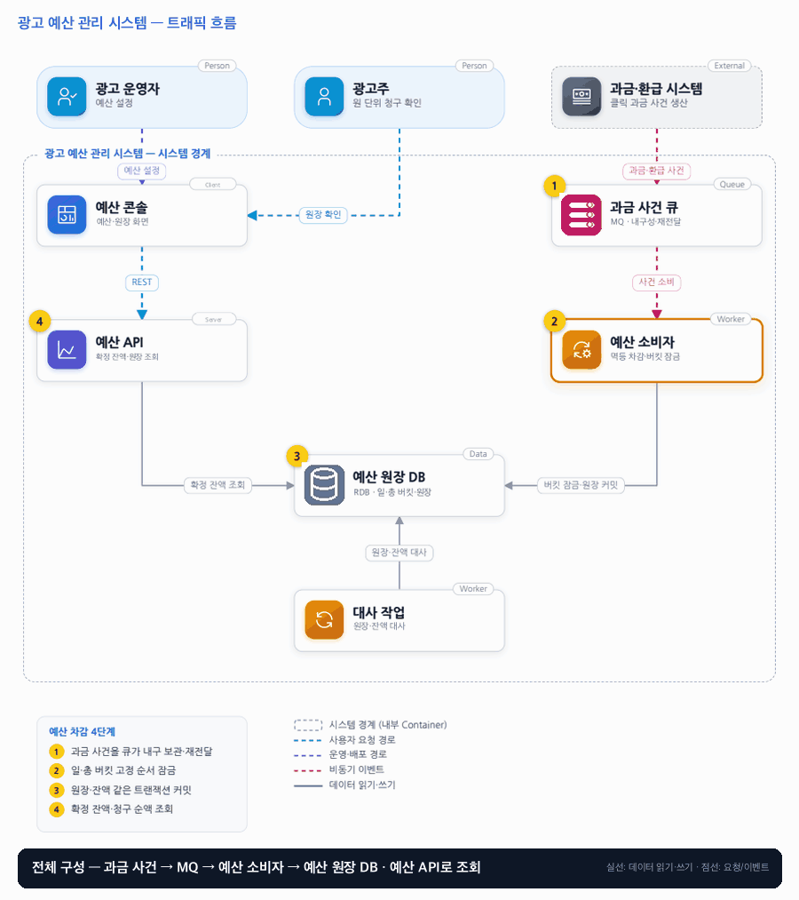

# 06. 광고 예산 관리 시스템

- **난이도**: 중급
- **규모**: 과금 이벤트 3,000건/초
- **핵심 요약**: 광고 예산 관리 시스템 · 일·총 버킷 원자 차감 · 원장 = 원본 · 멱등 과금 사건

## 1. 문제

### 요구사항

1. 원화 정수 단위, 캠페인별 일 예산·총예산을 동시에 만족해야 신규 확정 과금한다
2. 클릭 시점 가격·통화·캠페인·과금 식별자를 서명된 계약 또는 서버 기록으로 검증한다
3. 일 예산은 클릭 발생일을 광고주 시간대로 환산해 귀속하고 집행 후 시간대는 불변이다
4. 최대 48시간 지연 수용, 지난 일자 버킷 유지, 한도 부족 클릭은 미청구 사유 기록
5. 환급은 원 과금 참조, 누적 환급액은 원 과금 이하, 당일 집행 여력은 늘리지 않는다

### 문제 정의

클릭당 과금에서 재전달 클릭의 이중 청구와 자정 근처 지연 클릭의 잘못된 일 예산 차감을 막고 원 단위까지 설명 가능한 기록을 남긴다. 개발자 4명, 단일 쓰기 리전에서 시작한다.

## 2. 설계

### 01 아키텍처 드라이버

확정 과금은 예산을 넘으면 안 되며 환급과 지연 이벤트를 감사할 수 있어야 한다.

### 02 품질 속성

| 속성 | 목표 |
|---|---|
| 성능 | 과금 확정 p95 1초, 피크 3,000건/초 |
| 정합성 | 중복 청구 0건, 신규 과금 예산 초과 0건, 누적 환급 ≤ 원 과금 |
| 가용성 | DB 장애 때 이벤트를 대기시키고 성공 청구로 응답하지 않는다 |

### 03 아키텍처 택틱

- 중복 키로 과금 제한 · 원장 INSERT는 과금 식별자 유일 키에 ON CONFLICT DO NOTHING, 실제 삽입된 행만 차감하므로 중복은 오류 없이 차감 0
- 일·총 예산 조건부 차감
- 캠페인별 파티션 직렬화 · MQ 파티션 키 = 캠페인, 한 캠페인은 한 소비자가 순서대로 처리하고 N건을 한 트랜잭션으로 묶어 핫 키 잠금 경합을 줄 서기로 바꿈
- 불변 원장으로 대사

### 04 아키텍처 스타일

**단일 쓰기 리전 트랜잭션 중심 서비스** — 일·총 예산과 승인 원장을 하나의 쓰기 경계에 두고 후속 전파만비동기화한다

### 05 아키텍처 패턴

**추가 전용 원장과 멱등 소비자** — 일·총 예산을 같은 트랜잭션에서 검사하고 거래 기록으로 조정 근거를 남긴다

### 06 트레이드오프

| 대안 | 평가 |
|---|---|
| 현재 잔액 숫자만 보관 | 조회는 빠르지만 변경 이유 재구성이 어렵다. 원장을 원본으로 두고 잔액과 대사한다 |
| 제공 전 예산 예약 | 제공 비용 통제에 유리하나 예약 만료·확정·지연 클릭용 별도 상태 머신이 필요하다 |
| 사가로 분해(차감·원장·환급을 보상 단계로) | 여러 서비스·DB에 걸친 작업에 맞는 패턴. 이 시스템은 버킷·원장·환급·체크포인트가 한 DB에 있고 외부 부수 효과가 없어 DB 롤백으로 충분하다. 보상 원장만 늘고 얻는 것이 없어 채택하지 않음 |
| 2PC로 DB·MQ 원자 커밋 | 오프셋과 DB를 한 번에 커밋할 수 있으나 브로커·DB 양쪽 지원과 운영 비용이 크다. 체크포인트를 DB에 두고 멱등 재처리로 같은 결과를 얻는다 |

### 07 아키텍처 결정

- 승인 과금·잔액을 원자 갱신하고 일·총 버킷을 고정 순서로 잠가 같은 DB 트랜잭션으로 커밋한다
- 환급은 상쇄 원장으로 남기고 원장·잔액을 대사한다. 행 잠금이 병목이면 할당 모델을 별도 검토한다
- 예산 축소는 지출을 되돌리지 않는다 · 잔여 = 예산 − 지출이 0 이하가 되면 신규 과금만 거절, 예산 변경과 과금 차감은 같은 버킷 행 잠금 아래 처리
- 환급은 원 과금 행을 잠그고 누적 환급액 ≤ 원 과금을 검사한 뒤 상쇄 원장만 추가한다 · 버킷 지출은 되돌리지 않으므로 당일·총 여력이 늘지 않음
- 지난 일자 버킷은 (캠페인, 날짜) 유일 키로 없으면 삽입하며, 대사는 원장 커서 시점 이전만 합산해 같은 시점 잔액 스냅샷과 비교한다

#### 트랜잭션 경계

| 경계 | 포함되는 것 | 실패 시 |
|---|---|---|
| 배치 트랜잭션 (캠페인당 1개) | 총 버킷 잠금 → 일 버킷 잠금 → 사건 N건 처리 → 지출 가산 → 체크포인트(마지막 처리 오프셋) 갱신 | 시스템 오류(DB 장애·교착)에만 전체 롤백, 배치 재처리 |
| 사건 세이브포인트 (배치 안 N개) | 원장 INSERT ON CONFLICT → 잔여 검사 → 과금/미청구/충돌 기록 | 형식 불량 등 그 건만 되돌려 DLQ로, 나머지 건은 계속 |
| 환급 트랜잭션 | 원 과금 행 잠금 → 누적 한도 검사 → 상쇄 원장 INSERT | 한도 초과면 409, 롤백 |
| 예산 설정 트랜잭션 | 버킷 행 잠금 → 예산 갱신 (지출 불변) | — |
| 대사 (읽기 전용) | 커서 시점 이전 원장 합산 vs 같은 시점 지출 스냅샷 | 불일치는 기록·알림만, 자동 수정 없음 |

**DB와 MQ 사이**: 두 자원은 하나의 트랜잭션으로 묶이지 않는다. 체크포인트(오프셋)를 배치 트랜잭션 안에 저장하고, 소비자는 재시작 시 MQ 오프셋이 아니라 DB 체크포인트부터 읽는다. MQ 쪽 오프셋 커밋은 DB 커밋 뒤에 따로 하며 늦거나 빠져도 상관없다. 재전달된 사건은 ON CONFLICT로 차감 0이 되므로 결과는 정확히 1회다. 사가가 아니라 "체크포인트 + 멱등 재처리"로 분산 트랜잭션을 대신한다.

#### 동시성 처리 흐름

1. **캠페인별 순서 처리**: 과금 사건은 캠페인을 파티션 키로 MQ에 들어가고, 한 캠페인의 사건은 한 소비자만 처리한다. 인기 캠페인의 3,000건/초가 같은 버킷 행을 두고 DB에서 잠금 대기하는 대신 소비자 앞에서 줄을 선다. 소비자는 같은 캠페인 사건 N건(예: 50건)을 한 트랜잭션으로 묶어 버킷 잠금 1회, 원장 INSERT N회로 처리한다.
2. **한 트랜잭션의 내용**: 총예산 버킷 → 일 예산 버킷 순서로 잠근다(고정 순서라 교착 없음). 사건마다 원장 INSERT를 `ON CONFLICT (과금 식별자) DO NOTHING RETURNING`으로 실행해 삽입된 건만 잔여를 검사하고(부족하면 미청구 사유 원장, 충분하면 지출 가산), 0행이면 중복이므로 차감 없이 넘어간다. 같은 식별자에 다른 금액이면 기존 행을 읽어 충돌 기록만 남긴다. 유일 키 위반을 예외로 받지 않으므로 배치 안의 중복이 트랜잭션을 중단시키지 않는다.
3. **롤백은 시스템 오류에만**: 중복·예산 부족·서명 검증 실패는 "그 건의 결과를 기록하고 다음 건"이며 롤백 사유가 아니다. 롤백은 DB 장애·교착 같은 시스템 오류에만 일어나고, 그때는 배치 전체가 재처리된다. 형식이 깨져 처리 자체가 불가능한 사건은 세이브포인트로 격리해 불량 사건 큐(DLQ)로 보내고 나머지 건은 커밋한다. 한 건이 배치를 영원히 막는 일이 없어야 한다.
4. **예산 변경 vs 과금**: 운영자의 예산 설정도 같은 버킷 행을 잠근다. 일 예산을 이미 쓴 금액보다 낮추면 지출은 그대로이고 잔여가 0 이하가 되어 이후 과금은 미청구로 기록된다. 이미 확정된 과금은 되돌리지 않는다.
5. **환급**: 환급 요청은 원 과금 행을 잠그고 누적 환급액 ≤ 원 과금 금액을 검사한 뒤 상쇄 원장을 추가한다. 동시 환급 두 건은 잠금으로 직렬화되어 둘째가 한도 검사에서 거절된다. 환급은 버킷 지출을 되돌리지 않으므로 당일·총 여력이 늘지 않는다(요구사항 5).
6. **지연 클릭과 버킷 생성**: 48시간 지연 클릭은 클릭 발생일(광고주 시간대) 버킷에 귀속한다. 해당 날짜 버킷이 없으면 (캠페인, 날짜) 유일 키로 삽입하며, 동시 생성은 유일 키가 하나만 통과시키고 나머지는 기존 행을 쓴다. 지난 일자 버킷은 삭제하지 않는다.
7. **대사와 실시간 쓰기**: 대사 작업은 원장 커서(처리한 마지막 원장 ID)를 정하고 그 이전 원장만 합산해, 같은 커서 시점에 기록해 둔 버킷 지출 스냅샷과 비교한다. 쓰기가 계속되는 중에도 가짜 불일치가 나지 않는다.
8. **MQ 재전달**: 소비자 장애로 같은 사건이 다시 와도 2번의 ON CONFLICT가 차감을 막는다. 배치 단위 커밋 뒤 오프셋을 커밋하므로 배치 중간에 죽으면 배치 전체가 재처리되고, 이미 들어간 건은 전부 중복으로 처리되어 결과는 같다.

### 08 결정 기록 (ADR-001 · 제안 · 구현 전 검증 필요)

- **맥락**: 확정 과금은 예산을 넘으면 안 되며 환급과 지연 이벤트를 감사할 수 있어야 한다
- **선택**: 승인 과금·잔액을 원자 갱신하고 환급은 상쇄 원장으로 남긴다
- **결과와 비용**: 캠페인별 핫 키에서 잠금 대기가 늘 수 있다. 멀티 리전 쓰기 대신 지역 할당·단일 홈 리전 비교
- **재검토 조건**: 인기 캠페인 잠금 대기가 목표를 넘거나 제공 전 한도가 필요하면 예약 방식을 검토한다. 외부 결제·송출 시스템 연동이 추가되어 쓰기 경계가 둘 이상이 되면(이중 쓰기 발생) Outbox + 사가로 전환한다

### 검증

- 검증 1 동일 ID를 100회 재전송 → 과금 원장 1개, 동일 ID 다른 금액은 충돌 기록
- 검증 2 3,000 RPS + 인기 캠페인 편향 → 소비량 상한 준수, 잠금 p95/p99와 큐 지연 측정
- 검증 3 소비자를 배치 커밋 직후 종료 → 재시작 후 원장·버킷 지출 동일, 중복 차감 0건
- 검증 4 지출 5만 원인 버킷의 일 예산을 3만 원으로 축소 → 지출 5만 유지, 잔여 −2만, 이후 과금 전부 미청구 기록, 확정 과금 되돌림 0건
- 검증 5 같은 과금에 환급 요청 2건 병렬(각 원 과금의 70%) → 1건만 성공, 누적 환급 ≤ 원 과금, 버킷 지출 변화 없음
- 검증 6 쓰기 3,000 RPS 중 대사 실행 → 커서 시점 기준 원장 합계 = 버킷 지출, 불일치 0건
- 검증 7 50건 배치에 중복 1건·금액 불일치 1건·형식 불량 1건 혼입 → 47건 과금, 중복은 차감 0, 불일치는 충돌 기록, 불량은 DLQ 1건, 배치 재처리 횟수 0
- 검증 8 DB 커밋 뒤 MQ 오프셋 커밋 전 소비자 종료 → 재시작 시 DB 체크포인트부터 소비, 재전달 사건 전부 차감 0, 원장·지출 변화 없음

## 3. 전체 아키텍처 (System Context + Container)

광고 예산 관리 시스템 · 일·총 버킷 원자 차감 · 원장 = 원본 · 멱등 과금 사건

### 트래픽 흐름

### 구성 요소

| 구분 | 이름 | 기술·역할 | 내부 요소 |
|---|---|---|---|
| Person | 광고 운영자 | 예산 설정 |  |
| Person | 광고주 | 원 단위 청구 확인 |  |
| External | 과금·환급 시스템 | 클릭 과금 사건 생산 |  |
| Client | 예산 콘솔 | 예산·원장 화면 |  |
| Queue | 과금 사건 큐 | MQ · 내구성·재전달 |  |
| Server | 예산 API | 확정 잔액·원장 조회 |  |
| Worker | 예산 소비자 | 멱등 차감·버킷 잠금 |  |
| Data | 예산 원장 DB | RDB · 일·총 버킷·원장 |  |
| Worker | 대사 작업 | 원장·잔액 대사 |  |

### 예산 차감 4단계

1. 과금 사건을 큐가 내구 보관·재전달
2. 일·총 버킷 고정 순서 잠금
3. 원장·잔액 같은 트랜잭션 커밋
4. 확정 잔액·청구 순액 조회
