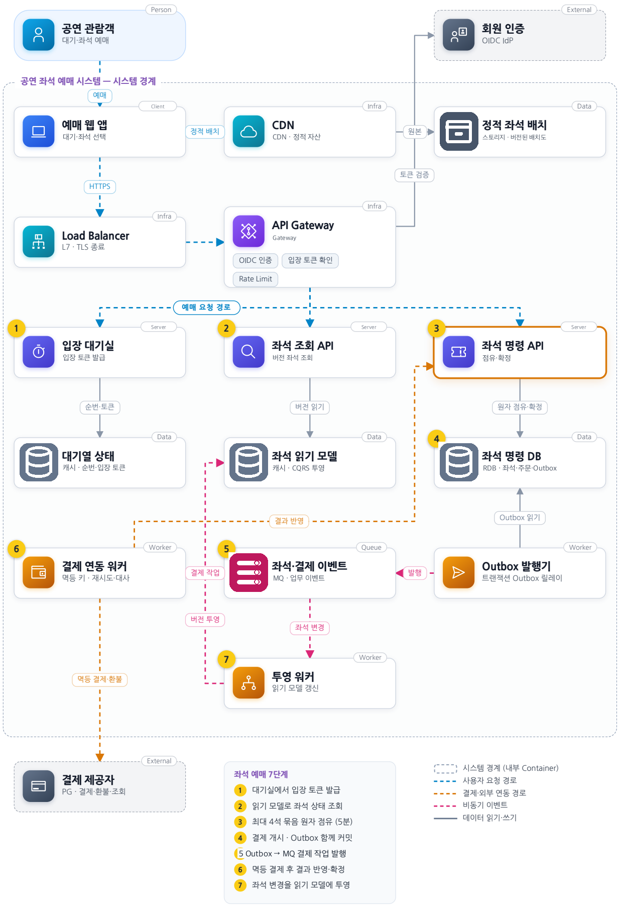
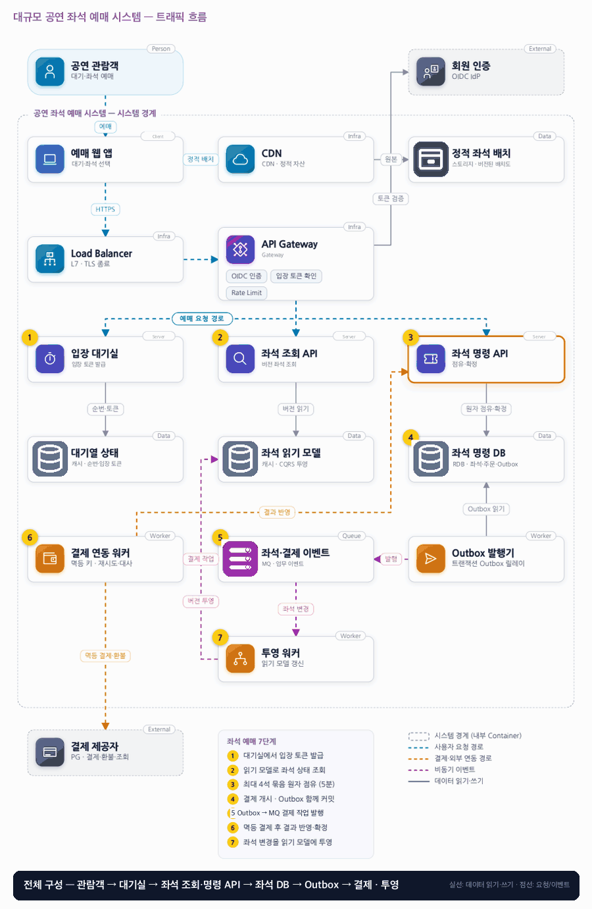

# 07. 대규모 공연 좌석 예매 시스템

- **난이도**: 고급
- **규모**: 공연당 5만 석 · 진입 피크 10만 요청/초
- **핵심 요약**: 대규모 공연 좌석 예매 시스템 · 입장 대기 · 원자 점유 · Outbox · 결제 연동 · CQRS 투영

## 1. 문제

### 요구사항

1. 공연당 최대 5만 석, 사용자당 최대 4석, 좌석 묶음은 모두 점유하거나 모두 실패한다
2. 임시 점유는 DB 시각 기준 5분, 사용자·점유 토큰·세대 검증, 타인 점유 연장 불가
3. 결제 전 PAYMENT_PENDING 전환, 결제 불명확 중에는 일반 만료로 해제 금지
4. 결제·주문·좌석은 따로 저장, 좌석 확정과 주문 성공은 같은 DB 트랜잭션으로 처리한다
5. 결제 불명확은 자동 조회·운영 확인, 늦은 성공 미수용 거래는 환불 대상으로 고정한다

### 문제 정의

예매 오픈 트래픽 집중 속에서 결제 중 점유가 만료돼 다른 사람에게 팔린 뒤 첫 고객의 결제 성공이 도착하는 사고를 막는다. 팀 8명, 단일 쓰기 리전, 외부 결제는 멱등 요청·상태 조회 지원 가정.

## 2. 설계

### 01 아키텍처 드라이버

특정 공연·좌석에 부하가 몰리고 점유 만료와 늦은 결제 성공이 경합한다.

### 02 품질 속성

| 속성 | 목표 |
|---|---|
| 정합성 | 좌석 이중 판매 0건, 공연·좌석별 SOLD 소유 주문은 최대 하나 |
| 원자성 | 묶음 점유·확정은 전부 또는 전무, 이전 generation은 소유권 변경 불가 |
| 성능 | 좌석 변경 p95 500ms, 진입 10만 요청/초는 거절·대기포함 경계 목표 |

### 03 아키텍처 택틱

- 진입 제한
- 묶음 원자 갱신 · 좌석 ID 오름차순 조건부 UPDATE(`WHERE status='FREE'`), 영향 행 수가 요청 좌석 수와 다르면 롤백
- 세대 검증 · 점유마다 generation 증가, 결제 시작·콜백·해제는 세대가 일치할 때만 적용
- 결제 불명 좌석 보류 · PAYMENT_PENDING은 일반 만료 제외, 결제 시한 뒤 HOLD_UNKNOWN으로 보류하고 조회로 수렴
- 투영 버전 비교 · 읽기 모델은 좌석별 버전이 더 새로운 이벤트만 적용해 중복·역전 무시

### 04 아키텍처 스타일

**마이크로서비스 아키텍처(MSA)** — 좌석 조회·좌석 명령·결제 연동을 독립 배포하고 원본 좌석 상태는 명령 서비스만 변경

### 05 아키텍처 패턴

**CQRS+Transactional Outbox+보상** — 좌석 조회 모델은 이벤트로 갱신하고 결제 실패·포기는 해제·환불로 보상한다

### 06 트레이드오프

| 대안 | 평가 |
|---|---|
| 캐시 TTL만으로 점유·확정 | 빠르지만 결제 중 TTL 만료·내구성 문제가 남아 확정 원본은 DB, 캐시는 진입·조회용 |
| 결제 전 좌석 완전 해제 | 가용성은 높지만 이중 약속이 생긴다. UNKNOWN 보류 또는 포기+환불 정책을 택한다 |

### 07 아키텍처 결정

- 결제 진행 좌석은 일반 만료에서 제외하고 좌석 명령 서비스가 묶음 점유·확정을 원자 처리한다
- Outbox→MQ→투영 워커가 읽기 모델을 갱신, UNKNOWN은 점유 보류 후 늦은 성공을 확정 또는 환불
- 사용자당 4석 한도는 (공연, 사용자) 행을 먼저 잠가 같은 사용자의 동시 점유 요청을 직렬화한 뒤 검사한다
- 만료 스위퍼는 "HELD이고 DB 시각 기준 expires_at 경과"인 행만 FREE로 돌리고 generation을 올린다 · PAYMENT_PENDING·HOLD_UNKNOWN·SOLD는 건드리지 않음
- 결제 시한(15분)이 지난 PAYMENT_PENDING은 HOLD_UNKNOWN으로 바꾸고 PG 조회를 반복한다 · 성공이면 SOLD, 실패면 FREE, 3회 조회 후에도 불명이면 운영 확인 큐
- 늦은 결제 성공의 generation이 현재 좌석 generation과 다르면 확정하지 않고 환불 대상으로 기록한다

#### 좌석 상태

| 상태 | 뜻 | 허용 전이 (주체) |
|---|---|---|
| FREE | 판매 가능 | 점유 → HELD (좌석 명령 API, 묶음 원자) |
| HELD | 임시 점유 5분 · 사용자·토큰·generation 보유 | 결제 시작 → PAYMENT_PENDING (소유자, 세대 일치) · 해제 → FREE (소유자) · 만료 → FREE (스위퍼, DB 시각 기준) |
| PAYMENT_PENDING | 결제 진행 중 · 일반 만료 제외 | 결제 성공 → SOLD (콜백·조회, 세대 일치) · 결제 실패·포기 → FREE · 결제 시한 경과 → HOLD_UNKNOWN |
| HOLD_UNKNOWN | 결제 결과 불명 보류 · 판매 불가 | 조회 성공 → SOLD · 조회 실패 → FREE · 운영자 강제 해제 → FREE (generation 증가, 늦은 성공은 환불) |
| SOLD | 확정 · 주문과 같은 트랜잭션 | 없음 (취소·환불은 범위 밖) |

#### 동시성 처리 흐름

1. **묶음 점유**: (공연, 사용자) 행을 잠가 보유 좌석 수 + 요청 수 ≤ 4를 검사한다. 요청 좌석을 ID 오름차순으로 `UPDATE seat SET status='HELD', owner, token, generation=generation+1, expires_at=now()+5min WHERE id IN (...) AND status='FREE'`로 갱신하고, 영향 행 수가 요청 수와 다르면 롤백해 전부 실패로 돌려준다. 고정 순서라 겹치는 묶음을 동시에 잡는 두 사용자 사이에 교착이 없고, 두 사용자 모두 부분 점유 없이 한쪽만 성공한다.
2. **읽기 모델과의 간격**: 좌석 조회는 투영된 읽기 모델을 보므로 몇백 ms 전 상태다. 이미 HELD인 좌석을 고르면 1번에서 0행으로 실패하고 409를 받는다. 조회는 참고, 확정은 명령 DB가 한다(1장과 같은 원칙).
3. **만료 스위퍼 vs 결제 시작**: 사용자가 만료 직전 결제를 누르면 결제 시작은 좌석 행을 잠그고 "HELD이고 소유자·토큰·generation 일치"를 검사한 뒤 PAYMENT_PENDING으로 바꾼다. 스위퍼는 같은 행을 잠그고 "HELD이고 expires_at < DB 시각"일 때만 FREE로 돌린다. 먼저 커밋한 쪽이 이긴다. 결제 시작이 이기면 스위퍼는 PAYMENT_PENDING을 보고 무동작, 스위퍼가 이기면 결제 시작은 FREE를 보고 "점유 만료"를 돌려준다. 앱 시계가 아니라 DB 시각을 쓰므로 노드 간 시계 차이가 결과를 바꾸지 않는다.
4. **결제 중 좌석의 시한**: PAYMENT_PENDING은 5분 만료를 적용하지 않는다(요구사항 3). 대신 결제 시한 15분이 지나면 HOLD_UNKNOWN으로 바꾸고 PG 상태 조회를 반복한다. 성공이면 SOLD, 실패면 FREE. 3회 조회 뒤에도 불명이면 운영 확인 큐에 올리고 좌석은 계속 보류한다. 이 보류가 판매 가능 좌석을 줄이는 비용이 재검토 조건이다.
5. **늦은 결제 성공**: 콜백·조회 결과는 결제 ID와 점유 generation을 함께 가진다. 좌석이 PAYMENT_PENDING·HOLD_UNKNOWN이고 generation이 일치하면 좌석 SOLD 확정과 주문 성공을 한 트랜잭션으로 커밋한다(요구사항 4). 운영자가 강제 해제해 generation이 바뀐 뒤 성공이 도착하면 확정하지 않고 환불 대상으로 기록한다. 이중 판매는 generation 불일치로 구조적으로 막힌다.
6. **콜백 중복·역전**: 같은 결제의 콜백이 두 번 오거나 조회 결과와 겹쳐도 좌석 행 잠금 아래 상태 머신의 유효 전이만 적용한다. 이미 SOLD면 무시한다.
7. **투영의 순서·중복**: Outbox 이벤트는 최소 1회 전달이고 파티션을 넘나들면 순서가 바뀔 수 있다. 투영 워커는 이벤트의 좌석 버전이 읽기 모델의 버전보다 클 때만 적용한다. 중복은 같은 버전이라 무시되고, 역전된 옛 이벤트는 작은 버전이라 무시된다.

#### 멱등성 경계

| 경계 | 키 | 보장 |
|---|---|---|
| 앱 → 좌석 명령 API (점유) | 클라이언트 생성 요청 키 | (사용자, 키) 유일 · 같은 키는 기존 점유 반환 |
| 좌석 명령 API → PG (결제 시작) | 주문 ID 파생 고정 키 | PG 멱등 계약 · 재시도에도 1회 승인 |
| PG → 결제 연동 워커 (콜백) | 결제 ID + 상태 + generation | 서명 검증 + 상태 머신 유효 전이 + 세대 일치 |
| Outbox → MQ → 워커 | 이벤트 ID | 처리 기록으로 중복 무시 |
| 투영 워커 → 읽기 모델 | 좌석 버전 | 더 큰 버전만 적용 |
| 스위퍼 | 없음 | 조건부 UPDATE 자체가 멱등 · 두 스위퍼가 겹쳐도 한 번만 해제 |

### 08 결정 기록 (ADR-001 · 제안 · 구현 전 검증 필요)

- **맥락**: 특정 공연·좌석에 부하가 몰리고 점유 만료와 늦은 결제 성공이 경합한다
- **선택**: 결제 진행 좌석은 일반 만료에서 제외하고 늦은 성공은 확정 또는 환불한다
- **결과와 비용**: CQRS 조회 지연으로 지도·실제 점유가 다를 수 있어 정적 지도만 장기 캐시, 가변 상태는 버전화
- **재검토 조건**: 결제 불명 보류가 판매 가능 좌석을 과도하게 줄이면 결제 계약과 포기 기준을 검토한다

### 검증

- 검증 1 동일 4석에 병렬 1,000요청 → 묶음 성공 1건, 부분 점유·이중 판매 0건
- 검증 2 결제 성공 뒤 프로세스 종료 → 복구 후 동일 결제로 확정 또는 정책상 단일 환불, 무기한 숨은 상태 0건
- 검증 3 만료 1초 전 결제 시작과 스위퍼를 동시 실행 → 결과는 PAYMENT_PENDING 또는 FREE 중 하나, 두 상태가 섞인 좌석 0건
- 검증 4 좌석 {1,2,3,4}와 {3,4,5,6}을 병렬 점유 → 교착 0건, 한쪽만 4석 성공, 다른 쪽 0석
- 검증 5 운영자 강제 해제 후 늦은 결제 성공 도착 → 좌석은 FREE 유지(또는 새 소유자), 환불 대상 1건, 이중 판매 0건
- 검증 6 투영 이벤트를 중복·역순으로 주입 → 읽기 모델 최종 상태가 명령 DB와 일치
- 검증 7 같은 사용자가 2석·3석 점유를 동시 요청 → 합계 4석 초과 시 한쪽 거절, 부분 성공 0건

## 3. 전체 아키텍처 (System Context + Container)

대규모 공연 좌석 예매 시스템 · 입장 대기 · 원자 점유 · Outbox · 결제 연동 · CQRS 투영

### 트래픽 흐름

### 구성 요소

| 구분 | 이름 | 기술·역할 | 내부 요소 |
|---|---|---|---|
| Person | 공연 관람객 | 대기·좌석 예매 |  |
| External | 회원 인증 | OIDC IdP |  |
| Client | 예매 웹 앱 | 대기·좌석 선택 |  |
| Infra | CDN | CDN · 정적 자산 |  |
| Data | 정적 좌석 배치 | 스토리지 · 버전된 배치도 |  |
| Infra | Load Balancer | L7 · TLS 종료 |  |
| Infra | API Gateway | Gateway | OIDC 인증 · 입장 토큰 확인 · Rate Limit |
| Server | 입장 대기실 | 입장 토큰 발급 |  |
| Server | 좌석 조회 API | 버전 좌석 조회 |  |
| Server | 좌석 명령 API | 점유·확정 |  |
| Data | 대기열 상태 | 캐시 · 순번·입장 토큰 |  |
| Data | 좌석 읽기 모델 | 캐시 · CQRS 투영 |  |
| Data | 좌석 명령 DB | RDB · 좌석·주문·Outbox |  |
| Worker | 결제 연동 워커 | 멱등 키 · 재시도·대사 |  |
| Queue | 좌석·결제 이벤트 | MQ · 업무 이벤트 |  |
| Worker | Outbox 발행기 | 트랜잭션 Outbox 릴레이 |  |
| Worker | 투영 워커 | 읽기 모델 갱신 |  |
| External | 결제 제공자 | PG · 결제·환불·조회 |  |

### 좌석 예매 7단계

1. 대기실에서 입장 토큰 발급
2. 읽기 모델로 좌석 상태 조회
3. 최대 4석 묶음 원자 점유 (5분)
4. 결제 개시 · Outbox 함께 커밋
5. Outbox → MQ 결제 작업 발행
6. 멱등 결제 후 결과 반영·확정
7. 좌석 변경을 읽기 모델에 투영
