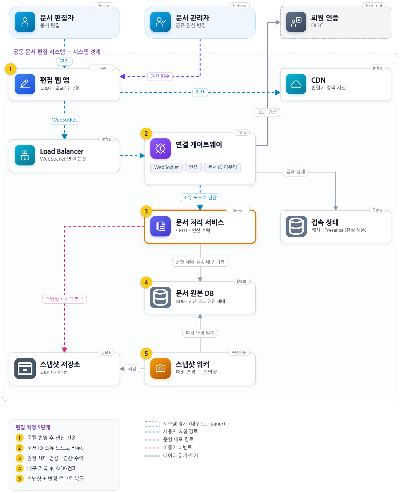
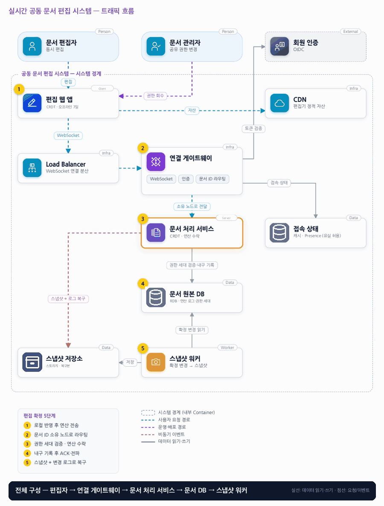

# 08. 실시간 공동 문서 편집 시스템

- **난이도**: 고급
- **규모**: 동시 1만 명 · 문서당 최대 100명
- **핵심 요약**: 실시간 공동 문서 편집 시스템 · CRDT · 문서 ID 소유권 · 권한 세대 · 스냅샷 + 변경 로그 복구

## 1. 문제

### 요구사항

1. 동시 1만 명, 문서당 최대 100명, 텍스트 삽입·삭제만 지원, 서식·표·이미지 제외
2. 일시적 오프라인 최대 7일 지원, 로컬 반영·서버 접수·내구성 저장을 UI에서 구분한다
3. 저장 완료로 확인한 연산은 노드 장애 뒤에도 복구, 커서·접속 표시는 유실을 허용한다
4. 권한 회수 API 성공 후 신규 편집 수락 없음, 로컬 문서 원격 삭제는 약속 안 함
5. 재접속 시 권한 재검사, 권한이 없으면 서버 병합 거절·로컬 사본 내보내기만 제공한다

### 문제 정의

회의록 동시 편집에서 마지막 저장이 다른 사람의 수정을 지우고 오프라인 편집이 재접속 시 사라지는 문제를 해결한다. 팀 8명이 일반 텍스트 공동 편집을 만들며 소유자의 즉시 권한 회수가 필요하다.

## 2. 설계

### 01 아키텍처 드라이버

오프라인 수정과 동시 편집을 병합하고 권한 회수 후 쓰기를 거절해야 한다.

### 02 품질 속성

| 속성 | 목표 |
|---|---|
| 성능 | 온라인 편집 반영 p95 200ms, 동일 지역 기준 |
| 내구성 | durable ack된 연산은 단일 노드 장애에서 RPO 0으로 복구 |
| 정합성 | 회수 커밋 후 이전 권한 epoch 쓰기 거절, 노드 세대는 감소하지 않는다 |

### 03 아키텍처 택틱

- CRDT 병합 · 연산은 (클라이언트, seq)로 식별해 중복 재전송을 무시
- 내구성 확인 후 응답 · 로그 커밋 뒤에만 durable ack, 클라이언트는 ack 전 연산을 재전송
- 노드 세대 검사 · 문서 소유권은 DB 리스(소유 노드, 세대, 만료)로 조건부 획득, 로그 append는 세대가 현재와 같을 때만 수락
- 권한 세대 검사 · 회수는 소유 노드를 거쳐 문서 로그에 epoch 증가 항목으로 기록, 그 뒤 옛 epoch 연산은 거절

### 04 아키텍처 스타일

**문서별 처리 노드 분산 편집 구조** — 문서별 처리 노드에 로그·스냅샷을 두고 연결 확장과 문서 단위 소유권을 분리한다

### 05 아키텍처 패턴

**변경 로그+스냅샷, Fencing Token** — 로그·스냅샷으로 재접속을 복구하고 새 generation만 쓰기 가능해 이전 노드 쓰기를 차단

### 06 트레이드오프

| 대안 | 평가 |
|---|---|
| 마지막 저장으로 문서 덮어쓰기 | 단순하지만 동시 수정이 사라진다. 낙관적 충돌 감지로는 자동 병합 경험이 부족하다 |
| OT 기반 중앙 서버 | 온라인 편집에 적합하나 오프라인 병합 요구로 CRDT를 택하고 자료구조 비용을 감수한다 |

### 07 아키텍처 결정

- CRDT 연산은 권한·세대를 검증하고 내구성 로그 커밋 뒤 확인하며 접속 상태는 손실 허용 캐시에 둔다
- 스냅샷·변경 로그로 재접속을 복구하며 LB 스티키 세션만으로 문서 쓰기 일관성을 보장하지 않는다
- 문서 소유권은 DB의 (문서, 소유 노드, 세대, 리스 만료) 행을 `UPDATE ... WHERE 만료 < now()`로 조건부 획득하고 세대를 1 올린다 · 소유 노드는 리스를 주기 갱신하며, 로그 append는 세대 불일치 시 저장소가 거절한다
- 로그 보존 지평선은 7일 이상이며 스냅샷은 로그 위치 커서 기준으로 만들고 커서 이전·지평선 밖만 압축한다
- 문서당 100명 입장은 원자 카운터(INCR 후 한도 초과 시 DECR·거절)로 제한한다

#### 동시성 처리 흐름

1. **문서 단위 직렬화**: 한 문서의 모든 쓰기(연산, 권한 회수, 소유 노드 교체 기록)는 그 문서의 소유 노드 하나를 거쳐 문서 로그에 순서대로 append된다. 동시 편집의 "충돌"은 CRDT가 자료구조 수준에서 병합하므로 잠금이 필요 없고, 순서가 필요한 것은 권한과 소유권뿐이다.
2. **소유 노드 교체와 좀비 노드**: 소유 노드가 죽거나 리스 갱신에 실패하면 다른 노드가 만료된 리스를 조건부 UPDATE로 잡고 세대를 올린다. 옛 노드가 아직 살아 늦게 append를 시도하면 세대가 작아 저장소에서 거절된다. 연결 게이트웨이는 거절을 받으면 소유자를 다시 조회해 재라우팅한다. 스티키 세션은 성능 최적화일 뿐 정합성 장치가 아니다.
3. **권한 회수 vs 연산 수락**: 소유자가 권한을 회수하면 API는 회수를 DB에 기록하는 것이 아니라 해당 문서의 소유 노드에 전달하고, 소유 노드가 로그에 "권한 epoch N→N+1" 항목을 append한 뒤 성공을 돌려준다. 로그에서 이 항목보다 앞선 연산은 수락, 뒤에 도착한 옛 epoch 연산은 거절이다. 1,000개 쓰기와 경합해도 로그 순서가 곧 판정 근거다(검증 2).
4. **연산 중복과 durable ack**: 클라이언트는 연산마다 (클라이언트 ID, 증가 seq)를 붙이고 durable ack를 받을 때까지 재전송한다. 소유 노드는 클라이언트별 마지막 seq를 기억해 이하 seq는 로그에 쓰지 않고 ack만 다시 준다. CRDT 자체가 멱등이라 설령 중복이 적용돼도 문서는 같지만, 중복 제거로 로그와 전파량을 줄인다.
5. **오프라인 7일 재접속**: 클라이언트는 마지막으로 본 로그 위치와 권한 epoch를 들고 온다. 소유 노드는 먼저 권한을 재검사해 회수됐으면 병합을 거절하고 로컬 사본 내보내기만 허용한다(요구사항 5). 권한이 있으면 클라이언트 위치 이후 로그(또는 스냅샷 + 이후 로그)를 보내 수렴시키고, 클라이언트의 오프라인 연산을 받아 append한다. 로그 보존이 7일 미만이면 이 복구가 불가능하므로 지평선은 7일 이상이다.
6. **스냅샷 워커 vs 실시간 append**: 워커는 로그 위치 커서 N을 정하고 N까지 적용한 스냅샷을 저장소에 쓴 뒤 (문서, N)을 기록한다. 복구는 "스냅샷 N + N 이후 로그"다. 압축은 N 이전이면서 보존 지평선 밖인 로그만 지운다. append가 계속돼도 커서가 고정돼 있어 스냅샷과 로그 사이에 빈틈이 없다.
7. **입장 한도**: 문서별 접속 카운터를 원자 INCR하고 100을 넘으면 DECR 후 거절한다. 접속 상태는 유실 허용이므로 카운터가 틀어지면 소유 노드가 실제 연결 수로 주기적으로 보정한다.

#### 멱등성 경계

| 경계 | 키 | 보장 |
|---|---|---|
| 클라이언트 → 소유 노드 (연산) | (클라이언트 ID, seq) | 마지막 seq 이하 무시 + CRDT 자체 멱등 |
| 소유자 → 소유 노드 (권한 회수) | 문서 epoch | 같은 epoch 회수 반복은 무동작, epoch는 감소하지 않음 |
| 노드 → 저장소 (로그 append) | (문서, 세대, 로그 위치) | 세대 불일치 거절 · 같은 위치 재append는 충돌로 거절 |
| 스냅샷 워커 → 스토리지 | (문서, 로그 위치 N) | 같은 N 재생성은 동일 내용 덮어쓰기 |
| 게이트웨이 → 접속 카운터 | 연결 ID | 같은 연결 중복 INCR 방지, 주기 보정 |

### 08 결정 기록 (ADR-001 · 제안 · 구현 전 검증 필요)

- **맥락**: 오프라인 수정과 동시 편집을 병합하고 권한 회수 후 쓰기를 거절해야한다
- **선택**: 텍스트 CRDT를 쓰되 권한 회수와 연산 수락을 같은 저장 경계에서 순서화한다
- **결과와 비용**: 문서당 연결 수와 변경 전파량이 핫 키 병목이라 문서 제한·스냅샷·느린 연결 처리로 제어
- **재검토 조건**: 오프라인 기간·로그 크기·문서당 팬아웃이 목표를 넘으면 압축과 배치를 재검토한다

### 검증

- 검증 1 durable ack 후 노드 강제 종료 → 다른 노드 복구 후 확인 연산 누락 0건
- 검증 2 권한 회수와 1,000개 쓰기 경합 → 회수 커밋 이후 이전 epoch 수락 0건, 로그로 순서 입증
- 검증 3 소유 노드를 일시 정지시켜 리스가 만료된 뒤 재개 → 새 노드가 세대를 올려 소유, 옛 노드의 append 전부 세대 불일치로 거절, 로그 분기 0건
- 검증 4 7일 오프라인 클라이언트가 연산 500개를 들고 재접속 (권한 유지·회수 두 경우) → 유지 시 500개 병합·문서 수렴, 회수 시 병합 0건·내보내기만 허용
- 검증 5 durable ack 유실로 같은 연산 100개 재전송 → 로그 추가 0건, ack 재응답 100건, 문서 내용 동일
- 검증 6 append 1,000건/초 중 스냅샷 생성 → 스냅샷 N + 이후 로그 재생 결과가 전체 로그 재생과 동일
- 검증 7 99명 접속 중 20명 동시 입장 → 1명만 성공, 카운터 100 유지

## 3. 전체 아키텍처 (System Context + Container)

실시간 공동 문서 편집 시스템 · CRDT · 문서 ID 소유권 · 권한 세대 · 스냅샷 + 변경 로그 복구

### 트래픽 흐름

### 구성 요소

| 구분 | 이름 | 기술·역할 | 내부 요소 |
|---|---|---|---|
| Person | 문서 편집자 | 동시 편집 |  |
| Person | 문서 관리자 | 공유 권한 변경 |  |
| External | 회원 인증 | OIDC |  |
| Client | 편집 웹 앱 | CRDT · 오프라인 7일 |  |
| Infra | CDN | 편집기 정적 자산 |  |
| Infra | Load Balancer | WebSocket 연결 분산 |  |
| Infra | 연결 게이트웨이 |  | WebSocket · 인증 · 문서 ID 라우팅 |
| Server | 문서 처리 서비스 | CRDT · 연산 수락 |  |
| Data | 접속 상태 | 캐시 · Presence (유실 허용) |  |
| Data | 문서 원본 DB | RDB · 연산 로그·권한 세대 |  |
| Data | 스냅샷 저장소 | 스토리지 · 복구본 |  |
| Worker | 스냅샷 워커 | 확정 변경 → 스냅샷 |  |

### 편집 확정 5단계

1. 로컬 반영 후 연산 전송
2. 문서 ID 소유 노드로 라우팅
3. 권한 세대 검증 · 연산 수락
4. 내구 기록 후 ACK·전파
5. 스냅샷 + 변경 로그로 복구
