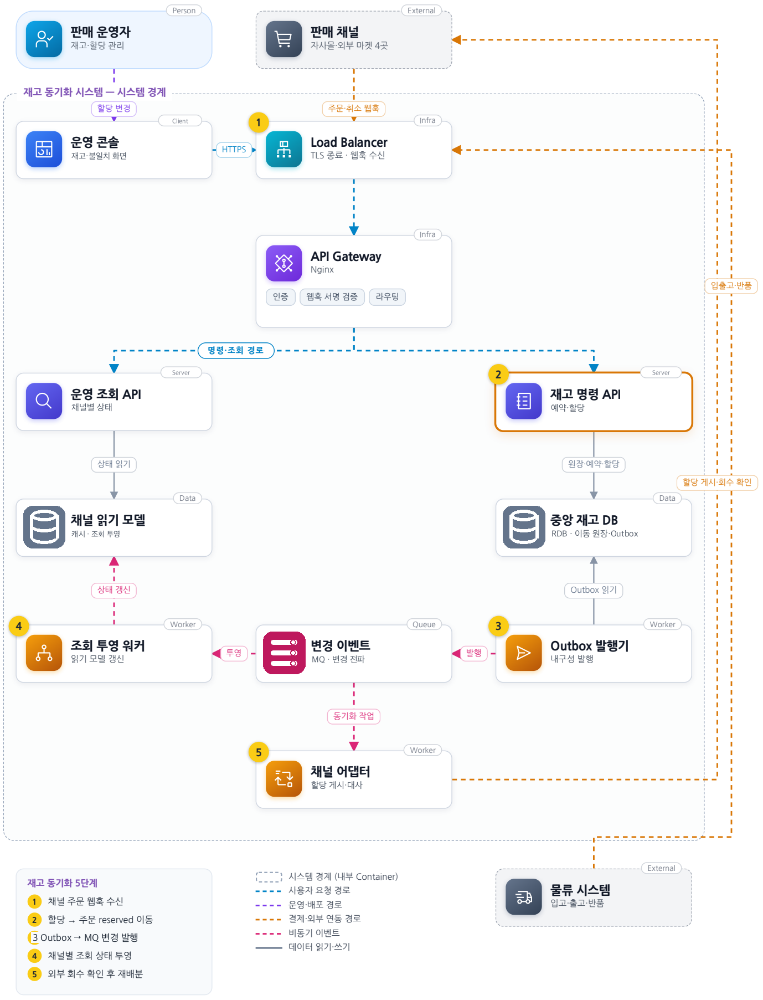
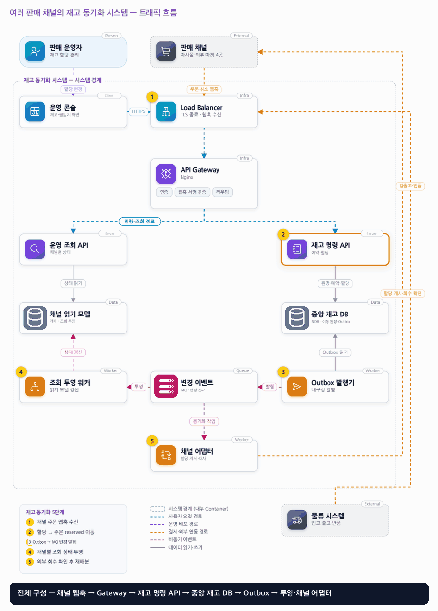

# 09. 여러 판매 채널의 재고 동기화 시스템

- **난이도**: 고급
- **규모**: SKU 100만 개 · 채널 5개 · 피크 주문 5,000건/초
- **핵심 요약**: 여러 판매 채널의 재고 동기화 시스템 · 중앙 재고 = 유일 권한 · Outbox · 채널 회수 확인 후 재배분

## 1. 문제

### 요구사항

1. 단일 거점·100만 SKU·채널 5개, 입고·출고·예약·취소·반품은 불변 이동 원장
2. 채널별 판매 할당 분리, 중앙 가용량은 on_hand에서 예약·할당·안전재고를 뺀 값
3. 주문 수락 시 할당→reserved 이전, 출고 시 on_hand·reserved 감소
4. 반품은 검수 전 판매 재고로 되돌리지 않고, 취소·출고 경합 시 출고분은 반품절차
5. 강제 할당·갱신 확인·주문 조회 계약 안에서 과판매 통제, 미지원 채널·분실은 보상

### 문제 정의

자사몰과 외부 마켓 4곳에 같은 재고를 복사하면 실제보다 더 주문받는다. 일부 채널은 웹훅이 늦고 재고 API가과거 요청을 뒤늦게 적용한다. 팀 8명이 중앙 재고와 채널별 수량을 추적한다.

## 2. 설계

### 01 아키텍처 드라이버

독립 판매 채널이 같은 물량을 약속할 수 있고 외부 갱신 결과가 불명확하다.

### 02 품질 속성

| 속성 | 목표 |
|---|---|
| 성능 | 중앙 예약 p95 300ms, 정상 채널 갱신 p95 30초 |
| 정합성 | 중앙 승인 시 음수 가용량·중복 재고 이동 0건, 주문 라인은 한 번만 예약 |
| 추적성 | 실물 오차는 별도 deficit 상태로 드러낸다 |

### 03 아키텍처 택틱

- 채널 할당으로 판매 권한 분할 · 예약은 (SKU, 채널) 할당 행의 조건부 UPDATE(`WHERE 할당 ≥ 수량`), 다중 SKU는 SKU ID 순 잠금
- 감소 확인 전 재할당 금지 · 재할당은 회수 중 → 채널 확인 → 확정 → 증가의 사가, 불명은 조회로 수렴
- 원장 대사 · 중앙 원장·할당 합계 대사와 채널 수량 조회 대사(stale write 교정)
- 웹훅 중복·역전 흡수 · (채널, 이벤트 ID) 유일 키, 짝 없는 취소는 보류 후 주문 도착 시 상쇄

### 04 아키텍처 스타일

**이벤트 기반 허브와 채널 어댑터** — 중앙 재고 서비스가 약속량을 소유하고 채널 어댑터가 외부 수량 게시를 맡는다

### 05 아키텍처 패턴

**CQRS + Transactional Outbox** — 가용량 쓰기 모델과 운영 조회 투영을 분리하고 채널 어댑터로 외부 동기화를 한다

### 06 트레이드오프

| 대안 | 평가 |
|---|---|
| 동일 재고를 모든 채널에 복제 | 노출량은 높지만 같은 물량을 중복 약속한다. 할당 분배로 안전성을 얻고 활용률을 희생 |
| 중앙 실시간 확인만 허용 | 자사몰엔 강하나 외부 마켓은 그 계약이 없을 수 있어 할당·대사·제한적 보장을 택한다 |

### 07 아키텍처 결정

- 중앙 재고 명령이 예약·할당의 유일한 권한이며 채널 할당 회수 확인 뒤에만 다른 채널로 옮긴다
- Outbox 이벤트로 조회 투영과 외부 동기화를 분리하고 외부 API 계약에 따라 보장 범위를 명시한다
- 주문 라인은 (채널, 주문 ID, 라인 ID) 유일 키로 한 번만 예약하고, 예약·취소·출고 전이는 예약 라인 행을 잠근 뒤 허용 전이만 적용한다 · 취소와 출고가 겹치면 먼저 커밋한 쪽이 성립하고 출고 뒤 취소는 반품 절차로 전환
- 채널 게시는 (SKU, 채널)마다 증가 시퀀스를 붙이고 같은 SKU의 연속 변경은 최신 값으로 합쳐 게시한다 · 시퀀스를 지원하지 않는 채널은 주기 대사로 수량을 조회해 다르면 재게시
- 재할당은 사가로 처리한다 · 중앙에서 A 할당을 "회수 중"으로 표시(가용량에서 제외) → 어댑터가 A에 감소 게시 → A 갱신 확인 → 중앙 A 할당 확정 감소 → B 할당 증가 → B 게시. 확인 불명은 조회 반복, 실패는 회수 중 해제로 보상

#### 예약 라인 상태

| 상태 | 뜻 | 허용 전이 |
|---|---|---|
| RESERVED | 채널 할당에서 이전된 약속 | 출고 → SHIPPED · 취소 → CANCELLED(할당 복귀) |
| SHIPPED | on_hand·reserved 감소 | 취소 요청 → RETURN_PENDING (반품 절차, 재고 복귀 없음) |
| CANCELLED | 할당으로 복귀 | 없음 |
| RETURN_PENDING → RETURNED | 검수 전 판매 재고 미복귀 → 검수 후 on_hand 복귀 | 검수 결과에 따라 |
| PENDING_CANCEL | 주문보다 먼저 온 취소 웹훅 보류 | 주문 도착 → 예약 없이 상쇄 · 보류 시한 경과 → 운영 확인 |

#### 동시성 처리 흐름

1. **예약**: 채널 주문 웹훅이 오면 (채널, 이벤트 ID) 유일 키로 중복을 거르고, 주문 라인마다 (채널, 주문, 라인) 유일 키로 예약 행을 만든다. 할당 이전은 SKU ID 오름차순으로 (SKU, 채널) 할당 행을 잠그며 `UPDATE allocation SET qty = qty - n WHERE sku=? AND channel=? AND qty >= n`으로 조건부 차감한다. 0행이면 그 주문은 과판매 후보이므로 거절·보상 경로로 보내고 전체 롤백한다. 고정 순서라 여러 SKU 주문이 겹쳐도 교착이 없다.
2. **웹훅 역전**: 취소가 주문보다 먼저 오면 PENDING_CANCEL로 보류한다. 뒤에 주문이 오면 예약을 만들지 않고 둘을 상쇄해 원장에 "주문·취소 상쇄"로 남긴다. 보류 시한(예: 1시간)이 지나도 주문이 안 오면 운영 확인 큐에 올린다. 주문이 두 번 오면 유일 키로 둘째는 무시한다.
3. **취소 vs 출고**: 물류의 출고 통지와 채널의 취소가 같은 예약 라인에 동시에 오면 행 잠금 아래 먼저 커밋한 쪽이 전이한다. 출고가 먼저면 취소는 RETURN_PENDING으로 바뀌어 반품 절차를 밟고 재고는 검수 전까지 복귀하지 않는다(요구사항 4). 취소가 먼저면 출고 통지는 "이미 취소"로 거절되고 운영 확인으로 간다(실물은 나갔을 수 있다).
4. **재할당 사가**: 재할당 ID로 상태(회수 중 → A 확인 → 확정 → B 증가 → B 게시 완료)를 저장한다. "회수 중" 단계에서 A의 해당 수량은 중앙 가용량에서 즉시 빠지므로 B에 더해지기 전까지 어느 채널도 그 물량을 약속하지 못한다. A의 갱신 확인이 타임아웃이면 채널 조회로 확인하고, 조회도 불명이면 사가를 보류한다. 확인 실패(채널이 감소를 거부)면 회수 중을 해제해 A로 되돌린다. B 증가는 A 확정 뒤에만 일어나므로 검증 2의 "A 감소 확인 전 B 증가 0건"이 구조적으로 성립한다.
5. **채널 stale write**: 어댑터는 (SKU, 채널)마다 시퀀스를 올려 게시하고, 같은 SKU에 변경이 몰리면 최신 값 하나로 합친다. 채널이 시퀀스를 지원하면 옛 요청은 채널이 버린다. 지원하지 않으면 채널이 과거 수량을 뒤늦게 적용할 수 있으므로 주기 대사가 채널 수량을 조회해 중앙 할당과 다르면 최신 값을 재게시한다. 이 창 동안의 과판매는 요구사항 5대로 보상으로 처리한다.
6. **Outbox와 투영**: 변경 이벤트는 최소 1회 전달이다. 조회 투영 워커는 (SKU, 채널) 버전이 더 클 때만 읽기 모델을 갱신하고, 채널 어댑터는 이벤트 ID로 중복 소비를 무시한다.
7. **실물 오차**: 출고 시 실물이 부족하면 on_hand를 음수로 만들지 않고 deficit 상태를 기록해 운영이 조정한다. 조정은 불변 이동 원장에 항목으로 남는다.

#### 멱등성 경계

| 경계 | 키 | 보장 |
|---|---|---|
| 채널 → 웹훅 수신 | (채널, 이벤트 ID) | 중복 웹훅 무시 |
| 주문 → 예약 | (채널, 주문 ID, 라인 ID) | 라인당 예약 1회 |
| 재고 명령 → 원장 | 이동 ID | 같은 이동 재적용 없음 |
| 어댑터 → 채널 게시 | (SKU, 채널, 시퀀스) | 채널 지원 시 옛 요청 폐기, 미지원 시 대사로 교정 |
| 재할당 | 재할당 ID + 단계 | 단계 재시도는 같은 단계에서 재개 |
| Outbox → 투영·어댑터 | 이벤트 ID / 버전 | 중복·역전 무시 |

### 08 결정 기록 (ADR-001 · 제안 · 구현 전 검증 필요)

- **맥락**: 독립 판매 채널이 같은 물량을 약속할 수 있고 외부 갱신 결과가 불명확하다
- **선택**: 중앙 가용량과 채널별 판매 할당을 구분하고 확인된 양만 이전한다
- **결과와 비용**: 읽기 모델 재구축·채널 대사 비용이 생기고, 외부가 할당을 강제하지 않으면 무과판매 약속 불가
- **재검토 조건**: 채널이 강제 할당·갱신 확인을 못 하면 보장 범위와 거래 조건을 재검토한다

### 검증

- 검증 1 실물 10개·채널 5개 동시 주문 → 강제 quota 계약 안에서 중앙 약속 합 <= 10, 주문 라인 중복 효과 0건
- 검증 2 A→B 재할당 중 응답 유실 → A 감소 확인 전 B 증가 0건, 재시도 후 할당 총합 보존
- 검증 3 취소 웹훅을 주문 웹훅보다 먼저 전송 → PENDING_CANCEL 보류 후 주문 도착 시 상쇄, 예약 0건, 할당 변화 0
- 검증 4 같은 주문 웹훅 3회 전송 → 예약 라인 1건, 할당 차감 1회
- 검증 5 출고 통지와 취소를 같은 라인에 동시 실행 → 종결 하나, 출고 선행 시 RETURN_PENDING, 취소 선행 시 출고 통지 거절·운영 확인 1건
- 검증 6 SKU {1,2,3}과 {3,2,1} 주문을 병렬 예약 → 교착 0건, 가용량 음수 0건
- 검증 7 채널에 옛 수량 요청을 뒤늦게 적용시킨 뒤 대사 실행 → 불일치 감지·최신 값 재게시, 재게시 후 채널 수량 = 중앙 할당

## 3. 전체 아키텍처 (System Context + Container)

여러 판매 채널의 재고 동기화 시스템 · 중앙 재고 = 유일 권한 · Outbox · 채널 회수 확인 후 재배분

### 트래픽 흐름

### 구성 요소

| 구분 | 이름 | 기술·역할 | 내부 요소 |
|---|---|---|---|
| Person | 판매 운영자 | 재고·할당 관리 |  |
| External | 판매 채널 | 자사몰·외부 마켓 4곳 |  |
| Client | 운영 콘솔 | 재고·불일치 화면 |  |
| Infra | Load Balancer | TLS 종료 · 웹훅 수신 |  |
| Infra | API Gateway | Gateway | 인증 · 웹훅 서명 검증 · 라우팅 |
| Server | 운영 조회 API | 채널별 상태 |  |
| Server | 재고 명령 API | 예약·할당 |  |
| Data | 채널 읽기 모델 | 캐시 · 조회 투영 |  |
| Data | 중앙 재고 DB | RDB · 이동 원장·Outbox |  |
| Worker | 조회 투영 워커 | 읽기 모델 갱신 |  |
| Queue | 변경 이벤트 | MQ · 변경 전파 |  |
| Worker | Outbox 발행기 | 내구성 발행 |  |
| Worker | 채널 어댑터 | 할당 게시·대사 |  |
| External | 물류 시스템 | 입고·출고·반품 |  |

### 재고 동기화 5단계

1. 채널 주문 웹훅 수신
2. 할당 → 주문 reserved 이동
3. Outbox → MQ 변경 발행
4. 채널별 조회 상태 투영
5. 외부 회수 확인 후 재배분
