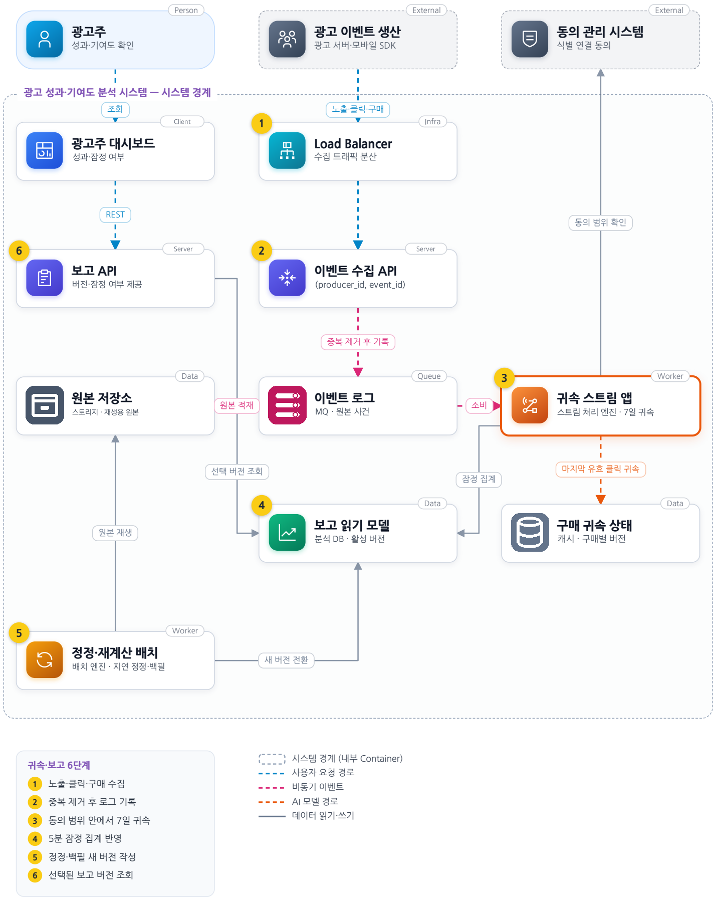
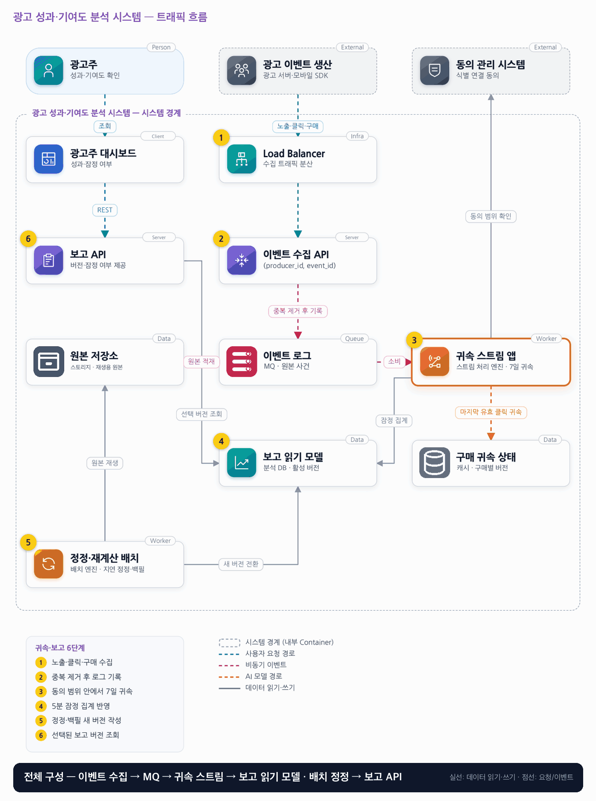

# 10. 광고 성과·기여도 분석 시스템

- **난이도**: 고급
- **규모**: 일 10억 이벤트 · 보고 목표 5분
- **핵심 요약**: 광고 성과·기여도 분석 시스템 · 스트림 잠정치 + 배치 정정 · 보고 버전 전환 · 동의 범위 귀속

## 1. 문제

### 요구사항

1. 노출·클릭·구매·구매 취소 처리, producer_id와 event_id로 중복 정의
2. 구매 전 7일 이내 마지막 유효 클릭에 귀속, 같은 시각은 event_id 고정 정렬
3. 최대 7일 늦은 이벤트를 정정에 포함, 지연 허용 7일과 클릭 귀속 창 7일은 별도
4. 식별 연결은 허용된 광고주 범위·동의 상태 안에서만, 연결 불가 구매는 미귀속
5. 5분 보고는 잠정치, 확정 시점·초과 지연 처리·모델 버전 노출, 과금 원장은 별도

### 문제 정의

광고주 대시보드의 구매 수가 다음 날 바뀐다. 모바일 SDK가 오프라인 이벤트를 늦게 보내며 구매 취소와 중복전송도 있다. 팀 8명이 5분 보고와 재현 가능한 월별 분석을 함께 제공한다.

## 2. 설계

### 01 아키텍처 드라이버

빠른 보고와 최대 7일 늦은 이벤트 정정 및 재계산이 동시에 필요하다.

### 02 품질 속성

| 속성 | 목표 |
|---|---|
| 성능 | 정상 수집 이벤트 보고 반영 p95 5분, 일 10억 이벤트 |
| 재현성 | 동일 입력 범위·규칙·모델 버전 재실행 시 같은 결과 |
| 정합성 | 모델·구매별 유효 귀속 최대 하나, 취소 구매 유효 매출 0 |

### 03 아키텍처 택틱

- 이벤트 시간 기준 처리
- 중복 제거 · (producer_id, event_id) 판정 저장소를 지연 허용 7일 + 여유만큼 보관
- 구매 키 파티션 직렬화 · 한 구매의 클릭·구매·취소는 한 처리기가 순서대로 상태를 갱신
- 버전별 정정 · 귀속 변경은 (구매, revision) 델타로 발행해 재시도에도 1회 집계
- 결과 전환 · 배치 버전은 스트림 도착분을 따라잡은 뒤 포인터를 원자 전환, 한 조회는 한 버전만 읽음

### 04 아키텍처 스타일

**이벤트 기반 스트림·배치 재계산** — 스트림 처리로 5분 잠정 보고를 내고 지연·모델 변경은 별도 배치 재계산 경로로 처리

### 05 아키텍처 패턴

**CQRS + 이벤트 로그 + 버전 정정** — 구매별 귀속은 쓰기 모델, 보고 집계는 읽기 모델이며 결과 포인터로 재계산본을 전환

### 06 트레이드오프

| 대안 | 평가 |
|---|---|
| 배치만 사용 | 재현은 쉽지만 5분 보고가 어렵다. 실시간 잠정과 버전 배치를 결합해 규칙을 공유한다 |
| 집계 숫자에 무조건 +1 | 중복·취소·귀속 변경에 취약하다. 구매별 상태와 정정 revision 보관 비용을 감수한다 |

### 07 아키텍처 결정

- 스트림이 구매별 상태를 갱신해 이전·신규 귀속 차이를 집계에 반영하고 원본은 배치 재생용으로 저장
- 지연 이벤트·모델 변경은 별도 재계산 경로에서 처리하고 정정·백필은 버전 검증 후 조회 포인터를 바꾼다
- 구매 상태 갱신과 귀속 델타(−이전 캠페인, +신규 캠페인) 기록은 한 트랜잭션이며 델타는 (구매 ID, revision)으로 멱등하다
- 구매보다 먼저 온 취소는 tombstone으로 보류하고 구매 도착 시 유효 매출 0으로 확정한다 · 보류 시한은 지연 허용 7일
- 배치 재계산은 원본 저장소에서 수집 시각 ≤ B(배치 시작)인 이벤트로 새 버전을 만들고, B 이후 스트림 델타를 새 버전에 재생해 따라잡은 뒤 활성 버전 포인터를 조건부 갱신(옛 버전 → 새 버전)한다 · 조회는 포인터를 한 번 읽어 그 버전으로만 끝까지 읽는다

#### 구매 귀속 상태

| 상태 | 뜻 | 전이 |
|---|---|---|
| ATTRIBUTED(캠페인, revision) | 7일 창 안 마지막 유효 클릭에 귀속 | 더 늦은 시각의 유효 클릭 도착 → revision+1, 캠페인 변경, 델타 발행 |
| UNATTRIBUTED | 창 안 유효 클릭 없음 또는 동의 범위 밖 | 지연 클릭 도착 → ATTRIBUTED |
| CANCELLED | 구매 취소 · 귀속은 유지하되 유효 매출 0 | 없음 (재구매는 새 구매 ID) |
| CANCEL_PENDING | 구매보다 먼저 온 취소 보류 | 구매 도착 → CANCELLED · 7일 경과 → 폐기·기록 |

#### 동시성 처리 흐름

1. **구매 단위 직렬화**: 스트림 파티션 키는 구매 식별에 쓰는 사용자 키다. 같은 사용자의 클릭·구매·취소는 한 처리기에 순서대로 들어오므로 구매 상태의 읽기 → 계산 → 쓰기가 교차하지 않는다. 잠금 없이 순서로 정합성을 얻는다.
2. **중복 제거**: 처리기는 (producer_id, event_id)를 판정 저장소에서 확인하고 처음 본 것만 처리한다. 저장소 보관 기간은 지연 허용 7일 + 여유(예: 8일)다. 그보다 짧으면 6일 늦게 온 중복이 새 이벤트로 들어온다. 하루 10억 건 × 8일의 키 보관이 이 설계의 고정 비용이다.
3. **귀속 변경과 델타**: 지연 클릭이 구매의 귀속을 캠페인 A에서 B로 바꾸면, 처리기는 구매 상태(B, revision+1)와 델타 두 건(A −1·−매출, B +1·+매출)을 한 트랜잭션으로 기록한다. 집계기는 델타를 (구매 ID, revision)으로 멱등 처리하므로 재시도나 재전달에도 한 번만 반영된다. 어떤 시점에도 한 구매의 유효 귀속은 최대 하나다.
4. **취소 역전**: 취소가 구매보다 먼저 오면 CANCEL_PENDING으로 보류한다. 구매가 오면 귀속은 계산하되 유효 매출 0인 CANCELLED로 바로 확정한다. 7일 안에 구매가 안 오면 폐기하고 기록만 남긴다.
5. **배치 재계산 인수인계**: 배치는 시작 시각 B를 기록하고 원본 저장소에서 수집 시각 ≤ B인 이벤트만으로 새 버전 V+1을 만든다. 그동안 스트림은 활성 버전 V에 계속 쓴다. 배치가 끝나면 B 이후 스트림이 발행한 델타를 V+1에 재생해 따라잡고, 차이가 임계값 아래로 줄면 포인터를 V → V+1로 조건부 갱신한다. 전환 뒤 스트림은 V+1에 쓴다. 이 절차가 없으면 배치가 도는 시간만큼의 데이터가 전환 순간 사라진다.
6. **조회 중 전환**: 보고 API는 요청 시작 시 포인터를 한 번 읽고 그 버전 번호를 모든 쿼리 조건에 넣는다. 전환이 중간에 일어나도 한 응답은 한 버전으로 일관된다. 옛 버전은 전환 후 일정 시간 보관해 진행 중 조회를 끝내게 한다.
7. **워터마크와 잠정·확정**: 워터마크 통과는 "대부분 도착"일 뿐 확정이 아니다. 보고는 각 값에 잠정(지연 허용 창 안)·확정(창 종료 후 배치 반영) 표시를 붙이고, 확정 시점과 모델 버전을 노출한다(요구사항 5).

#### 멱등성 경계

| 경계 | 키 | 보장 |
|---|---|---|
| SDK → 수집 API | (producer_id, event_id) | 7일 + 여유 보관으로 중복 폐기 |
| 처리기 → 집계 | (구매 ID, revision) | 델타 1회 집계 |
| 처리기 → 구매 상태 | 구매 ID + 파티션 직렬화 | 갱신 유실 없음 |
| 배치 → 버전 저장소 | 버전 ID (write-once) | 같은 배치 재실행은 같은 버전 덮어쓰기 |
| 포인터 전환 | 조건부 갱신(V → V+1) | 두 배치가 겹쳐도 한 번만 전환 |

### 08 결정 기록 (ADR-001 · 제안 · 구현 전 검증 필요)

- **맥락**: 빠른 보고와 최대 7일 늦은 이벤트 정정 및 재계산이 동시에 필요하다
- **선택**: 잠정 보고를 먼저 제공하고 지연·취소 시 이전 집계를 차감하고 새 결과를 반영한다
- **결과와 비용**: CQRS 재계산·백필·버전 전환 비용이 생기며 워터마크 통과가 확정이 아니므로 잠정 상태를 남긴다
- **재검토 조건**: 정정량·보존 비용·확정 지연이 허용 범위를 넘으면 지연 정책을 재검토한다

### 검증

- 검증 1 동일 데이터 재전송·순서 섞기 → 최종 구매 수·매출·귀속 캠페인 동일
- 검증 2 최대 지연·7일 창 경계 → 경계 포함 규칙과 약 14일 이력 접근을 검증
- 검증 3 같은 구매에 지연 클릭과 취소를 동시 주입 → 최종 상태 하나, 델타 합계가 집계와 일치, 유효 귀속 ≤ 1
- 검증 4 취소를 구매보다 먼저 전송 → CANCEL_PENDING 후 구매 도착 시 CANCELLED, 유효 매출 0, 구매 수 1
- 검증 5 같은 이벤트를 6일 뒤 재전송 → 중복 폐기, 집계 변화 0
- 검증 6 배치 재계산 중 스트림 이벤트 10만 건 주입 후 전환 → 전환 뒤 보고에 10만 건 전부 반영, 유실 0
- 검증 7 전환 중 대시보드 조회 1,000회 → 각 응답이 단일 버전, 버전 혼합 0건

## 3. 전체 아키텍처 (System Context + Container)

광고 성과·기여도 분석 시스템 · 스트림 잠정치 + 배치 정정 · 보고 버전 전환 · 동의 범위 귀속

### 트래픽 흐름

### 구성 요소

| 구분 | 이름 | 기술·역할 | 내부 요소 |
|---|---|---|---|
| Person | 광고주 | 성과·기여도 확인 |  |
| External | 광고 이벤트 생산 | 광고 서버·모바일 SDK |  |
| External | 동의 관리 시스템 | 식별 연결 동의 |  |
| Client | 광고주 대시보드 | 성과·잠정 여부 |  |
| Infra | Load Balancer | 수집 트래픽 분산 |  |
| Server | 보고 API | 버전·잠정 여부 제공 |  |
| Server | 이벤트 수집 API | (producer_id, event_id) |  |
| Data | 원본 저장소 | 스토리지 · 재생용 원본 |  |
| Queue | 이벤트 로그 | MQ · 원본 사건 |  |
| Worker | 귀속 스트림 앱 | 스트림 처리 엔진 · 7일 귀속 |  |
| Data | 보고 읽기 모델 | 분석 DB · 활성 버전 |  |
| Data | 구매 귀속 상태 | 캐시 · 구매별 버전 |  |
| Worker | 정정·재계산 배치 | 배치 엔진 · 지연 정정·백필 |  |

### 귀속·보고 6단계

1. 노출·클릭·구매 수집
2. 중복 제거 후 로그 기록
3. 동의 범위 안에서 7일 귀속
4. 5분 잠정 집계 반영
5. 정정·백필 새 버전 작성
6. 선택된 보고 버전 조회
