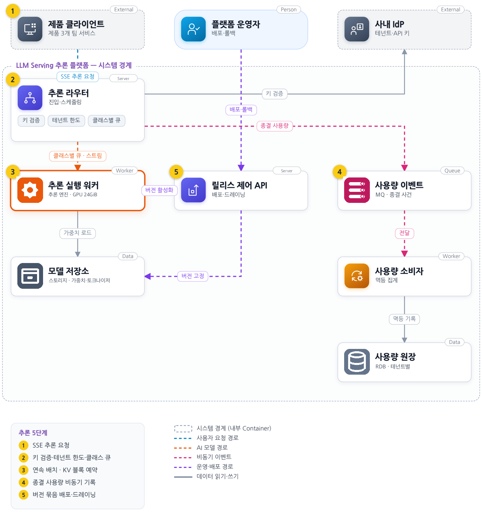
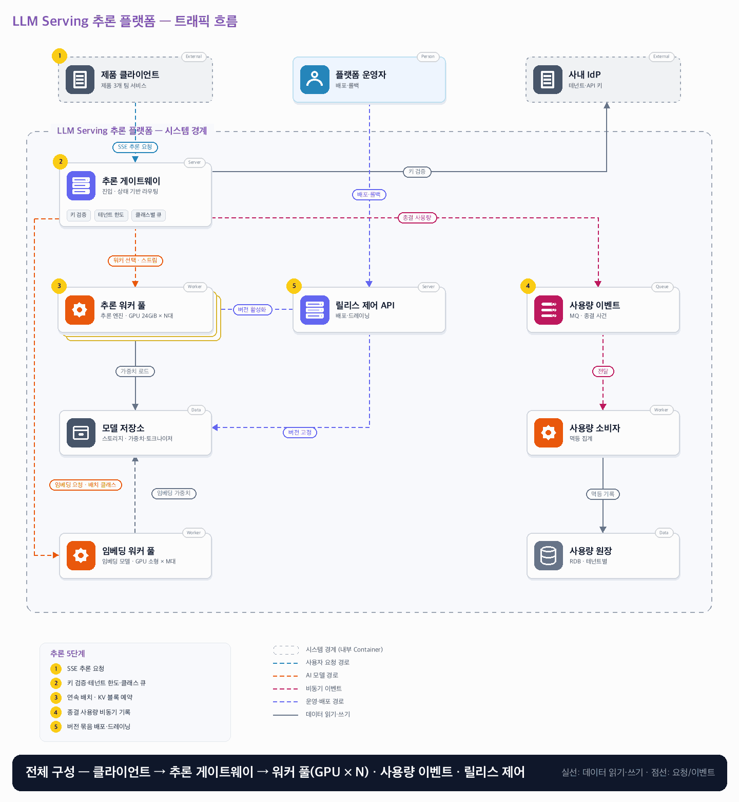

# 11. LLM Serving 추론 플랫폼

- **난이도**: 고급
- **규모**: 피크 20 RPS · 첫 토큰 p95 1.5초 목표
- **핵심 요약**: LLM Serving 추론 플랫폼 · 테넌트 한도 · 유한 큐 · 연속 배치·KV 예약 · 버전 묶음 배포

## 1. 문제

### 요구사항

1. SSE 스트리밍, 입력 8,192·출력 512 토큰 제한, 토크나이저·모델 버전 고정
2. 대화·배치 분리, 테넌트별 토큰·동시 요청 제한, 유한 큐·deadline 초과 미실행
3. 첫 토큰 전 인프라 실패는 남은 시간 내 1회 재시도, 이후 오류 종료·이어쓰기 금지
4. 취소·연결 종료를 워커로 전달, 실행 종료·KV 블록 반환은 워커 확인 후 처리
5. 요청·응답 원문은 기본 로그에 남기지 않고 모델 배포는 이전 버전으로 롤백 가능

### 문제 정의

제품 3개 팀이 동일한 8B 모델을 공유해 긴 문서 요약이짧은 대화까지 지연시킨다. GPU 24GiB 단위 배포, 단일리전 시작, 학습·검색 증강은 범위 밖이다.

## 2. 설계

### 01 아키텍처 드라이버

긴 입력과 짧은 대화가 GPU를 공유하며 첫 토큰 지연과 KV 메모리가 한정돼 있다.

### 02 품질 속성

| 속성 | 목표 |
|---|---|
| 성능 | 첫 토큰 p95 1.5초, 토큰 간 지연 p95 80ms(대기열·네트워크 포함) |
| 정합성 | 요청은 한 모델 버전에 고정, 테넌트 할당 한도를 넘겨 실행하지 않음 |

### 03 아키텍처 택틱

- 토큰 기준 유입 제한 · 테넌트 한도는 원자 카운터(INCR 후 초과면 DECR·거절), 진행 중 요청마다 만료 리스로 라우터 장애 누수 보정
- 작업군 격리
- 마감 시간 · 큐 대기 포함, deadline 경과 요청은 실행하지 않음
- 취소 전파와 워커 드레이닝 · 요청 상태 머신으로 종결 1회, 드레이닝 워커는 신규 admission 거절
- 시도 ID · 첫 토큰 전 재시도마다 시도 ID 증가, 라우터는 활성 시도 스트림만 수신, 과금은 이긴 시도만

### 04 아키텍처 스타일

**마이크로서비스 아키텍처(MSA)** — 추론 실행·릴리스 제어·사용량 기록을 독립 배포하고 GPU 스케줄러는 실행 내부에 둔다

### 05 아키텍처 패턴

**유한 작업 큐·Bulkhead·연속 배치** — 유한 대기열과 클래스 격리로 과부하를 제한하고 모델 버전은 요청 시작 시 고정한다

### 06 트레이드오프

| 대안 | 평가 |
|---|---|
| GPU 사용률로만 자동 확장 | GPU가 낮아도 대기·메모리가 병목일 수 있어 큐 나이·KV 사용량·SLO를 함께 본다 |
| prefill과 decode 즉시 분리 | 간섭은 줄지만 KV 전송·운영 복잡도가 늘어 동일 워커 기준선 측정 후 비교한다 |

### 07 아키텍처 결정

- 초기에는 동일 워커에서 prefill과 decode를 실행하고 요청 클래스별 유입을 제한한다
- 릴리스·사용량 기록을 실행 경로에서 분리하고 최종 사용량만 MQ로 전달한다
- 워커 admission은 스케줄러 한 곳에서 직렬로 KV 블록을 예약한다 · 예약 실패는 큐 대기, deadline 경과는 미실행 거절(429), 실행 중 KV 부족은 가장 최근 admission부터 선점·재큐잉
- 요청 종결은 상태 머신에서 한 번만 일어나며 사용량 이벤트는 (요청 ID, 시도 ID)로 1회 기록한다 · 취소가 유실되면 워커는 deadline까지 실행하고 그 사용량을 기록한다
- 버전 전환은 릴리스 제어가 활성 버전 포인터를 바꾸고 옛 버전 워커를 드레이닝으로 표시한다 · 드레이닝 워커의 신규 거절은 라우터가 다른 워커로 재배정하며 재시도 횟수에 세지 않음, 진행 중 요청은 시작 시 버전을 끝까지 사용

#### 요청 상태

| 상태 | 뜻 | 전이 |
|---|---|---|
| ADMITTED | 키·한도·클래스 큐 통과, 카운터 증가·리스 발급 | 워커 예약 성공 → RUNNING · 큐에서 deadline 경과 → REJECTED(미실행) |
| RUNNING(시도 n) | KV 예약, 토큰 생성 중 | 완료 → COMPLETED · 클라이언트 종료 → CANCELLING · 첫 토큰 전 워커 실패 → RUNNING(시도 n+1, 1회) · 첫 토큰 후 실패 → FAILED(이어쓰기 금지) |
| CANCELLING | 취소를 워커에 전달, 확인 대기 | 워커 확인 → CANCELLED · 확인 전 deadline → 워커 측 종료 후 CANCELLED |
| COMPLETED · CANCELLED · FAILED · REJECTED | 종결 · 카운터 감소, 리스 해제, 사용량 1회 기록 | 없음 |

#### 동시성 처리 흐름

1. **테넌트 한도**: 라우터는 테넌트별 동시 요청·토큰 카운터를 원자 증가시키고 한도를 넘으면 즉시 감소·거절한다. 여러 라우터가 동시에 검사해도 카운터가 한 곳이라 초과하지 않는다. 진행 중 요청마다 만료 리스(예: deadline + 여유)를 두고, 라우터가 죽어 감소를 못 하면 리스 만료 시 워커의 종결 보고와 대조해 보정한다.
2. **admission과 KV 예약**: 워커 스케줄러는 한 번에 하나씩 admission을 처리하며, 최대 출력 토큰 기준 KV 블록을 예약할 수 있을 때만 RUNNING으로 올린다. 예약이 안 되면 큐에서 기다리고, 기다리는 동안 deadline이 지나면 실행하지 않고 거절한다(요구사항 2). 연속 배치 중 실제 사용이 예약을 넘어 KV가 부족하면 가장 최근 admission을 선점해 재큐잉한다.
3. **취소 전파**: 클라이언트 연결이 끊기면 라우터가 요청을 CANCELLING으로 바꾸고 워커에 취소를 보낸다. 워커가 실행을 멈추고 KV를 반환했다고 확인하면 CANCELLED로 종결한다(요구사항 4). 취소 메시지가 유실되면 워커는 deadline까지 실행하고 종결 보고를 보내며, 그 시점에 CANCELLED로 종결한다. 종결은 상태 머신에서 한 번만 일어나므로 카운터 감소·사용량 기록도 한 번이다.
4. **첫 토큰 전 재시도와 좀비**: 첫 토큰 전에 워커 응답이 끊기면 라우터는 시도 ID를 올려 남은 시간 안에 다른 워커로 1회 재시도한다. 첫 워커가 사실 살아 있어 토큰을 내보내도 라우터는 활성 시도 ID가 아닌 스트림을 버리고 그 워커에 취소를 보낸다. 사용량은 이긴 시도만 테넌트에 과금하고, 버려진 시도는 인프라 낭비로 따로 기록한다. 첫 토큰이 이미 나간 뒤 실패는 재시도하지 않고 오류로 종료한다(이어쓰기 금지).
5. **버전 전환**: 릴리스 제어가 새 버전 워커를 띄우고 가중치 로드를 확인한 뒤 활성 버전 포인터를 바꾸고 옛 워커를 드레이닝으로 표시한다. 포인터를 캐시한 라우터가 드레이닝 워커로 보내면 워커가 admission을 거절하고 라우터는 포인터를 다시 읽어 다른 워커로 보낸다. 이 재배정은 아직 시도가 아니므로 재시도 횟수에 세지 않는다. 진행 중 요청은 시작 시 고정한 버전·토크나이저로 끝까지 간다. 롤백은 포인터를 되돌리는 같은 절차다.
6. **사용량 기록**: 종결 시 (요청 ID, 시도 ID, 토큰 수)를 MQ로 보내고 소비자는 유일 키로 멱등 기록한다. 최소 1회 전달이라 중복이 와도 원장은 1행이다.

#### 멱등성 경계

| 경계 | 키 | 보장 |
|---|---|---|
| 클라이언트 → 라우터 | 클라이언트 요청 ID | 미시작 요청의 재전송만 동일 요청으로 취급 · 토큰이 나간 뒤 재전송은 새 요청(이어쓰기 금지) |
| 라우터 → 워커 (admission) | (요청 ID, 시도 ID) | 같은 시도 중복 전달은 무시 |
| 워커 → 라우터 (스트림·종결 보고) | 시도 ID | 비활성 시도 스트림 폐기 |
| 라우터 → 카운터 | 요청 ID + 리스 | 증가·감소 각 1회, 누수는 리스 만료로 보정 |
| 워커 → 사용량 MQ → 원장 | (요청 ID, 시도 ID) | 유일 키로 1행 |
| 릴리스 제어 → 포인터 | 조건부 갱신(v → v+1) | 두 배포가 겹쳐도 한 번만 전환 |

### 08 결정 기록 (ADR-001 · 제안 · 구현 전 검증 필요)

- **맥락**: 긴 입력과 짧은 대화가 GPU를 공유하며 첫 토큰 지연과 KV 메모리가 한정돼 있다.
- **선택**: 초기에는 동일 워커에서 prefill과 decode를 실행하고 요청 클래스별 유입을 제한한다.
- **결과와 비용**: 실행 경로 RPC·스트림 취소가 복잡해진다. GPU 수는 혼합 길이 벤치마크와 장애 여유로 정한다.
- **재검토 조건**: 혼합 부하에서 지연 목표를 지속 위반하면 두 단계 분리와 KV 전송 비용을 비교한다.

### 검증

- 검증 1 짧은 대화+긴 문서 혼합 → 길이별 TTFT·토큰 간 지연·완료율·거절률을 함께 측정
- 검증 2 워커 1대 종료 → 첫 토큰 전후 실패 의미가 다르고 재시도 상한을 지킴
- 검증 3 테넌트 한도 10에서 요청 50건 동시 → 실행 ≤ 10, 거절 40, 라우터 1대 강제 종료 뒤 리스 만료로 카운터 복원
- 검증 4 토큰 스트리밍 중 클라이언트 연결 종료 → 워커 확인 후 KV 반환, 사용량 기록 1건, 취소 메시지 차단 시 deadline에 종결 1건
- 검증 5 첫 토큰 전 워커를 일시 정지 후 재개 → 재시도 1회, 재개된 워커의 토큰은 폐기, 테넌트 과금 1회, 낭비 기록 1건
- 검증 6 배포 전환 중 신규 요청 1,000건 → 드레이닝 워커 실행 0건, 진행 중 요청은 시작 버전 유지, 재배정은 재시도 횟수 미포함
- 검증 7 큐 대기 중 deadline 경과 요청 → 실행 0, GPU 사용 0, 429 응답

## 3. 전체 아키텍처 (System Context + Container)

LLM Serving 추론 플랫폼 · 테넌트 한도 · 유한 큐 · 연속 배치·KV 예약 · 버전 묶음 배포

### 트래픽 흐름

### 구성 요소

| 구분 | 이름 | 기술·역할 | 내부 요소 |
|---|---|---|---|
| External | 제품 클라이언트 | 제품 3개 팀 서비스 |  |
| Person | 플랫폼 운영자 | 배포·롤백 |  |
| External | 사내 IdP | 테넌트·API 키 |  |
| Server | 추론 라우터 | 진입·스케줄링 | 키 검증 · 테넌트 한도 · 클래스별 큐 |
| Worker | 추론 실행 워커 | 추론 엔진 · GPU 24GiB |  |
| Server | 릴리스 제어 API | 배포·드레이닝 |  |
| Queue | 사용량 이벤트 | MQ · 종결 사건 |  |
| Data | 모델 저장소 | 스토리지 · 가중치·토크나이저 |  |
| Worker | 사용량 소비자 | 멱등 집계 |  |
| Data | 사용량 원장 | RDB · 테넌트별 |  |

### 추론 5단계

1. SSE 추론 요청
2. 키 검증·테넌트 한도·클래스 큐
3. 연속 배치 · KV 블록 예약
4. 종결 사용량 비동기 기록
5. 버전 묶음 배포·드레이닝
