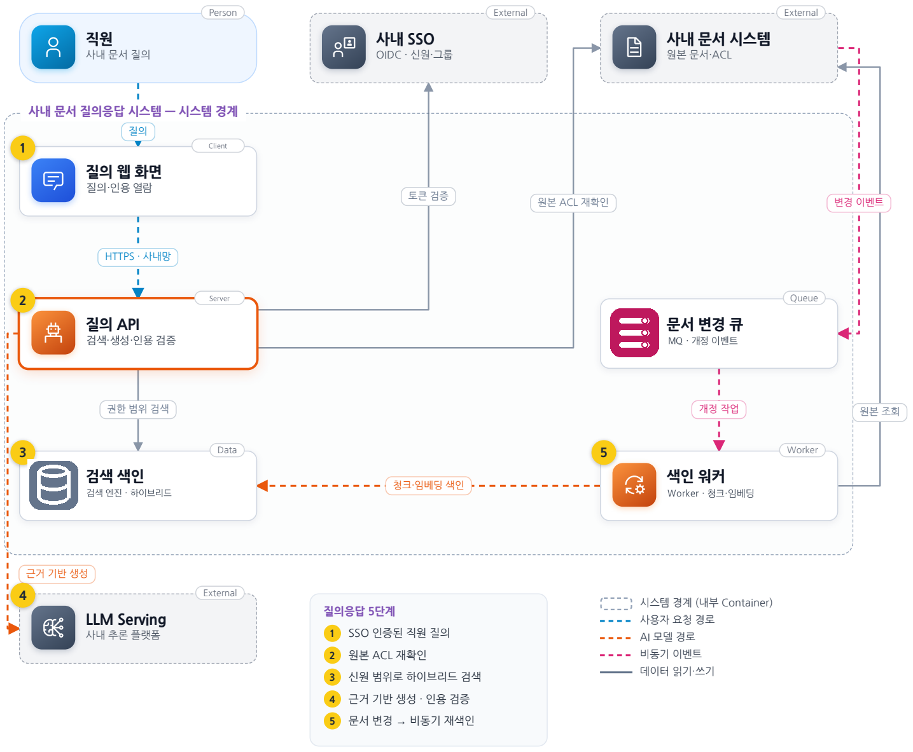
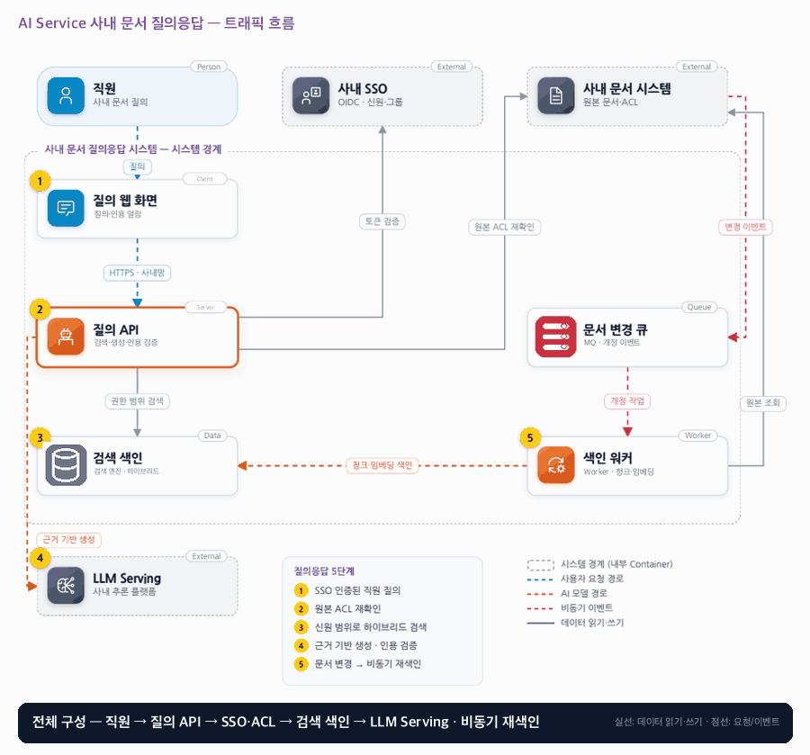

# 12. AI Service 사내 문서 질의응답

- **난이도**: 고급
- **규모**: 직원 5천 명 · 문서 20만 개 · 피크 30 RPS
- **핵심 요약**: AI Service 사내 문서 질의응답 · 권한 범위 검색 · 원본 ACL 재확인 · 근거 인용 · 임베딩 버전 고정 · 비동기 색인

## 1. 문제

### 요구사항

1. 수집 시 원본 ID·버전·페이지·ACL 참조 보존, 삭제·개정 시 기존 조각 비활성화
2. 검색 후보·캐시는 테넌트·권한 범위로 분리, 컨텍스트 구성·반환 직전 원본 권한 재확인
3. 질문·문서 본문은 비신뢰 입력, 문서 지시를 권한이나 도구 명령으로 해석하지 않음
4. 근거 부족·상충 시 답변 보류 또는 충돌 출처 표시, 링크는 볼 수 있는 문서만 반환
5. 버퍼링한 답변을 검증 후 한 번에 반환, 스트리밍으로 보낸 내용은 회수 불가로 가정

### 문제 정의

여러 부서가 사내 규정·매뉴얼을 질의하며 같은 제목의 개정 문서와 팀별 접근 제한이 있다. 출처 없는 답을 피하고 권한 회수 뒤 금지 문서를 인용하지 않는다. 실행형 도구는 제외.

## 2. 설계

### 01 아키텍처 드라이버

문서 버전과 접근 권한이 변하며 답변의 근거를 확인할 수 있어야 한다.

### 02 품질 속성

| 속성 | 목표 |
|---|---|
| 성능 | 답변 API p95 5초, 일반 문서 색인 반영 10분 목표 |
| 기밀성 | 접근 불가 문서는 모델 입력과 최종 인용에 들어가지 않음 |
| 정합성 | 반환 전 권한 확인이 선형화 기준, 권한 회수는 원본 권한 조회에서 거절 |

### 03 아키텍처 택틱

- 원본 권한 재검사 · 컨텍스트 구성 전과 반환 직전 두 번, 조회 실패는 닫힘(fail-closed)
- 검색 범위 제한 · 권한 범위 필터 + 문서별 활성 버전 포인터로 한 문서는 한 버전 조각만
- 답변 보류
- 출처 검증
- 버전 비교 색인 · (문서, 버전)이 더 클 때만 활성화, 삭제 tombstone 이후 개정은 무시, 조각 ID는 (문서, 버전, 순번, 임베딩 버전)으로 결정적
- 임베딩 버전 고정 · 질문 임베딩은 색인의 활성 임베딩 버전으로 계산, 임베딩 모델 교체는 새 색인에 전체 재색인을 마친 뒤 포인터 전환
- RAG 평가 분리 · 검색 품질(문맥 관련성·정밀도·재현율)과 생성 품질(근거 충실도·답변 관련성·인용 정확도)을 따로 재어 어느 레버를 당길지 정함, 검색 설정·프롬프트·임베딩 버전 변경은 골든 질문 세트 게이트를 통과해야 반영

### 04 아키텍처 스타일

**동기 질의 + 비동기 파이프라인** — 온라인 질의는 서비스 간 동기 호출, 수집·색인은 비동기 파이프라인으로 분리한다

### 05 아키텍처 패턴

**RAG·Policy Enforcement Point** — RAG 파이프라인으로 검색·생성하고 검색 전후 권한 검사를 분리한다

### 06 트레이드오프

| 대안 | 평가 |
|---|---|
| 파인튜닝에 문서 주입 | 응답 형식 개선엔 도움이나 즉시 개정·문서별 권한·출처 문제를 해결하지 않는다 |
| 벡터 검색만 사용 | 의미 검색엔 좋지만 사번·규정 번호 정확 일치가 약해 키워드와 혼합하고 평가로 선택 |
| 임베딩 모델을 질의 API에 내장 | 왕복은 줄지만 색인 워커와 모델·버전을 따로 들고 가게 돼 질문 벡터와 조각 벡터가 다른 공간에 놓일 수 있다. 사내 추론 플랫폼이 제공하는 임베딩 모델을 양쪽이 같은 버전으로 호출한다 |
| 리랭커·멀티턴 세션·답변 평가 루프 | 품질에는 도움이지만 요구사항 밖이라 단일 질의 범위로 고정하고, 권한 경계와 근거 부족·상충 처리를 먼저 검증한다 |

### 07 아키텍처 결정

- 허용된 최신 조각만 모델에 넣고 반환 직전 권한·근거를 검증한다
- 질의·응답에는 공유 캐시를 두지 않고 LLM 장애 시 권한 확인을 통과한 검색 결과만 반환한다
- 검색 후보 캐시는 (테넌트, 권한 범위 해시)로 키를 나누되 성능용일 뿐 보안 경계가 아니다 · 보안 경계는 반환 직전 원본 ACL 재확인이며, 재확인 조회 실패 시 보호 문서 조각은 전부 제외한다(fail-closed)
- 재색인은 새 버전 조각 삽입 → 문서 활성 버전 포인터를 조건부 갱신(더 큰 버전만) → 옛 조각 비활성화 순서로 하고, 검색은 활성 포인터와 일치하는 조각만 본다
- 권한 확인 사이(컨텍스트 구성 후, 반환 전)에 회수가 일어나면 해당 조각을 제거하고 남은 근거로 재생성하거나 근거 부족이면 보류한다 · 회수된 문서는 어떤 경우에도 인용되지 않음
- 질의 API는 RAG 오케스트레이터다 · 질문 임베딩 → 권한 범위 하이브리드 검색(후보 상한 20) → 원본 ACL 일괄 조회(2차) → 컨텍스트 구성 → 생성 호출 → 인용 검증·반환 직전 ACL 재확인(3차) → 보류 판단을 한 요청 안에서 순서대로 수행하고 요청 밖에 상태를 남기지 않는다
- 임베딩 모델은 생성 LLM과 별개 모델이며 둘 다 사내 추론 플랫폼(11장)이 제공한다 · 검색 색인은 활성 임베딩 버전 하나를 가리키고, 질문 임베딩은 요청 시작 시 읽은 그 버전으로 계산해 조각과 같은 벡터 공간에서 비교한다 · 임베딩 모델 교체는 새 색인에 20만 문서를 전부 재색인한 뒤 포인터를 바꾸는 전환이지 제자리 갱신이 아니다 · 재색인 기간에는 11장이 옛·새 임베딩 버전 풀을 함께 서빙하고, 옛 버전 폐기는 이 포인터 전환 뒤에 한다
- 원본 ACL 재확인은 문서 시스템의 일괄 조회 API 1회 호출이다 · 후보 상한 20이면 피크 30 RPS에서 초당 30회 호출·600건 문서 확인이 문서 시스템에 걸리는 부하이고, 이 한도를 문서 시스템 쪽과 합의하는 것이 전제다 · 타임아웃(예: 500ms)·부분 응답은 fail-closed로 보호 조각 전부 제외
- 임베딩 호출이 실패하면 키워드 검색만으로 후보를 만들고 답변에 의미 검색 미적용을 표시한다 · 권한 경계는 ACL 재확인이 지키므로 검색 방식 축소는 기밀성에 영향이 없다
- 검색 설정(top-k·청크 크기·하이브리드 가중치)·프롬프트·임베딩 버전은 하나의 질의 번들로 묶어 15장 평가 게이트를 거친다 · 게이트 지표는 RAG 전용 지표이며 근거 충실도 ≥ 0.9, 문맥 정밀도·답변 관련성은 현재 활성 대비 −3%p 이내 · 골든 질문 세트는 평가 전용 계정의 권한 범위 안 문서로만 만들고 평가 로그에도 ACL 재확인을 적용한다
- 질의 화면의 좋아요/싫어요와 인용 클릭은 (응답 ID, 사용자) 유일 키로 기록해 리뷰 큐로 보내고, 승인된 사례만 골든 질문 세트 새 버전에 들어간다 · 싫어요는 게이트가 아니라 재평가·리뷰 후보 신호다

#### 동시성 처리 흐름

1. **질의 경로의 두 검문**: 질의 API는 SSO 토큰 검증 뒤 권한 범위 필터로 검색하고(1차, 색인 기준·낡을 수 있음), 후보 조각의 원본 ACL을 원본 문서 시스템에 일괄 조회해 통과한 것만 컨텍스트로 만든다(2차). 생성이 끝나면 인용된 조각의 ACL을 다시 확인한다(3차, 반환 직전). 정합성의 선형화 기준은 3차다. 1차는 후보를 줄이는 용도라 낡아도 되고, 2차·3차가 실시간이다.
2. **생성 중 권한 회수**: 2차와 3차 사이에 회수가 일어나면 3차에서 걸린다. 걸린 조각을 빼고 남은 근거가 충분하면 재생성하고, 부족하면 보류 답변을 돌려준다. 버퍼링 후 반환이라 이미 나간 내용을 회수할 일이 없다(요구사항 5).
3. **ACL 조회 실패**: 원본 시스템이 응답하지 않으면 보호 문서 조각은 모두 제외하고 공개 범위 조각만으로 답하거나 보류한다. "확인 못 했으니 보여준다"는 경로는 없다.
4. **개정 이벤트 역전**: 문서 변경 큐는 문서 ID를 파티션 키로 해 같은 문서 이벤트가 한 워커에 순서대로 가지만, 재전달·재처리로 역전될 수 있다. 워커는 조각을 만든 뒤 활성 버전 포인터를 `UPDATE ... WHERE active_version < :v`로 갱신한다. 0행이면 더 새 버전이 이미 활성이므로 만든 조각을 비활성 상태로 남기고 끝낸다. 삭제는 tombstone 버전으로 기록되며 그 뒤 도착한 옛 개정은 같은 비교로 무시된다.
5. **개정 중 검색**: 검색은 조각의 (문서, 버전)이 문서 활성 포인터와 같은 것만 반환한다. 새 조각이 들어와도 포인터가 바뀌기 전까지는 옛 버전만 보이고, 바뀐 뒤에는 새 버전만 보인다. 두 버전이 섞이는 순간이 없으므로 "같은 제목 개정 문서 상충"은 색인 지연이 아니라 실제 내용 상충일 때만 발생한다.
6. **색인 멱등**: 조각 ID는 (문서, 버전, 순번, 임베딩 버전)으로 결정적이라 같은 이벤트를 두 번 처리해도 같은 ID에 덮어쓴다. 임베딩 재계산 비용은 들지만 중복 조각은 생기지 않는다.
7. **색인 지연 10분과 삭제**: 삭제된 문서가 색인에 남아 있는 최대 10분 동안 검색에는 나올 수 있다. 그러나 2차·3차 확인에서 원본이 "없음"을 돌려주므로 컨텍스트와 인용에서 빠진다. 색인 지연은 답변 품질 문제이지 기밀성 문제가 아니다.
8. **임베딩 버전 전환**: 임베딩 모델을 바꾸면 새 색인을 만들어 전체 문서를 새 버전으로 재색인하고, 끝나면 활성 임베딩 버전 포인터를 조건부 갱신한다. 질의는 요청 시작 시 포인터를 한 번 읽어 그 버전으로 질문을 임베딩하고 그 색인만 검색하므로 전환 중에도 한 요청 안에서 옛 벡터와 새 벡터가 섞이지 않는다. 재색인 도중 들어온 문서 변경 이벤트는 두 색인 모두에 필요하므로 색인 워커는 활성 버전과 준비 중 버전 양쪽에 조각을 쓴다(준비 중 버전이 없으면 하나만). 옛 색인은 전환 뒤 진행 중 요청이 끝날 시간만큼 보관한다.

#### RAG 평가 지표와 조정 레버

| 지표 | 묻는 것 | 낮을 때 당기는 레버 |
|---|---|---|
| 문맥 관련성·정밀도 | 검색된 조각이 질문에 맞는가, 쓸모없는 조각이 섞였는가 | top-k 축소, 하이브리드 가중치, 청크 크기, 리랭커 도입(현재 범위 밖) |
| 문맥 재현율 | 답에 필요한 조각이 빠졌는가 | top-k 확대, 청크 겹침, 임베딩 모델 교체(흐름 8) |
| 근거 충실도(faithfulness) | 답변이 검색 조각에만 근거하는가 | 프롬프트의 근거 제한 지시, 보류 임계 강화, 모델 등급 |
| 답변 관련성 | 질문에 답했는가 | 프롬프트, 질문 재작성 |
| 인용 정확도 | 인용한 조각이 실제 근거인가, 볼 수 있는 문서인가 | 인용 검증 규칙(결정적), 반환 직전 ACL 재확인 |
| 사용자 피드백 | 좋아요/싫어요, 인용 클릭, 재질문율 | 리뷰 큐 → 골든 질문 세트 환류 |

검색 지표가 낮으면 생성 쪽을 건드리지 않고, 충실도가 낮으면 검색 쪽을 건드리지 않는다. 두 지표를 같은 세트에서 함께 보지 않으면 레버를 잘못 당긴다. 규칙으로 재는 인용 검증과 PII는 판정자에 맡기지 않는다.

#### 멱등성 경계

| 경계 | 키 | 보장 |
|---|---|---|
| 문서 시스템 → 변경 큐 → 색인 워커 | (문서 ID, 버전, 이벤트 ID) | 중복 이벤트 무시, 역전은 버전 비교 |
| 색인 워커 → 검색 색인 | 조각 ID = (문서, 버전, 순번, 임베딩 버전) | 재색인 시 같은 ID 덮어쓰기 |
| 활성 버전 포인터 | 조건부 갱신(현재 < 새 버전) | 두 워커가 겹쳐도 큰 버전만 남음 |
| 직원 → 질의 API | 없음 (부수 효과 없는 읽기) | 재시도는 새 질의, 답변 캐시 없음 |
| 직원 → 피드백 → 리뷰 큐 | (응답 ID, 사용자) | 피드백 1회, 골든 세트는 버전으로만 증가 |
| 질의 API → 생성 LLM | 질의 ID | 타임아웃 재시도 1회, 결과 불일치는 허용 |
| 질의 API·색인 워커 → 임베딩 모델 | 없음 (같은 입력·버전이면 같은 출력, 부수 효과 없음) | 재시도 안전, 버전은 호출 시 명시 |
| 임베딩 버전 포인터 | 조건부 갱신(현재 < 새 버전) | 재색인 완료 전 전환 없음, 두 전환이 겹쳐도 한 번 |

### 08 결정 기록 (ADR-001 · 제안 · 구현 전 검증 필요)

- **맥락**: 문서 버전과 접근 권한이 변하며 답변의 근거를 확인할 수 있어야 한다.
- **선택**: 허용된 최신 조각만 모델에 넣고 반환 직전 권한·근거를 검증한다.
- **결과와 비용**: 권한 검증 왕복으로 지연이 늘 수 있다. 허용 후보를 일괄 확인하고 조회 실패 시 보호 답변 차단.
- **재검토 조건**: 색인·권한 조회 지연이 목표를 넘거나 스트리밍이 필요하면 보장 경계를 다시 정의한다.

### 검증

- 검증 1 권한 회수 후 오래된 색인 검색 → 보호 조각 컨텍스트·답변·인용 노출 0건
- 검증 2 개정 문서·정답 없음·상충 근거 → 최신 출처 선택, 근거 없으면 보류, 충돌은 명시
- 검증 3 v2·v3 변경 이벤트를 역순으로 처리 → 활성 버전 v3, v2 조각 비활성, 검색 결과에 v2 조각 0건
- 검증 4 재색인 중 검색 1,000회 → 각 응답에서 한 문서의 조각은 단일 버전, 혼합 0건
- 검증 5 컨텍스트 구성 직후 권한 회수 → 반환 직전 확인에서 제외, 답변·인용에 노출 0건, 재생성 또는 보류
- 검증 6 원본 ACL 조회를 차단 → 보호 문서 조각 전부 제외, 공개 문서만 답변 또는 보류, 노출 0건
- 검증 7 같은 변경 이벤트 3회 전달 → 조각 수 동일, 중복 조각 0건
- 검증 8 임베딩 모델 교체 중 질의 1,000회 → 각 요청의 질문 임베딩 버전과 검색된 조각의 임베딩 버전이 전부 일치, 혼합 0
- 검증 9 재색인 중 문서 개정 이벤트 → 옛·새 임베딩 색인 양쪽에 반영, 전환 뒤 유실 0
- 검증 10 임베딩 호출 차단 → 키워드 후보만으로 응답, 미적용 표시, 보호 문서 노출 0건
- 검증 11 피크 30 RPS → ACL 일괄 조회 호출 ≤ 30회/초, 요청당 후보 ≤ 20, 500ms 초과 시 보호 조각 전부 제외
- 검증 12 검색 top-k를 5 → 10으로 바꾼 질의 번들 → 문맥 정밀도 하락·재현율 상승 측정, 충실도 0.9 미만이면 반영 0
- 검증 13 근거 없는 질문 100건 → 보류 응답 비율과 근거 충실도 함께 보고, 충실도 유지 상태에서 보류율만 변동
- 검증 14 골든 질문 세트에 평가 계정 권한 밖 문서 인용 사례 주입 → 평가 로그·세트 저장에서 제외, 노출 0건
- 검증 15 같은 응답에 싫어요 2회 → 리뷰 큐 1건, 승인 전 골든 세트 변화 0

## 3. 전체 아키텍처 (System Context + Container)

AI Service 사내 문서 질의응답 · 권한 범위 검색 · 원본 ACL 재확인 · 근거 인용 · 임베딩 버전 고정 · 비동기 색인

### 트래픽 흐름

### 구성 요소

| 구분 | 이름 | 기술·역할 | 내부 요소 |
|---|---|---|---|
| Person | 직원 | 사내 문서 질의 |  |
| External | 사내 SSO | OIDC · 신원·그룹 |  |
| External | 사내 문서 시스템 | 원본 문서·ACL |  |
| Client | 질의 웹 화면 | 질의·인용 열람 | 좋아요/싫어요 · 인용 클릭 피드백 |
| Server | 질의 API | RAG 오케스트레이터 | 질문 임베딩 · 권한 범위 검색 · ACL 일괄 조회 · 컨텍스트 구성 · 생성 호출 · 인용 검증·보류 판단 |
| Queue | 문서 변경 큐 | MQ · 개정 이벤트 |  |
| Data | 검색 색인 | 검색 엔진 · 하이브리드 | 활성 임베딩 버전 포인터 · 문서별 활성 버전 포인터 |
| Worker | 색인 워커 | 청크 분할 · 임베딩 호출 · 조각 쓰기 | 활성·준비 중 임베딩 버전 양쪽 기록 |
| External | 사내 추론 플랫폼 | 11장 LLM Serving 추론 플랫폼 | 생성 LLM · 임베딩 모델(버전 고정) |

### 질의응답 5단계

1. SSO 인증된 직원 질의
2. 질문 임베딩 · 권한 범위 하이브리드 검색(후보 ≤ 20)
3. 후보 조각 원본 ACL 일괄 재확인
4. 근거 기반 생성 · 인용 검증 · 반환 직전 ACL 재확인
5. 문서 변경 → 청크 임베딩 → 비동기 재색인
