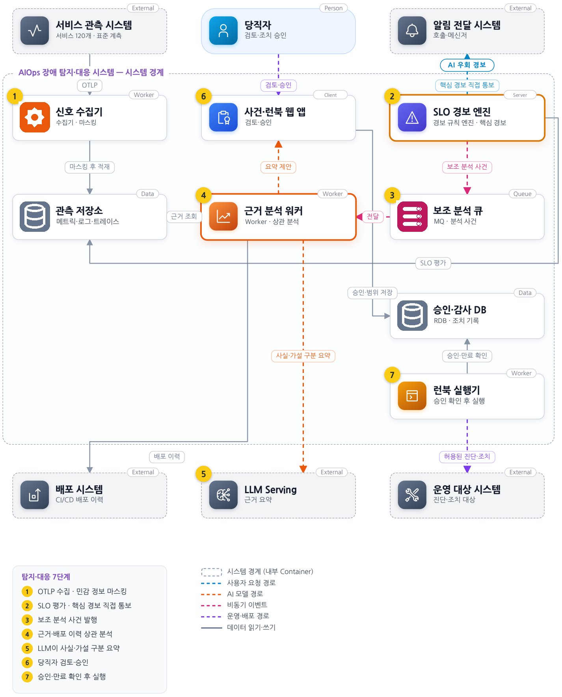
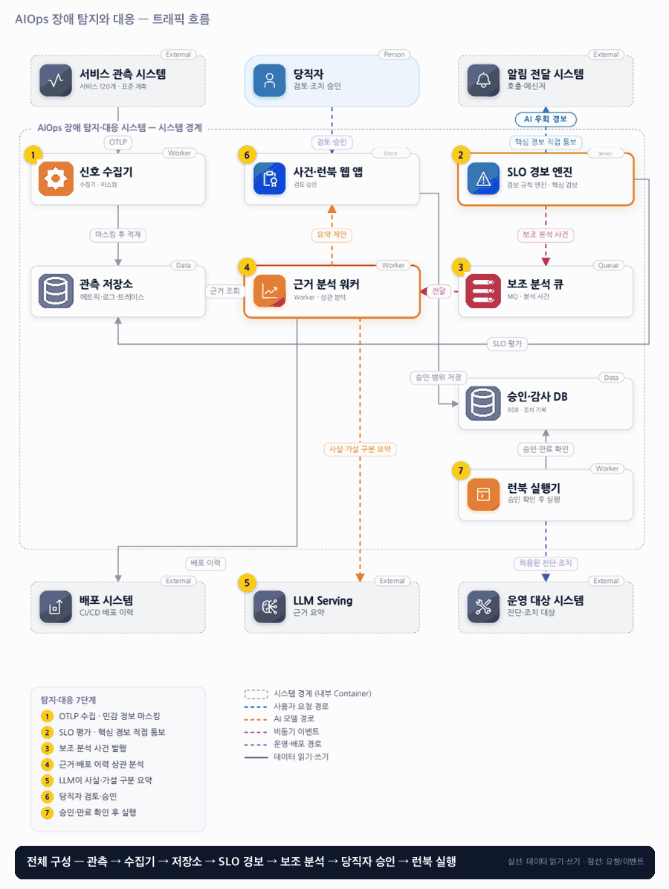

# 13. AIOps 장애 탐지와 대응

- **난이도**: 고급
- **규모**: 서비스 120개 · 로그 피크 2만 건/초
- **핵심 요약**: AIOps 장애 탐지와 대응 · 핵심 경보는 AI 우회 · 보조 분석 · 사람 승인 후 조치

## 1. 문제

### 요구사항

1. 서비스·환경·리전·배포 ID를 공통 속성으로 사용, 민감 필드는 수집 전 마스킹
2. 핵심 SLO 경보는 AI 분석 장애와 무관하게 당직자에게 전달, 사건 묶기는 원본 보존
3. 오류율·지연·유입량을 함께 보고 저트래픽·수집 누락을 정상으로 해석하지 않음
4. 요약은 관측 사실·원인 후보·확인 명령 구분, 변경은 승인된 대상·매개변수·만료 필요
5. 초기 자동 실행은 읽기 전용 진단만 허용, 재시작·롤백·확장은 사람이 승인

### 문제 정의

배포 직후 여러 서비스에서 경보가 동시에 울려 당직자가원인 후보와 영향을 파악하기 어렵다. 메트릭·로그·트레이스·배포 이력을 묶되 상관관계를 원인으로 단정하지 않는다.

## 2. 설계

### 01 아키텍처 드라이버

경보 폭주 속 핵심 경보를 유지하고 오진이 운영 변경으로 이어지는 것을 막아야 한다.

### 02 품질 속성

| 속성 | 목표 |
|---|---|
| 성능 | 핵심 SLO 위반을 관측 가능한 위반부터 2분 내 통보 |
| 가용성 | 모델 분석 실패가 핵심 경보를 막지 않음 |
| 안전성 | 승인 범위를 벗어난 변경을 실행하지 않음 |

### 03 아키텍처 택틱

- 경보 경로 격리 · 핵심 경보는 중복 통보를 허용(누락보다 중복), 알림 전달에서 (SLO, 창) 키로 최선 노력 중복 제거
- 수집 하트비트 · 데이터 없음은 정상이 아니라 결측 상태로 표시
- 승인 범위 제한 · 승인 행에 대상·버전·매개변수·만료를 고정
- 실행 전 상태 재검사 · APPROVED → EXECUTING 조건부 전이로 실행 1회, 결과 불명은 UNKNOWN으로 두고 자동 재시도 금지
- 사건 묶기 유일 키 · (그룹 키, 시간 창)으로 없으면 삽입, 원본 경보는 개별 보존

### 04 아키텍처 스타일

**관측 파이프라인 + 독립 대응 제어 경로** — 핵심 경보가 분석 모델·보조 MQ 가용성에 종속되지 않고 변경 제어 경계를 명시한다

### 05 아키텍처 패턴

**Human-in-the-loop·제한 런북** — AI는 근거 요약만 보조하고 변경은 승인 경로로 처리, 원본 경보와 요약을 별도 유지

### 06 트레이드오프

| 대안 | 평가 |
|---|---|
| LLM이 직접 로그를 보고 롤백 | 대응은 빠르나 오진과 권한 피해가 크다. 요약과 변경 실행을 분리한다 |
| 이상 탐지만으로 경보 | 기준선 변화에 취약하다. 고정 SLO 규칙과 보조 탐지를 함께 평가한다 |

### 07 아키텍처 결정

- SLO 경보는 독립 전달하고 AI는 근거 요약과 진단을 보조한다
- 런북 요청은 승인 후 실행 직전 대상·버전·만료를 확인하고 상태 불명 시 중복 변경하지 않는다
- 승인·실행은 승인 행의 상태 머신으로 직렬화한다 · 실행기는 `UPDATE approval SET state='EXECUTING', executor=? WHERE id=? AND state='APPROVED' AND expires_at > now()`로 claim하고 0행이면 실행하지 않음. 만료는 claim 시점에만 검사하며 진입한 실행은 끝까지 간다
- 실행 결과가 불명이면 UNKNOWN으로 기록하고 사람이 대상 상태를 확인해 DONE 또는 FAILED로 닫는다 · 어떤 경로로도 자동 재시도하지 않음
- 사건 그룹은 (서비스, 배포 ID, 증상, 시간 창) 유일 키로 생성하며 동시 도착 경보는 하나의 그룹에 붙는다 · 사건별 LLM 분석은 ANALYZING claim 1회, 요약은 버전을 붙여 최신만 표시

#### 승인 상태

| 상태 | 뜻 | 전이 |
|---|---|---|
| REQUESTED | 분석 워커 또는 당직자가 런북 제안 · 대상·버전·매개변수 고정 | 승인 → APPROVED(만료 시각 설정) · 거절 → REJECTED |
| APPROVED | 승인됨, 아직 실행 전 | claim 성공 → EXECUTING · 만료 → EXPIRED · 대상 버전 변경 감지 → INVALIDATED |
| EXECUTING | 실행기 하나가 claim, 실행 직전 대상·버전·매개변수 재검사 | 성공 → DONE · 실패 → FAILED · 응답 없음 → UNKNOWN |
| UNKNOWN | 명령은 나갔으나 결과 불명 | 사람 확인 → DONE 또는 FAILED · 자동 전이 없음 |
| DONE · FAILED · REJECTED · EXPIRED · INVALIDATED | 종결 · 감사 기록 | 없음 (재실행은 새 REQUESTED) |

#### 동시성 처리 흐름

1. **핵심 경보 경로**: SLO 엔진은 관측 저장소를 평가해 위반이면 알림 전달 시스템으로 바로 보낸다. 분석 큐·LLM·승인 DB가 모두 죽어도 이 경로는 동작한다. 엔진을 이중화하면 같은 위반이 두 번 통보될 수 있는데 누락보다 중복을 택하고, 알림 전달에서 (SLO, 평가 창) 키로 최선 노력 중복 제거만 한다. 수집 하트비트가 끊기면 "데이터 없음"을 결측으로 표시하고 정상으로 해석하지 않는다(요구사항 3).
2. **사건 묶기**: 배포 직후 같은 증상 경보가 수백 건 동시에 오면 각 경보는 원본 그대로 저장되고, 그룹은 (서비스, 배포 ID, 증상, 시간 창) 유일 키로 "없으면 삽입" 한다. 두 경보가 동시에 그룹을 만들려 해도 유일 키가 하나만 통과시키고 나머지는 기존 그룹에 붙는다. 원본은 묶기와 무관하게 개별 보존된다.
3. **분석 claim**: 보조 분석 큐에서 같은 사건을 두 워커가 꺼낼 수 있다. 워커는 사건 행을 `ANALYZING`으로 조건부 갱신해 하나만 분석한다. 실패하면 claim을 풀어 다른 워커가 잇는다. 요약은 사건에 버전을 붙여 저장하고 화면은 최신 버전만 보여주며, 이전 요약도 감사용으로 남는다. LLM 비결정성으로 요약이 달라도 "사실·가설·확인 명령" 구분은 유지된다.
4. **동시 승인**: 당직자 둘이 같은 제안을 승인하면 승인 행 잠금 아래 첫 승인만 REQUESTED → APPROVED로 전이하고 둘째는 "이미 승인됨"을 본다. 승인에는 대상·버전·매개변수·만료가 고정되며 감사 이력에 승인자가 남는다.
5. **실행 1회**: 실행기는 APPROVED이고 만료 전인 행만 EXECUTING으로 조건부 claim한다. 실행기가 여러 대여도 claim은 하나만 성공한다. claim 직후 대상의 현재 버전·매개변수를 다시 조회해 승인 시점과 다르면 실행하지 않고 INVALIDATED로 닫는다(검증 2). 같으면 실행한다. 만료 검사는 claim 시점에만 하므로 실행 도중 만료가 지나도 중단하지 않는다.
6. **결과 불명**: 명령을 보낸 뒤 응답이 없으면 UNKNOWN으로 기록하고 알림을 보낸다. 재시작·롤백 같은 변경은 두 번 하면 피해가 커지므로 자동 재시도는 어떤 경로에도 없다. 사람이 대상 상태를 확인해 DONE 또는 FAILED로 닫고, 필요하면 새 제안으로 다시 시작한다. 읽기 전용 진단만 자동 재시도가 허용된다(요구사항 5).
7. **권한·만료 변경 중 실행**: 승인자가 퇴사하거나 승인 정책이 바뀌어도 이미 EXECUTING에 들어간 실행은 영향받지 않는다. APPROVED 상태에서는 다음 claim 시 만료·정책을 다시 보므로 거기서 걸린다.

#### 멱등성 경계

| 경계 | 키 | 보장 |
|---|---|---|
| 관측 시스템 → 수집기 → 저장소 | (서비스, 신호, 시각) | 중복 적재는 같은 점 덮어쓰기 |
| SLO 엔진 → 알림 전달 | (SLO, 평가 창) | 최선 노력 중복 제거, 누락 없음 우선 |
| 경보 → 사건 그룹 | (서비스, 배포 ID, 증상, 창) 유일 키 | 그룹 1개, 원본은 개별 보존 |
| 분석 큐 → 분석 워커 | 사건 ID + ANALYZING claim | 분석 1회, 요약은 버전 |
| 당직자 → 승인 | 승인 ID + 상태 전이 | 중복 승인은 상태 검사에서 무동작 |
| 실행기 → 운영 대상 | 승인 ID + APPROVED→EXECUTING claim | 실행 1회, 불명은 UNKNOWN·재시도 없음 |

### 08 결정 기록 (ADR-001 · 제안 · 구현 전 검증 필요)

- **맥락**: 경보 폭주 속 핵심 경보를 유지하고 오진이 운영 변경으로 이어지는 것을 막아야 한다.
- **선택**: SLO 경보는 독립 전달하고 AI는 근거 요약과 진단을 보조한다.
- **결과와 비용**: 두 경로가 중복 경보·운영 비용을 늘린다. 원본 심각도·사건 묶기·수집 누락을 계측·감사한다.
- **재검토 조건**: 오탐·대응 개선 실측과 안전성 검증 후에만 저위험 자동 대응을 확대한다.

### 검증

- 검증 1 수집기·LLM 각각 종료 → 결측 표시와 핵심 경보 유지 확인
- 검증 2 승인 뒤 대상 버전 변경 → 실행 거절, 만료·변경된 파라미터도 차단
- 검증 3 당직자 2명이 같은 제안을 동시 승인하고 실행기 3대가 동시 claim → 승인 1회, 실행 1회, 나머지는 상태 검사에서 무동작
- 검증 4 실행 중 운영 대상 응답 차단 → UNKNOWN 1건, 자동 재시도 0회, 사람 확인 후 종결, 변경 명령 전송 횟수 1
- 검증 5 같은 증상 경보 1,000건 동시 주입 → 사건 그룹 1개, 원본 경보 1,000건 보존, 핵심 경보 통보 ≥ 1회
- 검증 6 보조 분석 큐에 같은 사건 2회 전달 → 분석 실행 1회 또는 요약 2버전 중 최신만 표시, 핵심 경보 지연 없음
- 검증 7 승인 만료 1초 전 claim → 실행 완료, 만료 1초 후 claim → EXPIRED, 실행 0

## 3. 전체 아키텍처 (System Context + Container)

AIOps 장애 탐지와 대응 · 핵심 경보는 AI 우회 · 보조 분석 · 사람 승인 후 조치

### 트래픽 흐름

### 구성 요소

| 구분 | 이름 | 기술·역할 | 내부 요소 |
|---|---|---|---|
| External | 서비스 관측 시스템 | 서비스 120개 · 표준 계측 |  |
| Person | 당직자 | 검토·조치 승인 |  |
| External | 알림 전달 시스템 | 호출·메신저 |  |
| Worker | 신호 수집기 | 수집기 · 마스킹 |  |
| Client | 사건·런북 웹 앱 | 검토·승인 |  |
| Server | SLO 경보 엔진 | 경보 규칙 엔진 · 핵심 경보 |  |
| Data | 관측 저장소 | 메트릭·로그·트레이스 |  |
| Worker | 근거 분석 워커 | Worker · 상관 분석 |  |
| Queue | 보조 분석 큐 | MQ · 분석 사건 |  |
| Data | 승인·감사 DB | RDB · 조치 기록 |  |
| Worker | 런북 실행기 | 승인 확인 후 실행 |  |
| External | 배포 시스템 | CI/CD 배포 이력 |  |
| External | LLM Serving | 근거 요약 |  |
| External | 운영 대상 시스템 | 진단·조치 대상 |  |

### 탐지·대응 7단계

1. OTLP 수집 · 민감 정보 마스킹
2. SLO 평가 · 핵심 경보 직접 통보
3. 보조 분석 사건 발행
4. 근거·배포 이력 상관 분석
5. LLM이 사실·가설 구분 요약
6. 당직자 검토·승인
7. 승인·만료 확인 후 실행
