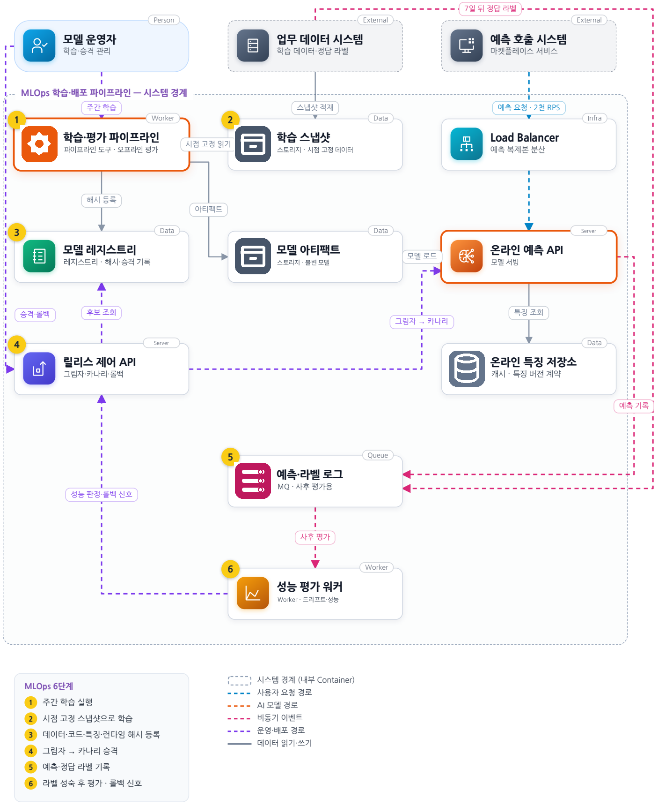
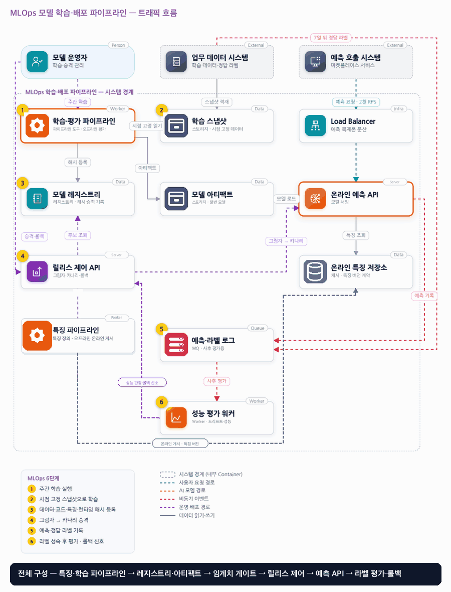

# 14. MLOps 모델 학습·배포 파이프라인

- **난이도**: 고급
- **규모**: 일 학습 데이터 2천만 행 · 예측 피크 2천 RPS
- **핵심 요약**: MLOps 모델 학습·배포 파이프라인 · 시점 고정 학습 · 해시 등록 · 그림자→카나리 · 라벨 성숙 후 평가

## 1. 문제

### 요구사항

1. 예측 시점까지 관측 가능했던 특징만 학습, 라벨 성숙 기간 반영해 학습·검증 기간 분리
2. 데이터·코드·특징·아티팩트·런타임 버전·해시 기록, 레지스트리 등록 시 자동 배포 금지
3. 데이터 품질·오프라인 평가·서빙 호환성·지연 검증 통과, 핵심 사용자군 품질 별도 비교
4. 그림자 배포는 사용자 결과 불변, 카나리는 일부 실제 제공하며 이전 릴리스로 롤백 가능
5. 분포 변화와 성능 저하 구분, 라벨 지연 시 기술 지표는 즉시·성능은 성숙 후 검증

### 문제 정의

마켓플레이스가 구매 전환 예측 모델을 매주 학습하며 전환 라벨은 최대 7일 뒤 확정된다. 배포 직후 정확도가 나빠졌지만 사용된 데이터·특징을 찾기 어렵다.

## 2. 설계

### 01 아키텍처 드라이버

라벨이 늦고 모델·특징·환경 변경을 추적하고 복구해야 한다.

### 02 품질 속성

| 속성 | 목표 |
|---|---|
| 성능 | 예측 p95 60ms |
| 추적성 | 버전 추적 누락 0건, 모든 예측은 불변 릴리스로 추적 |
| 복구성 | 롤백 5분 이내, 평가 미통과 후보는 운영 승격 금지 |

### 03 아키텍처 택틱

- 시점 기준 조인 · 쿼리 시간 필터가 아니라 불변 스냅샷 복사본(스냅샷 ID)으로 고정
- 승격 게이트 · 릴리스 상태 전이는 레지스트리 행 조건부 갱신, 자동 승격 금지
- 그림자 평가·카나리 · 자동 롤백은 카나리 기술 지표(지연·오류)에만, 품질 신호는 제안
- 버전 롤백 · 이전 릴리스를 warm 유지하고 포인터만 되돌림, 예측 로그에 사용 릴리스 기록
- 해시 유일 등록 · (데이터·코드·특징·런타임 해시) 묶음이 레지스트리 유일 키, 중복 실행은 1건으로 수렴

### 04 아키텍처 스타일

**학습 파이프라인 + 독립 온라인 예측** — 스냅샷·학습·평가·승격 의존 관계는 파이프라인, 온라인 서빙은 독립 배포한다

### 05 아키텍처 패턴

**Model Registry·Canary Release** — 불변 릴리스로 모델·특징·런타임을 함께 고정하고 단계적으로 승격한다

### 06 트레이드오프

| 대안 | 평가 |
|---|---|
| 최신 모델 파일 덮어쓰기 | 간단하지만 재현·복구가 어렵다. 불변 릴리스와 가변 트래픽 포인터를 분리 |
| 드리프트 즉시 재배포 | 오탐·계절성에 취약하다. 후보 재학습과 승격 판단을 분리한다 |

### 07 아키텍처 결정

- 자동 재학습은 후보까지 허용하고 검증된 릴리스만 단계적으로 승격한다
- 카나리에서 지연·오류를 먼저 확인하고 롤백 대상은 이전 모델·특징·런타임 묶음이다
- 릴리스 전이와 트래픽 포인터 변경은 `UPDATE ... WHERE state = :expected`·`WHERE active = :current` 조건부 갱신으로 하나만 성립한다 · 새 릴리스는 예측 API가 로드·워밍을 보고한 뒤에만 포인터 대상이 되고, 직전 릴리스는 롤백 창(최소 24시간) 동안 warm 유지
- 예측 로그는 예측 ID마다 사용한 릴리스 ID·특징 버전·요청 시각을 기록한다 · 특징 저장소 키에 특징 버전을 포함해 릴리스가 고정한 버전만 읽으며, 옛 버전은 그 버전을 쓰는 릴리스가 RETIRED될 때까지 삭제하지 않음
- 학습 스냅샷은 적재 워터마크 T를 경계로 불변 복사본을 뜨고 스냅샷 ID로 참조한다 · T 이후 도착한 T 이전 데이터는 다음 스냅샷에 포함되며 늦은 적재로 기록
- 성능 평가는 (릴리스, 평가 기간, 라벨 워터마크) 버전으로 저장하고 늦은 라벨 도착 시 새 버전으로 재계산한다 · 롤백 신호는 현재 활성 릴리스와 일치할 때만 제안으로 올리고 자동 실행하지 않음

#### 릴리스 상태

| 상태 | 뜻 | 전이 (주체) |
|---|---|---|
| CANDIDATE | 학습 완료, 해시 묶음 등록 | 품질·평가·호환성·지연 검증 통과 → VALIDATED (파이프라인) · 실패 → REJECTED |
| VALIDATED | 승격 가능 | 운영자 승인 → SHADOW |
| SHADOW | 실트래픽 복제 예측, 결과 미제공 | 기술 지표 통과 + 운영자 → CANARY · 실패 → REJECTED |
| CANARY | 일부 트래픽 실제 제공 | 운영자 승격 → ACTIVE · 지연·오류 임계 초과 → 자동 ROLLED_BACK(포인터 복귀) |
| ACTIVE | 전체 트래픽 | 새 릴리스 ACTIVE → PREVIOUS(warm 유지) · 운영자 롤백 → ROLLED_BACK |
| PREVIOUS | 직전 릴리스, 롤백 대상 | 롤백 → ACTIVE · 롤백 창 경과 → RETIRED |
| RETIRED · REJECTED · ROLLED_BACK | 종결, 아티팩트·해시는 보존 | 없음 |

#### 동시성 처리 흐름

1. **동시 승격·롤백**: 운영자 둘, 또는 운영자와 카나리 자동 롤백이 같은 릴리스를 동시에 바꾸려 하면 레지스트리 행의 `WHERE state = :expected` 조건부 갱신이 하나만 통과시킨다. 포인터도 `WHERE active_release = :current`로 바꾸므로 두 전환이 겹쳐도 한 번만 일어나고, 진 쪽은 현재 상태를 다시 읽는다. 모든 전이는 감사 이력에 주체와 함께 남는다.
2. **포인터 전환 중 예측**: 예측 API 인스턴스는 요청 시작 시 포인터를 읽어 그 릴리스로 끝까지 예측하고, 예측 로그에 릴리스 ID와 특징 버전을 기록한다. 전환 순간 두 릴리스의 예측이 공존하지만 각 예측은 어느 릴리스였는지 추적된다. 새 릴리스는 모든 인스턴스가 로드·워밍 완료를 보고한 뒤에만 포인터 대상이 되므로 첫 요청이 콜드 로드를 기다리지 않는다.
3. **롤백 5분**: 직전 릴리스를 PREVIOUS로 warm 유지하므로 롤백은 포인터를 되돌리는 조건부 갱신 하나다. 모델만이 아니라 특징 버전·런타임도 묶음으로 돌아간다. 롤백 창(최소 24시간)이 지나야 RETIRED로 내린다. 카나리의 지연·오류 임계 초과는 자동으로 이 절차를 밟고, 품질 저하는 사람이 판단한다.
4. **특징 버전 공존**: 특징 파이프라인이 v2를 게시해도 v1을 고정한 릴리스가 ACTIVE·PREVIOUS인 동안 v1 키는 유지된다. 예측은 릴리스가 고정한 버전의 키만 읽으므로 한 요청 안에서 v1·v2가 섞이지 않는다. 특징 값이 요청 중에 갱신되는 것은 허용되며(최신 값 사용), 버전만 섞이지 않으면 된다.
5. **시점 고정 스냅샷**: 주간 학습은 적재 워터마크 T를 정하고 T 이전에 적재된 행만 불변 스냅샷으로 복사한다. 쿼리의 시간 필터로 "T 이전"을 고르면 다음 주에 늦게 적재된 행이 끼어 같은 쿼리가 다른 결과를 낸다. 스냅샷 ID가 있어야 같은 입력으로 재학습·재현이 된다(검증 1). 특징도 예측 시점 이전 관측값만 조인한다.
6. **파이프라인 중복 실행**: 스케줄과 수동 실행이 겹치거나 재시도되면 같은 스냅샷·코드·특징·런타임으로 두 번 학습할 수 있다. 레지스트리는 네 해시 묶음을 유일 키로 하므로 둘째 등록은 기존 CANDIDATE를 돌려준다. 학습 비용은 중복될 수 있지만 후보가 둘 생기지는 않는다.
7. **늦은 라벨과 평가 재계산**: 라벨은 최대 7일 뒤 확정되고 그 뒤에도 정정될 수 있다. 평가 워커는 (릴리스, 기간, 라벨 워터마크) 버전으로 결과를 쌓고, 라벨이 더 오면 새 버전을 만든다. 성능 저하 신호가 나와도 그 릴리스가 이미 PREVIOUS·RETIRED면 기록만 남기고, ACTIVE와 일치할 때만 운영자에게 제안한다. 품질 신호로 자동 롤백하지 않는 것은 분포 변화와 성능 저하를 구분해야 하기 때문이다(요구사항 5).

#### 멱등성 경계

| 경계 | 키 | 보장 |
|---|---|---|
| 파이프라인 → 레지스트리 | (데이터·코드·특징·런타임 해시) | 중복 실행은 같은 CANDIDATE |
| 운영자·자동화 → 릴리스 상태 | 릴리스 ID + 기대 상태 | 전이 1회 |
| 릴리스 제어 → 트래픽 포인터 | 조건부 갱신(current → next) | 전환·롤백 1회 |
| 예측 API → 예측 로그 | 예측 ID | 중복 기록 없음, 릴리스·특징 버전 포함 |
| 업무 데이터 → 라벨 로그 | (엔티티, 이벤트) + 라벨 버전 | 최신 라벨만 유효, 정정 이력 보존 |
| 평가 워커 → 평가 결과 | (릴리스, 기간, 라벨 워터마크) | 같은 입력은 같은 결과, 늦은 라벨은 새 버전 |
| 특징 파이프라인 → 특징 저장소 | (엔티티, 특징 버전) | 버전별 키 공존, 릴리스 고정 버전만 읽음 |

### 08 결정 기록 (ADR-001 · 제안 · 구현 전 검증 필요)

- **맥락**: 라벨이 늦고 모델·특징·환경 변경을 추적하고 복구해야 한다.
- **선택**: 자동 재학습은 후보까지 허용하고 검증된 릴리스만 단계적으로 승격한다.
- **결과와 비용**: 이전 특징·런타임을 롤백 기간 동안 보존한다. 카나리 기술 지표와 성숙 후 품질 평가 분리.
- **재검토 조건**: 라벨 지연·트래픽 규모가 바뀌면 평가 기간과 승격 기준을 재검토한다.

### 검증

- 검증 1 미래 갱신된 특징 삽입 → 학습 조인에서 제외. 스냅샷으로 같은 입력 재현.
- 검증 2 카나리 지연·오류 주입 → 5분 내 이전 릴리스 전환 및 계약 복구 확인.
- 검증 3 운영자 승격과 자동 롤백을 같은 릴리스에 동시 실행 → 전이 1회, 포인터 변경 1회, 진 쪽은 현재 상태 재조회
- 검증 4 포인터 전환 중 예측 10만 건 → 모든 예측 로그에 릴리스 ID 기록, 단일 요청 안 특징 버전 혼합 0건, 콜드 로드 대기 0건
- 검증 5 스케줄·수동 학습을 같은 스냅샷으로 동시 실행 → 레지스트리 CANDIDATE 1건
- 검증 6 특징 v2 게시 중 v1 릴리스 예측 → v1 키만 읽음, v1 키 삭제 0건(v1 릴리스 RETIRED 전)
- 검증 7 스냅샷 T 이후 T 이전 데이터 늦은 적재 → 기존 스냅샷 불변·재학습 결과 동일, 늦은 적재는 다음 스냅샷에 포함
- 검증 8 PREVIOUS 릴리스에 대한 늦은 라벨로 성능 저하 신호 → 기록만, 자동 롤백 0, 운영자 제안 0 (ACTIVE 불일치)

## 3. 전체 아키텍처 (System Context + Container)

MLOps 모델 학습·배포 파이프라인 · 시점 고정 학습 · 해시 등록 · 그림자→카나리 · 라벨 성숙 후 평가

### 트래픽 흐름

### 구성 요소

| 구분 | 이름 | 기술·역할 | 내부 요소 |
|---|---|---|---|
| Person | 모델 운영자 | 학습·승격 관리 |  |
| External | 업무 데이터 시스템 | 학습 데이터·정답 라벨 |  |
| External | 예측 호출 시스템 | 마켓플레이스 서비스 |  |
| Worker | 학습·평가 파이프라인 | 파이프라인 도구 · 오프라인 평가 |  |
| Data | 학습 스냅샷 | 스토리지 · 시점 고정 데이터 |  |
| Infra | Load Balancer | 예측 복제본 분산 |  |
| Data | 모델 레지스트리 | 레지스트리 · 해시·승격 기록 |  |
| Data | 모델 아티팩트 | 스토리지 · 불변 모델 |  |
| Server | 온라인 예측 API | 모델 서빙 |  |
| Server | 릴리스 제어 API | 그림자·카나리·롤백 |  |
| Data | 온라인 특징 저장소 | 캐시 · 특징 버전 계약 |  |
| Queue | 예측·라벨 로그 | MQ · 사후 평가용 |  |
| Worker | 성능 평가 워커 | Worker · 드리프트·성능 |  |

### MLOps 6단계

1. 주간 학습 실행
2. 시점 고정 스냅샷으로 학습
3. 데이터·코드·특징·런타임 해시 등록
4. 그림자 → 카나리 승격
5. 예측·정답 라벨 기록
6. 라벨 성숙 후 평가 · 롤백 신호
