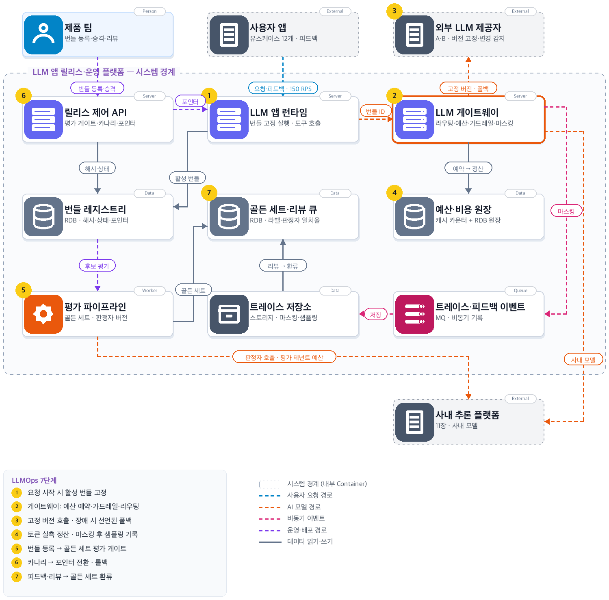
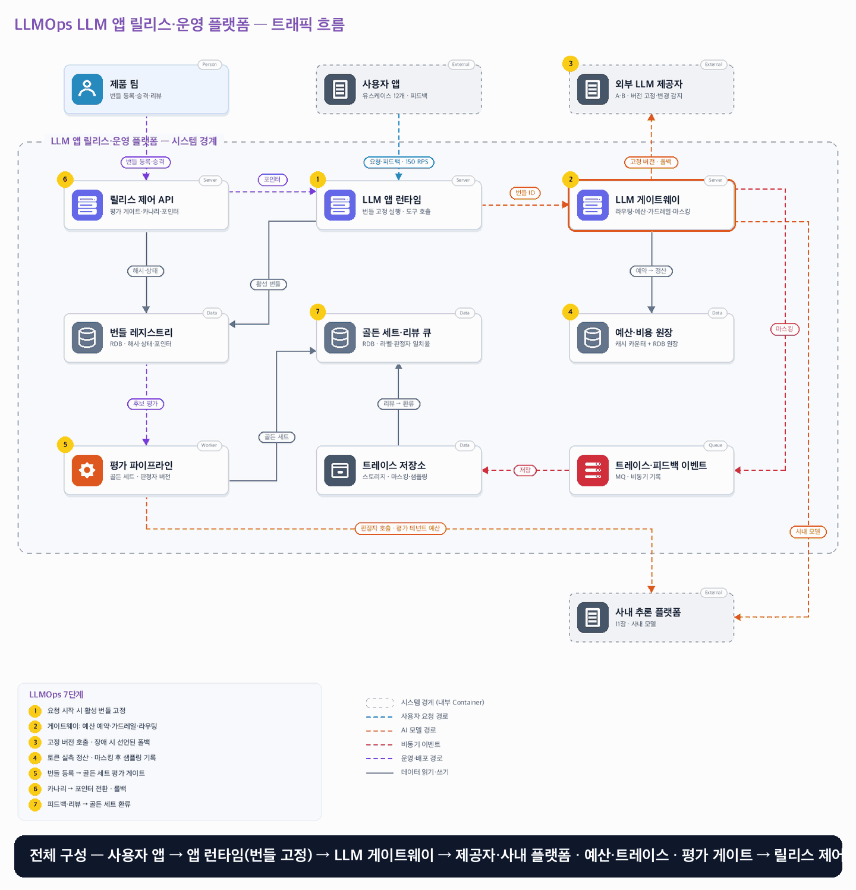

# 15. LLMOps LLM 앱 릴리스·운영 플랫폼

- **난이도**: 고급
- **규모**: 제품 팀 8개 · 유스케이스 12개 · 일 300만 호출 · 피크 150 RPS · 외부 제공자 2곳 + 사내 추론 플랫폼(11장) · 월 토큰 예산 팀별 배정
- **핵심 요약**: LLMOps LLM 앱 릴리스·운영 플랫폼 · 불변 앱 번들 · 골든 세트 평가 게이트 · LLM 게이트웨이(예산·가드레일·폴백) · 마스킹 트레이스 · 피드백 환류

## 1. 문제

### 요구사항

1. 프롬프트·모델(제공자·버전)·검색 설정·도구 목록·가드레일 정책을 하나의 불변 앱 릴리스 번들로 해시·버전 기록, 모든 응답은 번들 ID로 추적
2. 번들 변경은 골든 세트 평가(LLM 판정자 + 규칙 검사) 게이트를 통과해야 배포, 판정자 프롬프트·버전 기록, 사람 라벨 일치율 기준 미달 시 게이트 무효
3. 제공자 모델 버전 고정, 고정 불가 시 변경 감지 → 자동 재평가, 제공자 장애·한도 초과 시 번들에 선언된 대체 모델로만 폴백하고 응답에 폴백 표시
4. 팀·유스케이스별 토큰 예산·속도 제한, 초과 시 축소 모드(짧은 컨텍스트·저가 모델) 또는 거절, 비용은 응답마다 토큰으로 산정해 원장 기록
5. 입력·출력 가드레일(프롬프트 인젝션·PII·형식), 트레이스는 PII 마스킹 후 샘플링 저장(오류 100%), 사용자 피드백·사람 리뷰 결과가 골든 세트로 환류

### 문제 정의

제품 팀 여러 곳이 프롬프트를 코드에 박아 두고 각자 외부 LLM을 호출한다. 제공자가 모델을 바꾸자 요약 품질이 떨어졌는데 어떤 프롬프트·모델 조합이었는지 알 수 없고, 한 팀의 프롬프트 변경으로 토큰 비용이 하루 만에 4배가 됐다. 모델 학습(14장)·추론 인프라(11장)·검색 품질(12장)은 범위 밖.

## 2. 설계

### 01 아키텍처 드라이버

동작을 바꾸는 아티팩트가 여럿(프롬프트·모델·도구·가드레일·판정자)이고 그중 일부는 외부가 바꾼다. 변경을 추적·평가·되돌릴 수 있어야 하고 비용이 하루 단위로 폭증하지 않아야 한다.

### 02 품질 속성

| 속성 | 목표 |
|---|---|
| 추적성 | 모든 응답이 번들 ID·제공자·모델 버전·폴백 여부로 추적, 누락 0 |
| 품질 | 골든 세트 회귀 3%p 초과 번들은 배포 0건, 판정자·사람 라벨 일치율 ≥ 80% 유지 |
| 비용 | 팀 예산 초과 호출 0건, 축소 모드 전환 1분 내, 월 예산 대비 집계 오차 ≤ 1% |
| 성능 | 게이트웨이 추가 지연 p95 30ms, 폴백 전환 p95 2초 |
| 기밀성 | 트레이스·골든 세트에 마스킹 전 PII 0건 |

### 03 아키텍처 택틱

- 불변 번들 · (프롬프트, 모델·버전, 검색 설정, 도구 목록, 가드레일 정책, 폴백 목록)의 해시 묶음이 번들 ID, 요청 시작 시 활성 번들을 읽어 끝까지 고정
- 평가 게이트 · 골든 세트 버전과 판정자 버전을 결과 키에 포함, 판정자는 사람 라벨 일치율로 먼저 검정하고 미달이면 게이트를 무효로 판정
- 게이트웨이 집중 · 라우팅·예산·가드레일·마스킹·트레이스를 한 곳에서 처리, 제공자 추상화로 앱은 번들만 안다
- 예산 예약·정산 · 호출 전 추정 토큰을 원자 예약하고 응답 후 실측으로 정산, 리스로 게이트웨이 장애 누수 보정
- 선언된 폴백 · 폴백은 번들에 적힌 모델로만, 시도 ID로 1차 지연 응답 폐기·과금 1회
- 변경 감지 · 고정 프롬프트 샘플을 주기 호출해 응답 지문을 비교, 변화 시 재평가 1회 트리거
- 마스킹 후 샘플링 · 오류·가드레일 차단 100%, 정상 10%, 마스킹은 게이트웨이에서 저장 전에

### 04 아키텍처 스타일

**게이트웨이 중심 LLM 앱 플랫폼 + 릴리스 파이프라인** — 온라인 경로는 앱 런타임 → 게이트웨이 → 제공자로 동기, 번들 등록·평가·승격과 피드백 환류는 비동기 파이프라인

### 05 아키텍처 패턴

**Release Bundle Registry · Evaluation Gate · LLM Gateway** — 번들을 불변 릴리스로 승격하고(14장 패턴), 게이트웨이가 예산·가드레일·폴백을 집행하며(11장 게이트웨이와 역할 분리), 트레이스가 골든 세트로 돌아온다

### 06 트레이드오프

| 대안 | 평가 |
|---|---|
| 프롬프트를 앱 코드와 함께 배포 | 간단하지만 모델·가드레일과 따로 바뀌어 어떤 조합이 응답을 만들었는지 알 수 없다. 번들로 묶어 해시 하나로 추적한다 |
| 평가 없이 카나리로만 검증 | 사용자에게 회귀가 먼저 노출되고 품질 신호가 느리다. 골든 세트 게이트로 먼저 걸러 카나리는 비용·지연·안전 확인에 쓴다 |
| 판정자 점수를 그대로 신뢰 | 판정자도 LLM이라 프롬프트·모델이 바뀌면 점수가 흔들린다. 사람 라벨 일치율 검정과 판정자 버전 기록을 게이트 조건에 넣는다 |
| 제공자 폴백을 게이트웨이가 임의 선택 | 품질·비용·규정이 다른 모델로 몰래 바뀐다. 폴백 후보는 번들에 선언된 것만 쓰고 응답에 표시한다 |
| 트레이스 전량 저장 | 저장 비용이 추론 비용을 넘고 PII 노출면이 커진다. 마스킹 후 오류 100%·정상 10% 샘플링 |
| 11장 게이트웨이에 통합 | 11장은 GPU 워커 선택·KV admission이고 여기는 앱 번들·예산·제공자 추상화라 책임이 다르다. 사내 모델은 11장을 제공자 하나로 둔다 |

### 07 아키텍처 결정

- 번들 ID는 (프롬프트, 모델·버전, 검색 설정, 도구 목록, 가드레일 정책, 폴백 목록) 해시 묶음이며 레지스트리 유일 키다 · 같은 내용의 재등록은 기존 번들을 돌려주고, 번들은 수정 없이 새 번들로만 바뀐다
- 유스케이스마다 활성 번들 포인터가 있고 앱 런타임은 요청 시작 시 포인터를 한 번 읽어 그 번들로 끝까지 실행한다 · 응답·트레이스·비용 원장에 번들 ID를 기록한다
- 평가 게이트는 (번들, 골든 세트 버전, 판정자 버전)으로 결과를 저장한다 · 게이트 통과 조건은 규칙 검사(형식·금지어·PII) 전부 통과, 판정자 점수가 현재 활성 번들 대비 −3%p 이내, 판정자의 사람 라벨 일치율 ≥ 80% · 일치율 미달이면 결과는 "무효"로 저장되고 사람 리뷰로 넘어간다
- 승격은 VALIDATED → CANARY(유스케이스 트래픽 5% → 25%) → ACTIVE 순이며 카나리에서는 지연·오류·가드레일 차단율·요청당 토큰을 본다 · ACTIVE 전환과 롤백은 포인터 조건부 갱신(`WHERE active_bundle = :current`) 하나로 끝나고, 직전 번들은 롤백 창(7일) 동안 보존한다
- 게이트웨이는 호출 전 (테넌트, 유스케이스)의 예산 카운터를 추정 토큰(입력 실측 + 최대 출력)만큼 원자 예약한다 · 예약 실패면 번들에 정의된 축소 모드(컨텍스트 절반·저가 모델)로 재시도하고, 축소 모드도 실패면 거절한다 · 응답 후 실측 토큰으로 정산해 차액을 반환하고 비용 원장에 (요청 ID, 시도 ID)로 1행 기록한다
- 제공자 호출은 번들이 고정한 (제공자, 모델 버전)으로만 한다 · 타임아웃·5xx·429는 번들의 폴백 목록 순서대로 1회씩 시도하며 시도 ID를 올리고, 늦게 도착한 이전 시도 응답은 버린다 · 응답에는 실제 쓰인 모델과 폴백 여부를 표시한다
- 버전 고정이 안 되는 제공자는 변경 감지기가 고정 프롬프트 샘플 50건을 매시간 호출해 응답 지문(정규화 해시·길이·판정자 점수)을 비교한다 · 유의미한 변화면 그 제공자를 쓰는 활성 번들 전부에 재평가를 1회 걸고, 회귀면 운영자에게 롤백·폴백 전환을 제안한다
- 가드레일은 입력(인젝션 패턴·PII·길이)과 출력(PII·형식·금지어)을 게이트웨이에서 검사한다 · 차단은 응답 대신 정책 메시지를 돌려주고 트레이스에 100% 기록된다
- 트레이스는 게이트웨이가 마스킹한 뒤 MQ로 비동기 발행한다 · 저장소는 오류·차단 100%, 정상 10% 샘플링이며 요청 경로는 트레이스 저장을 기다리지 않는다
- 피드백(사용자 평가·사람 리뷰)은 (응답 ID, 리뷰어) 유일 키로 리뷰 큐에 쌓이고, 승인된 항목이 골든 세트 새 버전에 들어간다 · 골든 세트 버전이 오르면 활성 번들의 기준선을 그 버전으로 재평가해 다음 게이트 비교에 쓴다

#### 번들 상태

| 상태 | 뜻 | 전이 (주체) |
|---|---|---|
| REGISTERED | 해시 묶음 등록, 평가 전 | 평가 claim → EVALUATING (파이프라인) |
| EVALUATING | 골든 세트 평가 실행 중 (claim 1회) | 통과 → VALIDATED · 회귀·규칙 실패 → REJECTED · 판정자 일치율 미달 → NEEDS_REVIEW |
| NEEDS_REVIEW | 판정자 무효, 사람 리뷰 대기 | 리뷰 통과 → VALIDATED · 실패 → REJECTED |
| VALIDATED | 게이트 통과 | 운영자 승격 → CANARY |
| CANARY | 유스케이스 트래픽 5% → 25% | 단계 통과 → 확대 (자동) · 운영자 승인 → ACTIVE · 지연·오류·차단율·토큰 임계 초과 → 자동 ROLLED_BACK |
| ACTIVE | 전체 트래픽 | 새 번들 ACTIVE → PREVIOUS · 재평가 회귀 → 운영자 제안 · 롤백 → ROLLED_BACK |
| PREVIOUS | 직전 번들, 롤백 대상 (7일) | 롤백 → ACTIVE · 창 경과 → RETIRED |
| RETIRED · REJECTED · ROLLED_BACK | 종결, 해시·평가 결과 보존 | 없음 |

#### 동시성 처리 흐름

1. **포인터 전환 중 요청**: 앱 런타임은 요청 시작 시 유스케이스의 활성 번들 포인터를 한 번 읽고 그 번들로 프롬프트 조립·도구 호출·게이트웨이 호출을 끝까지 한다. 전환 순간 두 번들의 응답이 공존하지만 각 응답은 번들 ID로 추적된다. 전환과 롤백은 조건부 갱신이라 운영자 둘이 동시에 바꿔도 한 번만 성립한다(14장 패턴).
2. **예산 예약과 정산**: 게이트웨이 여러 대가 같은 테넌트 예산을 동시에 쓴다. 호출 전 추정 토큰을 원자 카운터에서 예약하고(INCRBY 후 한도 초과면 DECRBY·축소 모드), 응답 후 실측과의 차액을 반환한다. 예약마다 만료 리스를 두어 게이트웨이가 죽어 정산을 못 하면 리스 만료 시 원장과 대조해 되돌린다. 한도 근처에서 여러 요청이 동시에 예약하면 카운터가 한 곳이라 합계가 한도를 넘지 않는다. 축소 모드는 번들에 정의된 것만 쓰므로 "조용히 다른 모델"이 되지 않는다.
3. **폴백과 지연 응답**: 1차 제공자가 타임아웃이면 시도 ID를 올려 폴백 모델을 호출한다. 1차가 뒤늦게 응답하면 활성 시도가 아니므로 버리고, 비용 원장에는 이긴 시도만 테넌트에 과금하며 버려진 시도는 낭비로 따로 기록한다(11장과 같은 규칙). 스트리밍 중 실패는 폴백하지 않고 오류로 끝낸다(이어쓰기 금지).
4. **평가 claim과 결과 버전**: 등록 직후 스케줄과 수동 실행이 겹칠 수 있다. 평가 파이프라인은 번들 행을 `EVALUATING`으로 조건부 갱신해 하나만 실행한다. 결과는 (번들, 골든 세트 버전, 판정자 버전) 키로 저장되므로 세트나 판정자가 바뀌면 새 결과가 생기고 옛 결과는 비교에 쓰지 않는다. 판정자 호출도 게이트웨이를 거치며 "평가" 테넌트 예산을 쓰므로 평가 폭주가 제품 예산을 먹지 않는다.
5. **판정자 무효**: 평가마다 판정자를 사람 라벨 30건으로 먼저 검정한다. 일치율이 80% 미만이면 그 평가는 무효로 저장되고 번들은 NEEDS_REVIEW로 간다. 판정자 프롬프트·모델이 바뀌면 현재 활성 번들을 같은 판정자로 다시 돌려 기준선을 만든 뒤에만 비교한다.
6. **제공자 변경 감지와 재평가 폭주**: 변경 감지기가 변화를 보면 그 제공자를 쓰는 활성 번들 전부에 재평가를 건다. 번들마다 claim이 1회이므로 감지가 중복 발화해도 평가는 한 번이다. 재평가는 평가 테넌트 예산 안에서 순서대로 돌고, 회귀가 나온 번들만 운영자 제안이 된다. 자동 롤백은 카나리 기술 지표에만 있고 품질 회귀는 사람이 판단한다.
7. **가드레일 차단과 트레이스**: 입력 차단은 제공자 호출 전이라 예약을 즉시 반환한다. 출력 차단은 토큰을 이미 썼으므로 정산은 하고 응답만 정책 메시지로 바꾼다. 차단은 트레이스 100% 기록 대상이며 마스킹 뒤 발행된다. 트레이스 MQ가 밀려도 요청 경로는 기다리지 않고, 소비자가 (요청 ID, 시도 ID) 유일 키로 멱등 저장한다.
8. **피드백 환류와 세트 버전**: 같은 응답에 대한 피드백·리뷰는 (응답 ID, 리뷰어) 유일 키로 한 번만 반영된다. 승인된 항목은 골든 세트 새 버전으로만 들어가고 기존 버전은 불변이다. 세트 버전이 오르면 활성 번들을 새 버전으로 재평가해 기준선을 갱신한다. 진행 중인 평가는 시작 시 읽은 세트 버전으로 끝까지 간다.

#### 멱등성 경계

| 경계 | 키 | 보장 |
|---|---|---|
| 제품 팀 → 번들 레지스트리 | 번들 해시 묶음 | 같은 내용 재등록은 기존 번들 |
| 파이프라인 → 평가 결과 | (번들, 골든 세트 버전, 판정자 버전) + EVALUATING claim | 평가 1회, 결과는 버전 |
| 운영자·자동화 → 번들 상태 | 번들 ID + 기대 상태 | 전이 1회 |
| 릴리스 제어 → 활성 번들 포인터 | 조건부 갱신(current → next) | 전환·롤백 1회 |
| 게이트웨이 → 예산 카운터 | 요청 ID + 리스 | 예약·정산 각 1회, 누수는 리스로 보정 |
| 게이트웨이 → 제공자 | (요청 ID, 시도 ID) | 비활성 시도 응답 폐기, 과금은 이긴 시도만 |
| 게이트웨이 → 비용 원장 | (요청 ID, 시도 ID) | 1행 |
| 게이트웨이 → 트레이스 MQ → 저장소 | (요청 ID, 시도 ID) | 중복 발행도 1건 |
| 사용자·리뷰어 → 골든 세트 | (응답 ID, 리뷰어) | 피드백 1회, 세트는 버전으로만 증가 |
| 변경 감지기 → 재평가 | (제공자, 감지 창) + 번들 claim | 감지 중복에도 번들당 평가 1회 |

### 08 결정 기록 (ADR-001 · 제안 · 구현 전 검증 필요)

- **맥락**: 동작을 바꾸는 아티팩트가 여럿이고 일부는 외부가 바꾼다. 추적·평가·롤백과 비용 통제가 함께 필요하다.
- **선택**: 불변 번들과 골든 세트 게이트로 릴리스를 통제하고, 게이트웨이가 예산·가드레일·폴백을 집행하며, 마스킹된 트레이스가 골든 세트로 환류한다.
- **결과와 비용**: 번들 레지스트리·평가 인프라·판정자 검정에 운영 부담이 생기고 게이트웨이가 모든 호출의 경로가 된다(가용성 설계 필요). 골든 세트는 사람이 계속 가꿔야 한다.
- **재검토 조건**: 유스케이스가 늘어 평가 비용이 제품 비용의 일정 비율을 넘거나, 제공자가 버전 고정을 모두 지원하면 변경 감지기를 줄인다. 에이전트형 도구 호출이 늘면 도구 권한을 번들 밖 정책으로 분리한다.

### 검증

- 검증 1 같은 내용의 번들을 두 팀이 동시 등록 → 레지스트리 1건, 두 등록 모두 같은 번들 ID
- 검증 2 포인터 전환 중 요청 10만 건 → 모든 응답에 번들 ID, 한 요청 안 번들 혼합 0, 전환·롤백 각 1회
- 검증 3 테넌트 예산 잔여 1만 토큰에 추정 3천 토큰 요청 10건 동시 → 예약 성공 ≤ 3건, 나머지 축소 모드 또는 거절, 합계 한도 초과 0
- 검증 4 게이트웨이 1대 강제 종료 → 리스 만료 뒤 예약 누수 0, 원장과 카운터 일치
- 검증 5 1차 제공자 타임아웃 뒤 지연 응답 주입 → 폴백 응답 1건, 지연 응답 폐기, 테넌트 과금 1회, 낭비 기록 1건, 응답에 폴백 표시
- 검증 6 골든 세트에서 −5%p 회귀 번들 → VALIDATED 전이 0, REJECTED, 사유 기록
- 검증 7 판정자 사람 라벨 일치율 70%로 검정 → 평가 무효, NEEDS_REVIEW, 게이트 통과 0
- 검증 8 판정자 프롬프트 변경 → 활성 번들 기준선 재평가 후에만 비교, 이전 결과 참조 0
- 검증 9 제공자 모의 변경(샘플 응답 지문 변화) → 해당 번들 재평가 각 1회, 감지 3회 중복에도 평가 중복 0
- 검증 10 프롬프트 인젝션·PII 입력 1,000건 → 입력 차단, 제공자 호출 0, 예약 반환, 트레이스 100% 기록
- 검증 11 트레이스 MQ 10분 지연 → 요청 지연 영향 0, 복구 후 유실 0, 중복 저장 0
- 검증 12 저장된 트레이스·골든 세트 전수 검사 → 마스킹 전 PII 0건
- 검증 13 같은 응답에 리뷰 2회 → 골든 세트 반영 1회, 세트 버전 +1, 활성 번들 재평가 1회
- 검증 14 카나리에서 요청당 토큰 2배 주입 → 자동 롤백, 포인터 복귀 5분 내, ACTIVE 응답 영향 0

## 3. 전체 아키텍처 (System Context + Container)

LLMOps LLM 앱 릴리스·운영 플랫폼 · 불변 앱 번들 · 골든 세트 평가 게이트 · LLM 게이트웨이(예산·가드레일·폴백) · 마스킹 트레이스 · 피드백 환류

### 트래픽 흐름

### 구성 요소

| 구분 | 이름 | 기술·역할 | 내부 요소 |
|---|---|---|---|
| Person | 제품 팀 | 번들 등록·승격·리뷰 |  |
| External | 사용자 앱 | 유스케이스 12개 · 피드백 |  |
| External | 외부 LLM 제공자 | A·B · 버전 고정·변경 감지 대상 |  |
| External | 사내 추론 플랫폼 | 11장 LLM Serving · 사내 모델·판정자 |  |
| Server | LLM 앱 런타임 | 번들 고정 실행 | 프롬프트 조립 · 도구 호출 · 응답에 번들 ID |
| Server | LLM 게이트웨이 | 라우팅·예산·가드레일·마스킹 | 제공자 추상화 · 예산 예약·정산 · 입력·출력 가드레일 · 폴백(시도 ID) · 변경 감지기 · 트레이스 발행 |
| Server | 릴리스 제어 API | 평가 게이트·카나리·포인터 | 번들 상태 머신 · 카나리 비율 · 조건부 포인터 전환 · 자동 롤백(기술 지표) |
| Data | 번들 레지스트리 | RDB · 해시·상태·포인터 | 번들 해시 유일 키 · 유스케이스별 활성 포인터 · 감사 이력 |
| Data | 골든 세트·리뷰 큐 | RDB · 라벨·판정자 일치율 | 세트 버전(불변) · 사람 라벨 · 리뷰 큐 · 판정자 검정 결과 |
| Data | 예산·비용 원장 | 캐시 카운터 + RDB 원장 | (테넌트, 유스케이스) 원자 카운터·리스 · (요청, 시도) 비용 1행 |
| Worker | 평가 파이프라인 | 골든 세트 · 판정자 버전 | EVALUATING claim · 규칙 검사 · 판정자 호출(평가 테넌트) · (번들, 세트, 판정자) 결과 |
| Queue | 트레이스·피드백 이벤트 | MQ · 비동기 기록 |  |
| Data | 트레이스 저장소 | 스토리지 · 마스킹·샘플링 | 오류·차단 100% · 정상 10% · 번들·시도 계보 |

### LLMOps 7단계

1. 요청 시작 시 활성 번들 고정
2. 게이트웨이: 예산 예약·가드레일·라우팅
3. 고정 버전 호출 · 장애 시 선언된 폴백
4. 토큰 실측 정산 · 마스킹 후 샘플링 기록
5. 번들 등록 → 골든 세트 평가 게이트
6. 카나리 → 포인터 전환 · 롤백
7. 피드백·리뷰 → 골든 세트 환류
