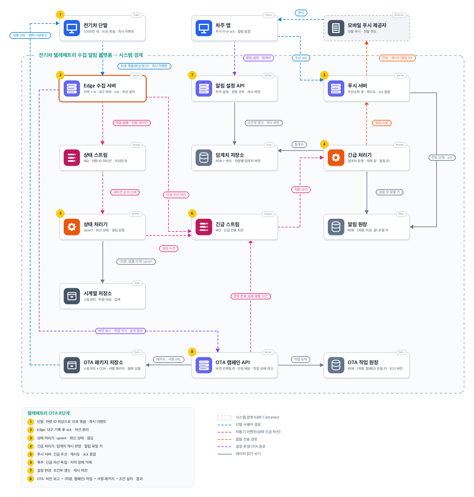
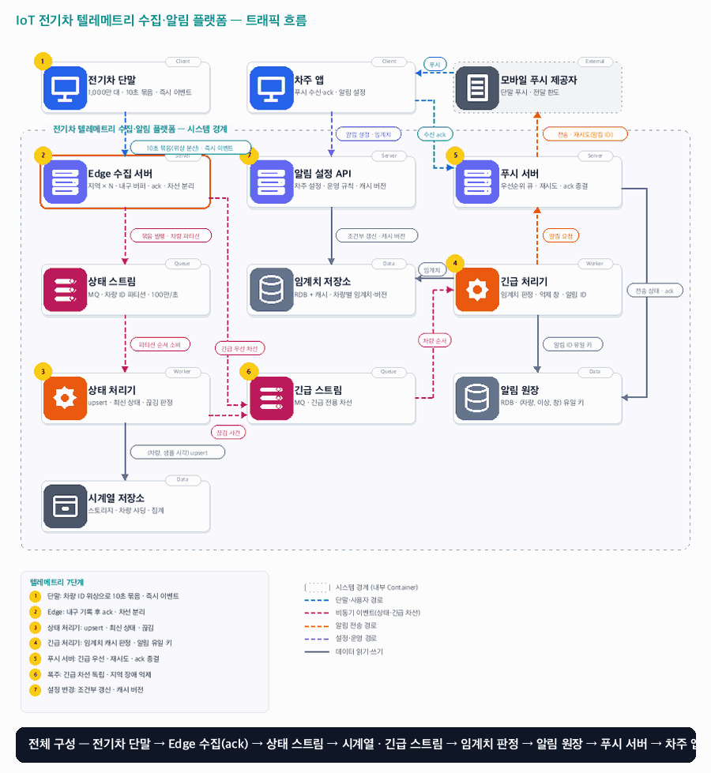

# 16. IoT 전기차 텔레메트리 수집·알림 플랫폼

- **난이도**: 고급
- **규모**: 차량 1,000만 대 · 10초 묶음 보고(1초 샘플 10개 · 약 2KB) · 평시 초당 100만 묶음(약 2GB/s) · 이상 이벤트 폭주 초당 5만 건(폭염·한파) · 긴급 알림 5초 · 지역 Edge 수집 N곳 · OTA 캠페인 100만 대 · 패키지 500MB · 단계 배포 7일
- **핵심 요약**: IoT 전기차 텔레메트리 수집·알림 플랫폼 · 차량 ID 위상 분산 보고 · Edge 수집(내구 기록 후 ack) · 상태/긴급 차선 분리 · (차량, 순번) 멱등 묶음 · 차량별 임계치 캐시 · (차량, 이상, 억제 창) 알림 유일 키 · ack 종결 · OTA는 (차량, 캠페인) 작업 유일 키 · 차량이 당겨 가는 단계 배포

## 1. 문제

### 요구사항

1. 차량은 10초마다 그 10초 동안의 1초 샘플(배터리 SoC·셀 전압·온도, 충전 상태, 위치·속도, 고장 코드)을 한 묶음으로 보내되, 전송 시각은 차량 ID로 10초 안에 고르게 분산한다. 이상을 감지하면 즉시 별도 이벤트를 보낸다. 통신 두절 중 묶음은 차량이 보관했다가 재접속 때 보낸다. 수신 확인(ack)된 묶음·이벤트 유실 0, 같은 묶음 중복 저장 0
2. 수집은 지역 Edge 서버가 받아 ack하고 중앙으로 넘긴다. Edge 1대·지역 1곳 장애에도 차량은 다른 Edge로 붙고 데이터는 유실되지 않는다
3. 긴급 이벤트(배터리 과열·셀 전압 편차·절연 저항 저하 등)는 차량 발생부터 차주 앱 도착까지 p95 5초, 일반 알림(충전 완료·연결 끊김 등)은 1분. 상태 묶음이 적체돼도 긴급 경로는 늦어지지 않는다
4. 판정은 차량별 임계치(차종 기본값 + 차주 설정 + 운영 캠페인)로 하고, 판정 경로의 임계치 조회는 캐시로 끝낸다. 설정 변경은 1분 안에 판정에 반영
5. 같은 이상은 억제 창 안에 1회만 알린다. 차량 재전송·Edge 전환·재접속 몰아 보내기가 있어도 알림은 1회. 알림은 앱 수신 확인(ack)으로 종결하고 미확인은 재시도
6. 상태 묶음은 시계열 저장소에 쌓아 차량·차량군 모니터링에 쓰고, 주행·충전 중 10초 보고가 끊기면 연결 끊김을 판정한다
7. 차량은 접속할 때 ECU별 소프트웨어 버전과 하드웨어 리비전을 보고한다. 운영자가 캠페인(대상 차종·하드웨어 리비전·현재 버전 범위·목표 버전·패키지)을 등록하면 플랫폼은 대상 차량에 작업을 내려주고, 차량은 패키지를 내려받아 서명·해시를 검증한 뒤 설치 조건(주차·시동 OFF·SoC 30% 이상·차주 동의)이 맞을 때 설치하고 결과를 보고한다. 같은 차량에 같은 캠페인 작업 중복 0, 끊긴 다운로드는 이어받기, 설치 실패는 이전 버전으로 복귀, 캠페인은 단계(1% → 10% → 100%)로 배포하고 단계 실패율이 임계를 넘으면 자동 중단

### 문제 정의

차량이 많아지자 중앙 수집 서버 한 곳이 동시 연결 수와 지역 통신 장애에 함께 흔들린다. 터널을 지난 차량이 밀린 묶음을 한꺼번에 보내면 같은 데이터가 두 번 저장되고, 배터리 과열 경보가 평시 상태 묶음 뒤에 줄을 서서 분 단위로 늦게 도착한다. 같은 과열을 10초마다 다시 알려 차주가 알림을 꺼 버린다. 배터리 제어 소프트웨어 결함은 정비소 소환 대신 무선 업데이트로 고쳐야 하는데, 1,000만 대에 한꺼번에 내리면 잘못된 빌드가 전체에 퍼지고 주행 중 설치는 안전 문제가 된다. 차량 단말의 설치 로직(A/B 파티션·부팅 검증), 배터리 진단 알고리즘, 지도·경로 서비스는 범위 밖.

## 2. 설계

### 01 아키텍처 드라이버

보내는 쪽이 1,000만 개이고 연결이 수시로 끊긴다. 데이터는 한 번 저장되어야 하고, 긴급 신호는 평시 데이터 양과 무관하게 5초 안에 사람에게 닿아야 한다. 내려보내는 소프트웨어는 검증된 패키지만, 안전한 조건에서만, 한 번에 일부에게만 설치되어야 한다.

### 02 품질 속성

| 속성 | 목표 |
|---|---|
| 처리량 | 평시 초당 100만 묶음, 지역 Edge당 초당 2만 묶음, 상태 스트림 적체 ≤ 30초 |
| 지연 | 긴급 이벤트 차량 → 앱 p95 5초(플랫폼 내부 p95 1.5초), 일반 알림 1분 |
| 내구성 | ack된 묶음·이벤트 유실 0, Edge 장애 시 미전달 묶음은 디스크 버퍼에서 복구 |
| 정확성 | 같은 묶음 중복 저장 0, 같은 이상 알림 중복 0, 설정 변경 반영 1분 |
| 가용성 | 지역 Edge 1곳 장애에도 수집 지속, 차량 재접속 p95 30초 |
| OTA | 캠페인 100만 대 · 500MB 패키지 7일 내 완료, 작업 조회 초당 1만(접속 폭주 시), 같은 (차량, 캠페인) 작업 1건, 주행 중 설치 0, 서명 검증 실패 패키지 설치 0, 단계 실패율 2% 초과 시 1분 내 자동 중단 |

### 03 아키텍처 택틱

- 위상 분산 · 차량의 전송 시각 오프셋 = 해시(차량 ID) mod 10,000ms, 단말이 혼자 정하므로 조정 서버 없이 초당 부하가 평탄
- 묶음 순번 · 차량이 (차량 ID, 묶음 순번)·(차량 ID, 이벤트 순번)을 붙이고 ack 전 재전송은 같은 순번, 중복·순서는 하류가 순번으로 판정
- 내구 기록 후 ack · 긴급 이벤트는 긴급 스트림 커밋 후 ack, 상태 묶음은 Edge 디스크 버퍼 기록 후 ack하고 비동기로 전달
- 차선 분리 · 상태 스트림과 긴급 스트림을 다른 MQ 클러스터·소비자 그룹으로 두고, 긴급 소비 지연에 상한 경보
- 멱등 저장 · 시계열은 (차량, 샘플 시각) upsert, 최신 상태는 묶음 순번이 큰 쪽만 반영
- 임계치 캐시 · 차량별 병합 임계치를 버전과 함께 캐시, 쓰기는 RDB 조건부 갱신 뒤 캐시 교체
- 알림 유일 키 · (차량, 이상 종류, 억제 창)으로 알림 원장에 INSERT, 충돌이면 억제 기록만
- 폭주 억제 · 지역 단위 끊김 비율이 임계를 넘으면 플랫폼 장애로 묶어 개별 알림을 억제, 푸시는 긴급 우선 큐
- ack 종결 · 알림 상태 머신으로 ack·재시도·실패를 전이로 처리, ack가 전송 기록보다 먼저 와도 성립
- 버전 인벤토리 · 차량이 접속 때 보고한 (차량, ECU, 버전, 하드웨어 리비전)을 보고 순번으로 최신만 보관, 캠페인 대상 선정은 인벤토리 조회
- 작업 유일 키 · (차량 ID, 캠페인 ID) 유일 키로 작업 1건, 작업 상태 머신(OFFERED → DOWNLOADING → READY → INSTALLING → INSTALLED/FAILED)
- 당겨 가는 배포 · 플랫폼은 작업을 조회하는 차량에만 내려주고 설치 시작은 차량이 조건을 판단, 설치 직전 허가 조회로 캠페인 중단을 반영
- 단계 배포 · 캠페인 단계(1/10/100%)의 대상은 해시(차량 ID) 버킷으로 고정, 단계 실패율이 임계를 넘으면 PAUSED로 전이하고 신규 작업·설치 허가를 막음
- 서명 패키지 · 패키지는 서명·해시와 함께 스토리지에 두고 CDN으로 배포, 서명 URL은 작업 ID 단위·24시간, 범위 요청으로 이어받기

### 04 아키텍처 스타일

**Edge 수집 + 이중 차선 스트리밍 파이프라인 + 이벤트 기반 알림 + 당겨 가는 OTA** — 차량 → Edge는 연결 유지 세션, Edge → 중앙은 MQ 비동기, 판정·알림은 스트림 소비자, 푸시 제공자 호출만 동기. OTA는 차량이 Edge 세션으로 작업을 조회하는 요청·응답이고 패키지는 CDN에서 직접 받는다

### 05 아키텍처 패턴

**Edge Ingestion · Dual-lane Stream · Idempotent Upsert · Alert Ledger · Pull-based Staged Rollout** — 지역 Edge가 연결과 내구 버퍼를 맡고, 상태와 긴급을 다른 차선으로 흘리며, 저장은 멱등 upsert, 알림은 원장 유일 키로 1회가 된다(04·06장 패턴). OTA는 차량이 당겨 가는 작업 원장과 단계 게이트로 14장의 임계치 게이트·롤백 원리를 차량 쪽에 적용한다

### 06 트레이드오프

| 대안 | 평가 |
|---|---|
| 모든 차량이 정각 기준 10초마다 전송 | 시계가 맞을수록 매 10초 첫 1초에 1,000만 묶음이 몰려 Edge·MQ가 피크 10배를 감당해야 한다. 차량 ID 해시로 오프셋을 정해 초당 100만으로 평탄화하고, 서버 조정 없이 단말 혼자 계산한다 |
| 중앙 수집 서버가 차량과 직접 연결 | 1,000만 동시 연결이 한 곳에 몰리고 지역 통신 장애가 전체 수집을 흔든다. 지역 Edge가 연결·ack·버퍼를 맡고 중앙은 스트림만 본다 |
| Edge에서 임계치 판정까지 | 차량별 임계치·억제 창이 Edge마다 복제돼 Edge 전환 시 중복 알림과 불일치가 생긴다. 5초 예산은 중앙 비동기 경로로도 충족되므로 판정은 중앙 한 곳 |
| 큐 하나에 우선순위 필드 | 적체 시 같은 소비자가 상태 묶음을 읽는 동안 긴급이 뒤에 묶인다. 클러스터·소비자를 분리해 적체가 전파되지 않게 한다 |
| 수집 경로에서 중복 제거 후 저장 | Edge가 1,000만 차량의 최근 순번을 들고 있어야 하고 전환 시 그 상태도 옮겨야 한다. 저장을 (차량, 샘플 시각) upsert로 만들어 중복이 무해하게 한다 |
| 중앙이 10초 상태 묶음을 평가해 알림 | 상태 스트림 적체가 그대로 알림 지연이 된다. 차량이 즉시 이벤트를 보내고 중앙은 추세·끊김 같은 묶음 기반 판정만 한다 |
| 제공자 수락을 전달 완료로 간주 | 제공자 수락은 폰 도착이 아니다. 긴급 알림은 앱 ack로 종결하고 미확인은 재시도·보조 채널로 간다 |
| 플랫폼이 설치 시점을 정해 차량에 설치 명령을 푸시 | 플랫폼은 차량이 지금 주행 중인지 10초 묶음으로만 알고, 명령이 도착했을 때 조건이 바뀌어 있을 수 있다. 조건 판단은 차량이 하고 플랫폼은 작업과 조건을 내려준 뒤 설치 직전 허가만 답한다 |
| 차량이 OTA API에 직접 접속 | 차량에 두 번째 연결·인증 경로가 생기고 접속 폭주 제어가 두 곳이 된다. Edge 세션으로 중계하되 타임아웃·retry-after로 OTA 장애가 텔레메트리 경로에 번지지 않게 한다 |
| 패키지를 Edge가 중계 | 500MB × 100만 대를 수집 서버가 나르면 긴급 경로와 대역·디스크를 다툰다. 패키지는 CDN에서 서명 URL로 직접 받고 Edge는 작업 메시지만 중계한다 |
| 캠페인 대상 전체에 동시 배포 | 잘못된 빌드가 1,000만 대에 한 번에 퍼진다. 해시 버킷 단계(1/10/100%)로 내리고 단계 실패율로 자동 중단한다 |

### 07 아키텍처 결정

- 차량은 전송 오프셋을 해시(차량 ID) mod 10,000ms로 정해 10초 주기 안에서 그 위상에 보낸다 · 1,000만 대가 10초 구간에 고르게 퍼져 초당 100만 묶음이 되고, 시계 보정이 어긋난 차량도 자기 주기만 지키면 되므로 서버가 슬롯을 배정하지 않는다 · 재접속 뒤에도 같은 위상으로 복귀한다
- 차량은 묶음마다 (차량 ID, 묶음 순번)을, 이벤트마다 (차량 ID, 이벤트 순번)을 붙이고 순번은 단말에서 단조 증가한다 · ack를 못 받은 묶음·이벤트는 같은 순번으로 재전송하며, 재접속 때는 보관분을 오래된 순서로 보내되 이벤트를 먼저 보낸다
- Edge 수집 서버는 상태 묶음을 디스크 버퍼(복제 2)에 기록한 뒤 ack하고 비동기로 상태 스트림에 발행한다 · 긴급 이벤트는 긴급 스트림 커밋을 받은 뒤 ack한다 · ack 전에 Edge가 죽으면 차량이 다른 Edge로 재전송하므로 유실이 아니라 중복이 되고, 중복은 하류 멱등 저장이 흡수한다
- 차량은 Edge 세션이 끊기면 지터(0–10초)를 두고 다른 Edge에 붙는다 · 옛 Edge의 버퍼에 남은 묶음은 그 Edge가 복구되면 그대로 발행되며, 도착 순서가 뒤바뀌어도 시계열은 샘플 시각 기준이고 최신 상태는 순번 비교라 결과가 같다
- 상태 스트림은 차량 ID 파티션이고 상태 처리기는 파티션 단위로 소비한다 · 시계열 저장은 (차량, 샘플 시각) upsert, 차량 최신 상태(주행·충전·주차·SoC)는 저장된 순번보다 큰 묶음만 반영한다 · 소비 오프셋은 저장과 같은 트랜잭션이 아니므로 재처리는 같은 결과가 된다
- 연결 끊김은 상태 처리기가 판정한다 · 마지막 묶음의 상태가 주행·충전이고 30초(3회) 결측이면 끊김 사건을 긴급 스트림에 발행하고, 시동 OFF 묶음을 받은 차량은 대상이 아니다 · 같은 지역의 끊김 비율이 1분 안에 5%를 넘으면 플랫폼·통신 장애로 묶어 운영 경보 1건만 내고 개별 알림은 억제한다
- 긴급 처리기는 차량 ID 파티션으로 긴급 스트림을 소비하고, 임계치 저장소 캐시에서 (차량 ID → 병합 임계치, 설정 버전)을 읽어 판정한다 · 캐시 미스는 RDB 조회 후 캐시 채움, 판정 결과에 설정 버전을 기록한다 · 발생 시각이 5분 넘은 이벤트(재접속 몰아 보내기)는 원장에 기록만 하고 푸시하지 않는다
- 알림 원장은 (차량, 이상 종류, 억제 창 시작) 유일 키이고 억제 창은 30분이다 · 긴급 처리기는 INSERT로 알림을 만들며 충돌이면 억제 기록만 남긴다 · 심각도가 올라가면(경고 → 위험) 이상 종류가 달라 새 알림이 된다 · 이상 해제 이벤트는 같은 창의 알림을 RESOLVED로 닫고 해제 알림 1건을 보낸다
- 푸시 서버는 긴급·일반 두 우선순위 큐를 두고 제공자 전달 한도 안에서 긴급을 먼저 보낸다 · 제공자 호출에는 알림 ID를 collapse 키로 넣어 재시도가 폰에 두 번 쌓이지 않게 한다 · 실패는 1초 → 4초 → 16초 지수 백오프 3회, 긴급 알림이 60초 안에 ack되지 않으면 1회 재전송하고 그래도 없으면 SMS 보조 채널(사전 동의된 차주만)로 보낸다
- 앱 ack는 (알림 ID)로 원장 상태를 ACKED로 전이한다 · 전송 기록(SENT)보다 ack가 먼저 도착해도 CREATED → ACKED 전이를 허용하고, 그 뒤 도착한 전송 결과는 상태를 되돌리지 않는다
- 임계치 저장소는 차종 기본값 ← 차주 설정 ← 운영 캠페인(리콜 대상 온도 하향 등) 순으로 병합한 차량별 임계치를 RDB에 (차량 ID, 설정 버전)으로 두고, 알림 설정 API가 조건부 갱신(`WHERE version = :expected`)으로 쓴 뒤 캐시 항목을 새 버전으로 교체한다 · 캐시 TTL 1분은 교체 누락의 상한이다 · 캠페인은 대상 차량의 설정 버전을 일괄 올리고 캐시는 TTL로 따라온다
- 차량의 OTA 요청(버전 보고 · 작업 조회 · 설치 허가 · 설치 결과)은 Edge 세션의 별도 메시지 종류로 들어오고 Edge가 OTA 캠페인 API에 동기 중계한다(타임아웃 2초) · 접속 직후 작업 조회는 Edge가 0–300초 지터를 두어 재접속 폭주가 OTA API로 번지지 않게 하고, OTA API가 응답하지 못하면 차량에 retry-after(1시간)를 돌려주며 텔레메트리 ack 경로는 영향받지 않는다
- OTA 캠페인 API는 버전 보고를 (차량, ECU) 최신 보고 순번으로 작업 원장의 인벤토리에 반영한 뒤 작업을 조회한다 · 캠페인 대상이고 현재 단계의 해시 버킷에 들며 보고 버전이 캠페인의 현재 버전 범위에 있으면 (차량 ID, 캠페인 ID) 유일 키로 작업을 INSERT하고, 이미 있으면 그 작업을 돌려준다 · 응답에는 작업 ID·목표 버전·패키지 해시·서명 URL(작업 ID 단위, 24시간)·설치 조건이 담긴다 · 보고 버전이 이미 목표 이상이면 작업을 SKIPPED로 닫는다
- 차량은 CDN에서 범위 요청으로 패키지를 받고(끊기면 받은 범위부터 이어받기, URL 만료는 작업 재조회로 새 URL) 서명·해시를 검증한 뒤 READY를 보고한다 · 설치는 차량이 주차·시동 OFF·SoC ≥ 30%·차주 동의를 모두 확인한 시점에 설치 허가를 조회하고, OTA API는 캠페인이 ACTIVE일 때만 `WHERE campaign.status = 'ACTIVE'` 조건부 갱신으로 INSTALLING 전이를 허용한다 · 설치 후 부팅 검증에 실패하면 차량이 이전 파티션으로 복귀하고 FAILED를 보고한다
- 캠페인 단계는 운영자가 승격하고(1% → 10% → 100%), OTA API는 단계별 INSTALLED·FAILED를 1분 창으로 집계해 실패율이 2%를 넘으면 캠페인을 PAUSED로 전이한다 · PAUSED 이후 작업 조회에는 새 작업을 주지 않고 설치 허가는 거절하며, 허가 뒤 설치 중인 차량 수를 운영 화면에 보여준다 · 캠페인 수정·승격·중단은 (캠페인 ID, 캠페인 버전) 조건부 갱신으로 하나만 성립한다
- 작업이 READY·INSTALLED·FAILED로 바뀌면 OTA API가 긴급 스트림에 일반 등급 사건을 발행하고 기존 알림 경로(긴급 처리기 → 알림 원장 → 푸시 서버)로 차주 앱에 알린다 · 알림 유일 키의 이상 종류는 `OTA_READY:캠페인 ID`처럼 캠페인을 포함해 같은 작업의 재보고가 알림을 늘리지 않는다

#### 긴급 알림 지연 예산 (차량 발생 → 앱 도착 p95 5초)

| 구간 | 예산 | 비고 |
|---|---|---|
| 차량 감지 → Edge 수신 | 0.5초 | 이동 통신 왕복, 범위 밖이지만 예산에 포함 |
| Edge → 긴급 스트림 커밋 → ack | 0.3초 | 복제 커밋 뒤 ack |
| 긴급 스트림 소비 대기 | 0.3초 | 소비 지연 1초 초과 시 소비자 확장·경보 |
| 임계치 판정 + 원장 INSERT | 0.1초 | 캐시 적중 전제, 미스는 +20ms |
| 푸시 서버 → 제공자 수락 | 0.3초 | 긴급 우선 큐 |
| 제공자 → 폰 → 앱 표시 | 2–3초 | 제공자 영역, 측정은 앱 ack 시각으로 |
| 합계 | ≈ 3.5–4.5초 | 플랫폼 내부(Edge 수신 → 제공자 수락) 1.0초, 여유 0.5초 |

#### 장애 복구 전략

| 장애 | 복구 |
|---|---|
| Edge 1대 장애 | 차량이 지터(0–10초) 후 다른 Edge로 재접속, 미ack 묶음 재전송, 디스크 버퍼는 복구 후 발행(중복은 upsert로 흡수) |
| 지역 Edge 전체 장애 | 인접 지역 Edge로 접속 전환, 끊김 비율 5% 초과로 플랫폼 장애 판정 → 개별 끊김 알림 억제 |
| 상태 스트림 적체 | 상태 처리기 수평 확장, 시계열 쓰기는 upsert라 재처리 안전, 긴급 경로 영향 0 |
| 긴급 스트림 소비 지연 1초 초과 | 소비자 확장 경보, 푸시 서버는 발생 시각 기준 5분 지난 알림 폐기 |
| 임계치 캐시 장애 | RDB 직접 조회(연결 상한)로 판정 지속, 캐시 복구 후 TTL로 재적재 |
| 임계치 RDB 장애 | 캐시 적중분은 판정 지속, 미스는 차종 기본값으로 판정하고 설정 버전 "기본값"으로 기록 |
| 푸시 제공자 한도·장애 | 지수 백오프, 긴급은 ack 60초 미확인 시 SMS 보조 채널, 일반은 큐 보류 |
| 재접속 몰아 보내기 폭주 | Edge가 차량당 전송 속도를 제한(초당 묶음 20개), 이벤트 먼저 수신 |
| OTA 캠페인 API 장애 | Edge가 차량에 retry-after 응답, 텔레메트리 경로 영향 0, 복구 후 다음 접속·1시간 주기 조회로 재개 |
| 패키지 저장소·CDN 장애 | 차량이 받은 범위를 보관, 복구 후 이어받기, 서명 URL 만료는 작업 재조회로 새 URL |
| 단계 실패율 2% 초과 | 캠페인 PAUSED, 신규 작업·설치 허가 중단, 설치 중 차량 수 집계, 운영자 판단 후 재개·폐기 |
| 설치 후 부팅 검증 실패 | 차량이 이전 파티션으로 복귀, FAILED(BOOT) 보고, 실패율 집계에 반영 |

#### 알림 상태

| 상태 | 뜻 | 전이 (주체) |
|---|---|---|
| CREATED | 원장에 유일 키로 생성 | 전송 시도 → SENT (푸시 서버) · 앱 ack 선도착 → ACKED |
| SENT | 제공자 수락 | 앱 ack → ACKED · 전송 실패 → RETRY · 긴급 60초 미ack → 재전송 1회 후 FALLBACK |
| RETRY | 지수 백오프 대기 | 재시도 → SENT · 3회 초과 → FAILED |
| FALLBACK | SMS 보조 채널 전송 | 앱·SMS ack → ACKED · 미확인 → FAILED |
| ACKED | 차주 확인, 종결 | 없음 |
| FAILED | 전달 실패, 운영 큐 | 운영자 처리 |
| RESOLVED | 이상 해제, 해제 알림 전송 | 없음 |
| SUPPRESSED | 억제 창 내 중복, 기록만 | 없음 |

#### OTA 작업 상태

| 상태 | 뜻 | 전이 (주체) |
|---|---|---|
| OFFERED | (차량, 캠페인) 유일 키로 생성, 서명 URL 발급 | 다운로드 시작 보고 → DOWNLOADING (차량) · 보고 버전 ≥ 목표 → SKIPPED (OTA API) |
| DOWNLOADING | 범위 요청으로 수신 중 | 검증 통과 보고 → READY · 서명·해시 불일치 → FAILED(SIGNATURE) |
| READY | 패키지 검증 완료, 조건 대기 | 설치 허가(캠페인 ACTIVE) → INSTALLING (OTA API) · 캠페인 PAUSED → 허가 거절, 상태 유지 |
| INSTALLING | 차량 설치 중 | 부팅 검증 통과 보고 → INSTALLED · 실패·복귀 보고 → FAILED(BOOT) |
| INSTALLED | 목표 버전 확인, 종결 | 없음 |
| FAILED | 실패 사유 기록, 실패율 집계 | 운영자 재시도 → 새 작업(캠페인 버전 증가) |
| SKIPPED | 다른 경로로 이미 목표 버전 | 없음 |

#### 동시성 처리 흐름

1. **ack 유실과 재전송**: 차량이 묶음 100번을 보내고 Edge가 디스크 버퍼에 기록한 뒤 ack했는데 ack가 유실되면 차량은 100번을 다시 보낸다. Edge는 같은 (차량, 순번)이면 버퍼에 다시 쓰지 않고 ack만 하되, 이 중복 제거는 Edge 메모리의 최근 순번 창(차량당 64개)에 의존하는 최선 노력이다. 창을 벗어난 중복은 상태 스트림까지 흘러가고 시계열 upsert에서 같은 결과가 된다. 멱등의 최종 보장은 저장이 맡는다(04장 원칙).
2. **Edge 전환 중 이중 경로**: 차량이 Edge A와의 세션이 끊겨 B에 붙었는데 A는 아직 살아 있고 버퍼에 98·99번이 남아 있다. 차량은 ack를 못 받은 99번을 B로 다시 보내고 A도 복구 후 98·99번을 발행한다. 상태 스트림은 차량 ID 파티션이라 A·B가 발행한 묶음이 같은 파티션으로 모이고, 상태 처리기는 샘플 시각 upsert·순번 비교로 순서와 무관하게 같은 상태에 수렴한다. 긴급 이벤트가 두 경로로 오면 긴급 처리기가 두 번 판정하지만 알림 원장 유일 키에서 하나만 성립한다.
3. **재접속 몰아 보내기**: 터널에서 30분 끊긴 차량이 묶음 180개와 이벤트 2건을 보낸다. 차량은 이벤트를 먼저 보내고 묶음은 오래된 순서로 보내며 Edge는 차량당 초당 20묶음으로 제한한다. 긴급 처리기는 발생 시각이 5분 넘은 이벤트를 기록만 하고 푸시하지 않는다. 이상이 지금도 지속 중이면 차량이 현재 시각의 이벤트를 새로 보냈을 것이므로 알림은 그 이벤트로 나간다. 상태 처리기는 밀린 묶음이 도착하는 동안 최신 상태를 순번이 큰 묶음으로만 갱신하므로 "30분 전 주행 중" 상태가 현재를 덮지 않는다.
4. **상태 적체와 긴급 분리**: 출퇴근 피크에 상태 스트림 소비가 20초 밀려도 긴급 스트림은 다른 클러스터·소비자 그룹이라 영향이 없다. 긴급 소비 지연은 1초 상한 경보로 감시하고 소비자를 늘린다. 끊김 판정은 상태 처리기가 하므로 상태 적체 중에는 끊김 판정도 늦어지는데, 이 지연은 일반 알림 예산(1분) 안에서 허용하고 30초를 넘으면 끊김 판정을 적체 해소까지 보류해 거짓 끊김을 내지 않는다.
5. **같은 이상의 반복 이벤트**: 과열 상태가 지속되면 차량이 10초마다 이벤트를 다시 보낼 수 있다. 긴급 처리기는 (차량, 이상 종류, 억제 창 시작)으로 INSERT하고 충돌이면 SUPPRESSED로 기록만 한다. 같은 차량은 같은 파티션이라 처리기가 하나지만, 리밸런싱 중 두 소비자가 같은 이벤트를 겹쳐 처리해도 원장 유일 키가 한 번만 받는다. 심각도 상승(경고 → 위험)은 이상 종류가 달라 새 알림이 되고, 해제 이벤트는 창을 닫는다.
6. **임계치 변경 중 판정**: 차주가 앱에서 충전 완료 알림 기준을 80% → 90%로 바꾸는 순간 같은 차량의 이벤트가 판정 중이면, 그 판정은 읽은 설정 버전으로 끝나고 결과에 버전이 남는다. 두 기기에서 동시에 설정을 바꾸면 조건부 갱신으로 하나만 성립하고 다른 쪽은 409로 최신 설정을 다시 받는다. 캠페인이 대상 10만 대의 버전을 일괄 올리는 중에도 차량별 캐시 항목은 TTL 1분 안에 새 버전으로 따라온다.
7. **푸시 재시도와 ack 경쟁**: 푸시 서버가 제공자 호출 후 SENT를 기록하기 전에 앱이 ack를 보낼 수 있다. 원장은 CREATED → ACKED 전이를 허용하고, 뒤늦게 도착한 SENT 갱신은 `WHERE status = 'CREATED'` 조건에 걸려 무시된다. 제공자가 타임아웃을 돌려줬지만 실제로는 전달돼 ack가 오면 RETRY 상태에서도 ACKED로 전이하고 예약된 재시도는 상태 확인 후 취소된다. collapse 키 덕에 재시도가 실제로 두 번 나가도 폰에는 하나만 남는다.
8. **지역 장애와 끊김 폭주**: 지역 Edge나 통신사 장애로 50만 대가 동시에 끊기면 상태 처리기가 차량마다 끊김 사건을 내서 긴급 스트림과 푸시 서버가 폭주한다. 상태 처리기는 지역별 끊김 비율을 1분 창으로 집계해 5%를 넘으면 플랫폼 장애로 판정하고 운영 경보 1건만 내며 개별 끊김 알림을 억제한다. 복구 때는 차량이 0–10초 지터로 재접속해 Edge 접속 폭주를 분산한다(13장 복구 전략과 같은 원리).
9. **캠페인 중단과 설치 시작의 경쟁**: 10% 단계에서 실패율이 2%를 넘어 OTA API가 캠페인을 PAUSED로 바꾸는 순간, 이미 READY인 차량 5천 대가 주차·SoC 조건을 만족해 설치 허가를 조회한다. 허가는 `UPDATE job SET status = 'INSTALLING' WHERE job.id = :id AND status = 'READY' AND (SELECT status FROM campaign WHERE id = :c) = 'ACTIVE'`로 한 문장이라 PAUSED 커밋 이후의 허가는 전부 거절된다. PAUSED 커밋 직전에 허가받은 차량은 설치를 계속하며, 이 수는 허가 시각으로 집계해 운영 화면에 "설치 중 N대"로 보인다. 플랫폼이 설치를 되돌릴 방법은 없고 차량의 부팅 검증·복귀가 마지막 방어선이다.
10. **재접속 폭주와 작업 조회**: 지역 복구로 50만 대가 0–10초 지터로 재접속하면 같은 시각에 50만 건의 버전 보고·작업 조회가 생긴다. Edge는 세션 시작 뒤 작업 조회를 0–300초 지터로 늦춰 OTA API 부하를 초당 2천 이하로 펴고, 텔레메트리 ack는 이 지연과 무관하게 흐른다. OTA API가 타임아웃이면 Edge는 차량에 retry-after를 주고 차량은 1시간 뒤 다시 조회한다. 긴급 이벤트와 OTA 요청이 같은 세션으로 오지만 Edge는 긴급 이벤트를 먼저 처리한다.
11. **설치 결과 보고 재전송과 역행**: 차량이 INSTALLED 보고의 ack를 못 받고 3회 재전송하면 (작업 ID, 상태) 전이가 한 번만 성립하고 나머지는 현재 상태 반환으로 끝난다. 세션이 바뀌면서 늦게 도착한 DOWNLOADING 보고는 상태 머신에 INSTALLED → DOWNLOADING 전이가 없어 무시된다. 결과 보고가 Edge A·B 두 세션으로 중복 도착해도 같은 작업 ID라 결과가 같다.
12. **다른 경로의 업데이트와 작업**: 작업이 OFFERED인 차량이 정비소에서 유선으로 목표 버전 이상을 설치하고 재접속하면, 차량은 버전 보고를 먼저 보내고 ack를 받은 뒤 작업을 조회하므로 OTA API는 인벤토리를 갱신한 상태로 작업을 보고 SKIPPED로 닫는다. 보고 순번이 큰 보고만 인벤토리에 반영하므로 두 세션의 보고가 뒤바뀌어도 옛 버전이 최신을 덮지 않는다. 캠페인 대상 집계는 인벤토리 기준이라 정비소 설치분은 완료율에 SKIPPED로 따로 보인다.

#### 멱등성 경계

| 경계 | 키 | 보장 |
|---|---|---|
| 차량 → Edge | (차량 ID, 묶음 순번) · (차량 ID, 이벤트 순번) | ack 유실 재전송은 중복, Edge 최근 순번 창으로 최선 노력 제거 |
| Edge → 상태 스트림 · 긴급 스트림 | 묶음·이벤트 키 | at-least-once 발행, 중복은 하류가 흡수 |
| 상태 처리기 → 시계열 저장소 | (차량, 샘플 시각) | upsert, 재처리·중복 발행에도 같은 결과 |
| 상태 처리기 → 차량 최신 상태 | 묶음 순번 비교 | 큰 순번만 반영, 늦게 온 옛 묶음 무시 |
| 상태 처리기 → 끊김 사건 | (차량, 마지막 묶음 순번) | 같은 결측에 사건 1회 |
| 긴급 처리기 → 알림 원장 | (차량, 이상 종류, 억제 창 시작) | 알림 1회, 중복은 SUPPRESSED |
| 푸시 서버 → 제공자 | 알림 ID (collapse 키) | 재시도가 폰에 중복 표시되지 않음 |
| 앱 → 알림 원장 | 알림 ID + 상태 전이 | ACKED 1회, 선도착 ack 허용 |
| 설정 API → 임계치 저장소 | (차량 ID, 설정 버전) 조건부 갱신 | 동시 수정 하나만 성립, 캐시는 버전 교체 |
| 캠페인 → 임계치 저장소 | (캠페인 ID, 차량 ID) | 재실행에도 버전 증가 1회 |
| 차량 → OTA 캠페인 API (버전 보고) | (차량 ID, 보고 순번) | 큰 순번만 인벤토리 반영 |
| OTA 캠페인 API → 작업 원장 (작업 생성) | (차량 ID, 캠페인 ID) 유일 키 | 작업 1건, 재조회는 같은 작업 반환 |
| 차량 → OTA 캠페인 API (결과·허가) | (작업 ID, 상태) 전이 | 재전송 1회 적용, 역행·중단 후 허가 거절 |
| 차량 → 패키지 저장소 | (작업 ID, 바이트 범위) | 이어받기, 전체는 해시로 검증 |
| 운영자 → 캠페인 | (캠페인 ID, 캠페인 버전) 조건부 갱신 | 승격·중단·수정 하나만 성립 |

### 08 결정 기록 (ADR-001 · 제안 · 구현 전 검증 필요)

- **맥락**: 송신자 1,000만 개가 수시로 끊기고 재전송한다. 데이터는 한 번만 남아야 하고 긴급 신호는 평시 데이터 양과 무관하게 5초 안에 사람에게 닿아야 한다.
- **선택**: 지역 Edge가 연결·내구 버퍼·ack를 맡고, 상태와 긴급을 다른 스트림으로 흘리며, 저장은 멱등 upsert, 판정은 중앙 한 곳, 알림은 원장 유일 키와 ack 상태 머신으로 1회를 보장한다. OTA는 차량이 Edge 세션으로 작업을 당겨 가고 패키지는 CDN에서 받으며, (차량, 캠페인) 작업 유일 키·설치 직전 허가·단계 실패율 자동 중단으로 안전하게 내린다.
- **결과와 비용**: Edge 디스크 버퍼·MQ 클러스터 2벌·시계열 저장소 운영 부담이 크고, 중복 제거를 저장소에 맡기므로 시계열 쓰기는 upsert 가능한 저장소여야 한다. 억제 창 30분은 같은 이상의 재발을 놓칠 수 있어 심각도 단계로 보완한다. OTA는 당겨 가는 방식이라 캠페인 완료 시각이 차량의 접속·주차 패턴에 달려 있고, 중단 직전 허가받은 차량의 설치는 플랫폼이 막지 못한다.
- **재검토 조건**: 평시 묶음량이 저장 비용을 넘으면 Edge에서 샘플 요약(10초 → 통계)으로 줄인다. 단말이 순번·보관을 지원하지 않는 구형 차량이 많으면 Edge가 차량당 순번 상태를 갖는 설계로 되돌린다. 긴급 판정 지연이 예산을 반복해서 넘으면 Edge 1차 판정을 재검토한다. 긴급 리콜처럼 시한이 있는 캠페인이 늘면 푸시로 조회를 재촉하는 경로를 더한다.

### 검증

- 검증 1 차량이 같은 묶음을 ack 전 3회 재전송 → Edge 버퍼 기록 1건, ack 3회, 시계열 샘플 10개 저장 1회
- 검증 2 Edge 최근 순번 창을 넘는 중복(순번 100개 뒤 재전송) → 상태 스트림 중복 발행, 시계열 저장 결과 동일, 중복 행 0
- 검증 3 Edge A 세션 강제 종료 후 B 재접속, A 복구 발행 → 묶음 98·99 각 1회 저장, 최신 상태는 순번 큰 묶음, 끊김 알림 0
- 검증 4 Edge 1대 강제 종료(버퍼 5초분) → 복구 후 발행, ack된 묶음 유실 0
- 검증 5 상태 스트림 소비 20초 지연 주입 + 긴급 이벤트 1만 건 → 긴급 p95 5초 유지, 긴급 소비 지연 ≤ 1초
- 검증 6 30분 끊김 후 묶음 180개·이벤트 2건 몰아 보내기 → 이벤트 먼저 수신, 5분 지난 이벤트 푸시 0·기록 2, 차량당 초당 20묶음 제한, 최신 상태 역행 0
- 검증 7 과열 이벤트를 10초 간격 20회 전송 → 알림 1건, SUPPRESSED 19건, 경고 → 위험 상승 시 새 알림 1건, 해제 시 RESOLVED·해제 알림 1건
- 검증 8 긴급 이벤트를 두 Edge로 동시 발행 → 긴급 처리기 판정 2회, 원장 알림 1건
- 검증 9 소비자 리밸런싱 중 같은 이벤트 겹침 처리 → 원장 1건
- 검증 10 임계치 캐시 미스율 100% 주입 → 판정 p95 +20ms, RDB 연결 상한 준수, 알림 누락 0
- 검증 11 두 기기에서 같은 차량 설정 동시 변경 → RDB 갱신 1회, 다른 쪽 409, 캐시 버전 = RDB 버전 1분 내
- 검증 12 캠페인으로 10만 대 임계치 하향 → 1분 내 판정에 반영, 판정 결과에 설정 버전 기록
- 검증 13 앱 ack가 SENT 기록보다 먼저 도착 → ACKED, 뒤늦은 SENT 갱신 무시, 재시도 0
- 검증 14 제공자 타임아웃 뒤 실제 전달·ack → RETRY → ACKED, 예약 재시도 취소, 폰 표시 1건
- 검증 15 긴급 알림 ack 60초 미확인 → 재전송 1회, 그래도 미확인 시 SMS 1건(동의 차주만), 상태 FALLBACK
- 검증 16 지역 50만 대 동시 끊김 → 운영 경보 1건, 개별 끊김 알림 0, 복구 시 재접속 분포 0–10초
- 검증 17 차량 100만 대 모의 단말을 같은 시각에 기동 → 10초 구간의 초당 묶음 수 편차 ±10% 이내, 정각 피크 0
- 검증 18 평시 초당 100만 묶음 24시간 → 상태 스트림 적체 ≤ 30초, 시계열 쓰기 오류 0, 긴급 경로 지연 영향 0
- 검증 19 캠페인 등록(1% 단계) 후 대상 100만 대 조회 → 작업 부여 1만 대(해시 버킷), 나머지 응답 "작업 없음", 같은 차량 조회 3회 → 작업 1건·같은 작업 ID
- 검증 20 다운로드 50% 지점에서 세션 종료 → 받은 범위부터 이어받기, 전체 재다운로드 0, 해시 검증 통과
- 검증 21 변조 패키지(서명 불일치) 주입 → 설치 0, FAILED(SIGNATURE) 보고 1, 운영 경보 1
- 검증 22 설치 허가 조회와 캠페인 PAUSED 동시 → PAUSED 커밋 이후 허가 전부 거절, 직전 허가분은 설치 완료·"설치 중 N대" 집계 일치
- 검증 23 INSTALLED 보고 3회 재전송 + 늦은 DOWNLOADING 보고 → 상태 전이 1회, 역행 0, 알림 1건
- 검증 24 정비소에서 목표 버전 설치 뒤 재접속 → 인벤토리 갱신, 작업 SKIPPED, 알림 0
- 검증 25 지역 복구 50만 대 재접속 → 작업 조회가 0–300초로 분산, OTA API 초당 ≤ 2천, 텔레메트리 ack p95 변화 0
- 검증 26 OTA API 중단 10분 → 차량 retry-after 응답, 텔레메트리 수집·긴급 알림 영향 0, 복구 후 1시간 내 조회 재개

## 3. 전체 아키텍처 (System Context + Container)

IoT 전기차 텔레메트리 수집·알림 플랫폼 · Edge 수집(내구 기록 후 ack) · 상태/긴급 차선 분리 · (차량, 순번) 멱등 묶음 · 차량별 임계치 캐시 · (차량, 이상, 억제 창) 알림 유일 키 · ack 종결 · OTA는 (차량, 캠페인) 작업 유일 키 · 서명 패키지 CDN 직접 수신 · 단계 배포·자동 중단

### 트래픽 흐름

### 구성 요소

| 구분 | 이름 | 기술·역할 | 내부 요소 |
|---|---|---|---|
| Client | 전기차 단말 | 1,000만 대 · 10초 묶음 · 즉시 이벤트 | 오프셋 = 해시(차량 ID) mod 10초 · (차량, 묶음 순번)·(차량, 이벤트 순번) · 두절 중 보관 · 재접속 지터 · ECU 버전 보고 · 패키지 서명 검증 · 조건 판단 후 설치 허가 조회 |
| Client | 차주 앱 | 푸시 수신·ack · 알림 설정 | 알림 ID ack · 충전 완료 기준 등 차주 설정 |
| External | 모바일 푸시 제공자 | 단말 푸시 · 전달 한도 | collapse 키 · 수락 ≠ 도착 |
| Server | Edge 수집 서버 | 지역 × N · 내구 버퍼 · ack · 차선 분리 | 연결 유지 세션 · 디스크 버퍼(복제 2) · 최근 순번 창 · 차량당 속도 제한 · 긴급은 스트림 커밋 후 ack · OTA 요청 동기 중계(0–300초 지터 · retry-after) |
| Server | 알림 설정 API | 차주 설정 · 운영자 규칙 · 캐시 버전 | 차종 기본값 ← 차주 설정 ← 캠페인 병합 · 조건부 갱신 · 캐시 교체 |
| Server | 푸시 서버 | 우선순위 큐 · 재시도 · ack 종결 | 긴급·일반 큐 · 지수 백오프 3회 · 60초 미ack 재전송 · SMS 보조 채널 · 원장 상태 전이 |
| Queue | 상태 스트림 | MQ · 차량 ID 파티션 · 평시 100만/초 |  |
| Queue | 긴급 스트림 | MQ · 긴급 전용 차선 | 별도 클러스터·소비자 그룹 · 소비 지연 1초 경보 |
| Worker | 상태 처리기 | upsert · 최신 상태 · 끊김 판정 | (차량, 샘플 시각) upsert · 순번 비교 · 30초 결측 끊김 · 지역 끊김 비율 집계 |
| Worker | 긴급 처리기 | 임계치 판정 · 억제 창 · 알림 ID | 캐시 조회(설정 버전 기록) · 5분 지난 이벤트 기록만 · (차량, 이상, 창) INSERT |
| Data | 임계치 저장소 | RDB + 캐시 · 차량별 임계치·버전 | (차량 ID, 설정 버전) · 캐시 TTL 1분 · 캠페인 일괄 버전 증가 |
| Data | 알림 원장 | RDB · (차량, 이상, 창) 유일 키 | 알림 상태 머신 · ack 선도착 허용 · SUPPRESSED 기록 |
| Data | 시계열 저장소 | 스토리지 · 차량 샤딩 · 집계 | 원본 보존 창 · 차량군 집계 · 모니터링 화면 조회 |
| Server | OTA 캠페인 API | 버전 인벤토리 · 단계 배포 · 작업 상태 머신 | (차량, 캠페인) 작업 유일 키 · 해시 버킷 단계 · 실패율 2% 자동 중단 · 설치 허가(캠페인 ACTIVE 조건) · 서명 URL 발급 · 준비·완료·실패 알림 사건 |
| Data | OTA 작업 원장 | RDB · (차량, 캠페인) 유일 키 · ECU 버전 | 작업 상태 머신 · (차량, ECU) 최신 보고 순번 · 캠페인 버전 조건부 갱신 · 단계별 실패율 |
| Data | OTA 패키지 저장소 | 스토리지 + CDN · 서명 패키지 · 범위 요청 | 서명·해시 동봉 · 서명 URL(작업 ID, 24시간) · 범위 요청 이어받기 |

### 텔레메트리·OTA 8단계

1. 단말: 차량 ID 위상으로 10초 묶음(순번) · 이상 즉시 이벤트
2. Edge: 내구 기록 후 ack · 상태/긴급 차선 분리
3. 상태 처리기: 시계열 upsert · 최신 상태 · 끊김 판정
4. 긴급 처리기: 차량별 임계치(캐시) 판정 · 알림 유일 키
5. 푸시 서버: 긴급 우선 전송 · 재시도 · ack 종결
6. 폭주: 긴급 차선 독립 · 지역 장애는 개별 알림 억제
7. 설정 변경: 조건부 갱신 · 캐시 버전 교체
8. OTA: 접속 때 버전 보고 → (차량, 캠페인) 작업 지시 → CDN 서명 패키지 이어받기·검증 → 조건 충족 시 설치 허가 → 결과 보고·단계 실패율 자동 중단
